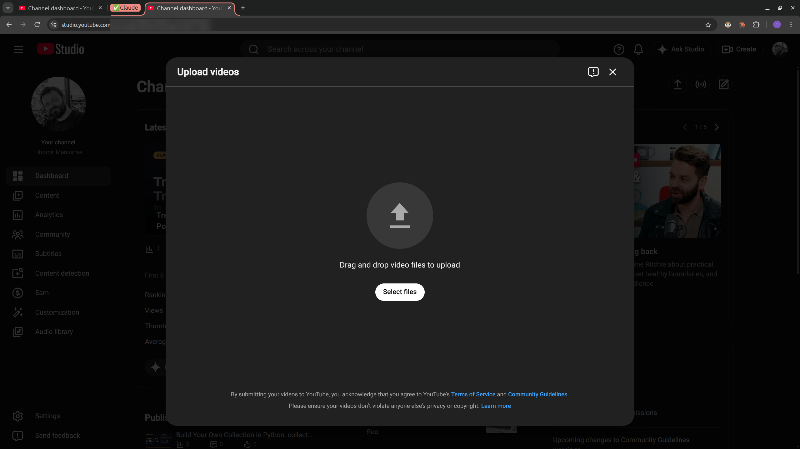
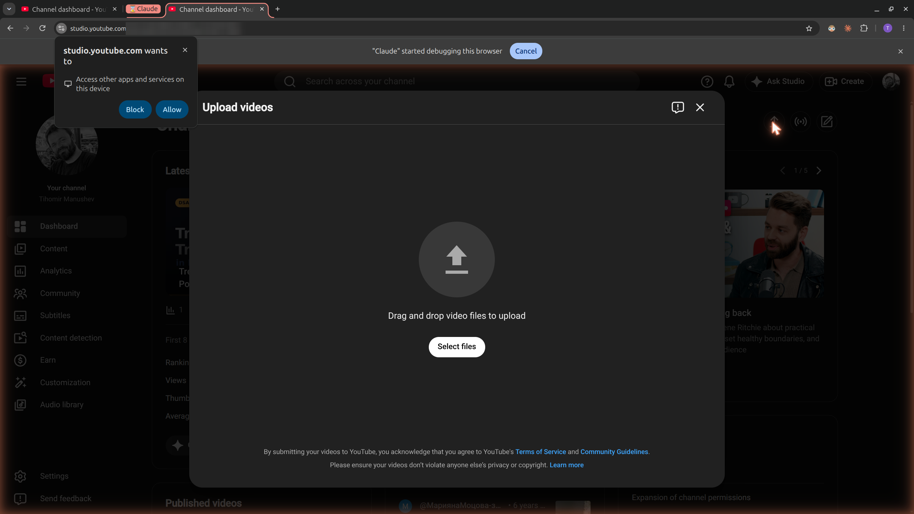
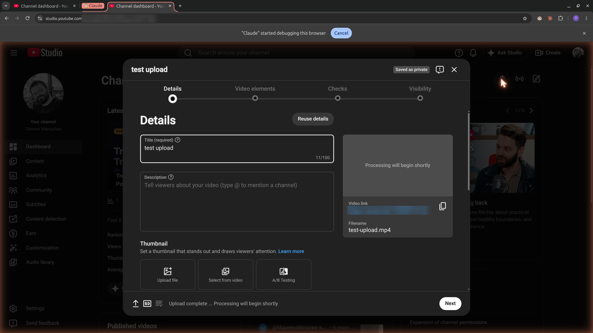

# Claude in Chrome Can't Upload Files Over 10 MB. Let the Page Fetch Them Instead

#### A 30-line localhost server got my 59 MB videos into YouTube Studio, and the same trick works on any site with an upload button

**By Tihomir Manushev**

*Oct 31, 2026 · 6 min read*

---

I make a free YouTube series, [Data Structures and Algorithms in Python](https://www.youtube.com/playlist?list=PLEMKuczXONeE): short animated lessons where you watch a list grow, a heap sift and a graph search spread, one idea per video. Claude Code writes, renders and publishes them, and Claude in Chrome fills in YouTube Studio for me: title, description, tags, thumbnail, subtitles, end screen, cards.

Until this week, one step stayed manual. I had to click Upload and pick the video myself, because Claude couldn't attach it. Then I found a way around that, and lesson 44 went from a rendered file to a public video with one click from me: allowing a Chrome prompt the first time.

Here is the recipe, the real code, and the two places where it trips you up.

---

### The 10 MB wall

Claude in Chrome's `file_upload` tool sends the file's bytes through the extension in a single message. Images for a Medium post fit easily. A rendered lesson doesn't: the 8-minute 1080p video was 59 MB, and the tool refused it:

```text
Cannot upload ".../out/video.mp4": total upload size would exceed 10 MB. file_upload sends
file contents over the browser bridge in a single message; use a smaller file, or split across
multiple file_upload calls if the page accepts files one at a time.
```

Splitting doesn't help, because YouTube takes one file. Squeezing eight minutes of 1080p into 10 MB would ruin it. The file had to reach the page some other way.

---

### The idea: let the page download it

The tool's limit is about how the data travels, not about permission. So I stopped sending the file through the extension. A tiny web server on my machine serves the folder, the Studio tab downloads the video from it with JavaScript, and the page hands the file to its own upload box, as if I had picked it.

YouTube's servers never connect to my computer. My own browser reads a file from my own machine, then uploads it the way it always does.

The upload dialog shows why Claude can't just click the button:



*"Select files" opens the system file picker, which the extension can't see or control.*

Behind that button the page has a hidden file input, and that's what we fill.

---

### Step 1: a server that answers one site

The whole server is Python's standard library:

```python
import functools
import http.server
import sys

PORT = 8765
ORIGIN = "https://studio.youtube.com"


class OneSiteHandler(http.server.SimpleHTTPRequestHandler):
    def end_headers(self):
        self.send_header("Access-Control-Allow-Origin", ORIGIN)
        self.send_header("Access-Control-Allow-Private-Network", "true")
        self.send_header("Access-Control-Allow-Headers", "*")
        super().end_headers()

    def do_OPTIONS(self):
        self.send_response(204)
        self.end_headers()


folder = sys.argv[1]
handler = functools.partial(OneSiteHandler, directory=folder)
server = http.server.ThreadingHTTPServer(("127.0.0.1", PORT), handler)
print(f"serving {folder} at http://127.0.0.1:{PORT}/ for {ORIGIN}", flush=True)
server.serve_forever()
```

Binding to `127.0.0.1` means only programs on this computer can reach it. It serves the one folder you name and nothing else. `Access-Control-Allow-Origin` is the permission slip: browsers block a site from reading another address's data unless that address allows it, and this allows exactly one site. The private-network header and the `OPTIONS` reply answer Chrome's extra check when a public site reaches into your own machine.

Start it on the folder that holds the file, and check the header from a second terminal:

```bash
python3 upload_server.py out
# in a second terminal:
curl -sI -H "Origin: https://studio.youtube.com" http://127.0.0.1:8765/video.mp4
```

```text
HTTP/1.0 200 OK
...
Access-Control-Allow-Origin: https://studio.youtube.com
```

---

### Step 2: Chrome asks first

The first time the Studio tab reaches the server, Chrome stops and asks:



*"studio.youtube.com wants to: Access other apps and services on this device." Block or Allow.*

This is the first gotcha. The request that triggers the prompt doesn't resume after you click **Allow**. On my first real run it failed with a bare `Failed to fetch`. On a later test it hung forever. Either way, allow the prompt and run the fetch again, and from then on every request goes through.

---

### Step 3: fetch it, hand it over

Claude runs this inside the Studio tab with the extension's JavaScript tool:

```javascript
const response = await fetch('http://127.0.0.1:8765/video.mp4');
const blob = await response.blob();
window.pendingVideo = new File([blob], 'video.mp4', {type: 'video/mp4'});
`ok ${response.status} ${blob.size}`;
```

It returned `ok 200 59478807`, the same byte count as the file on disk. The server's log showed the one request:

```text
127.0.0.1 - - [30/Oct/2026 23:23:21] "GET /video.mp4 HTTP/1.1" 200 -
```

Then the file goes into the upload dialog:

```javascript
const input = document.querySelector('ytcp-uploads-dialog input[type=file]');
const transfer = new DataTransfer();
transfer.items.add(window.pendingVideo);
input.files = transfer.files;
input.dispatchEvent(new Event('change', {bubbles: true}));
```

A script can't type a path into a file input, but it can hand it a file list, and a `DataTransfer` (the object drag-and-drop uses) is how you build one. The `change` event is what Studio listens for when a person picks a file, so it reacts as usual: the Details page opens and the upload starts.



*Studio treats the file like a normal pick. This is the rerun with a 20 MB test clip, done for the screenshots.*

The second gotcha: the extension hid the return value of that second call behind `[BLOCKED: Cookie/query string data]`, a privacy filter on tool output. The code had still run. Have Claude check with a screenshot, not the return value.

When the upload finished, Claude stopped the server and ran `delete window.pendingVideo`. The small files, a 238 KB thumbnail and 12 KB of subtitles, still go through the normal `file_upload` tool.

---

### Copy this prompt

You don't need to paste code into your session or explain the trick to Claude. Change the file and the site in the first lines, then paste this into Claude Code with Claude in Chrome connected:

```text
I need to upload ~/Videos/conference-talk.mp4 to https://studio.youtube.com, and it is too big
for Claude in Chrome's file_upload tool (10 MB limit). Do it like this:

1. Write a Python standard-library server that serves only the folder holding the file, bound
   to 127.0.0.1 on port 8765. Every response sends Access-Control-Allow-Origin set to the site
   above and Access-Control-Allow-Private-Network: true, and OPTIONS requests get a 204. Start
   it in the background and check the header with curl.
2. Open the site in a new tab and open its upload dialog. Never click the button that opens
   the system file picker.
3. With the JavaScript tool, fetch the file from http://127.0.0.1:8765/ in the page, wrap the
   blob in a File with the right name and type, and compare its size with the file on disk.
   If the fetch hangs or fails, Chrome is asking me to allow local access: tell me, wait until
   I click Allow, then fetch again.
4. Put the File into the dialog's input[type=file] with a DataTransfer and dispatch a bubbling
   change event. Confirm with a screenshot that the upload started; don't trust the tool's
   return value.
5. When the upload is done, stop the server and delete the page's copy of the file.

Stop and tell me if the site refuses the fetch or ignores the file.
```

---

### Using it on other sites

Nothing here is specific to YouTube. Change `ORIGIN` to the site's address, serve the folder with your file, and find the site's `input[type=file]`; the extension's `find` tool locates it quickly.

It won't work everywhere. A site's Content Security Policy can forbid fetching from other addresses, a declined prompt blocks it, and a site that accepts only drag and drop, or checks for a real click, may ignore a scripted file. Chrome keeps tightening what public sites may read from your machine, so a future version may block it outright.

Whatever the site, keep the server on `127.0.0.1`. Bind it to `0.0.0.0` and anyone on your network can read the folder. Allow every origin with `*` and so can any website you open while it runs. Stop it as soon as the upload starts.

---

### Conclusion

When a tool's limit is about how data travels, move the data another way. Here the page downloads the file itself, so it never has to fit in the extension's message. The recipe has three parts: a server on `127.0.0.1` that allows one site, a `fetch` in the page, and a `DataTransfer` into the hidden file input. Expect Chrome's permission prompt the first time, and re-run the request after you allow it.

I wrote the steps into my project's publishing rules, so "publish to YouTube" now covers the upload too. If Chrome ever closes the door, the fallback is the old routine: I pick the file, and Claude does everything else.
