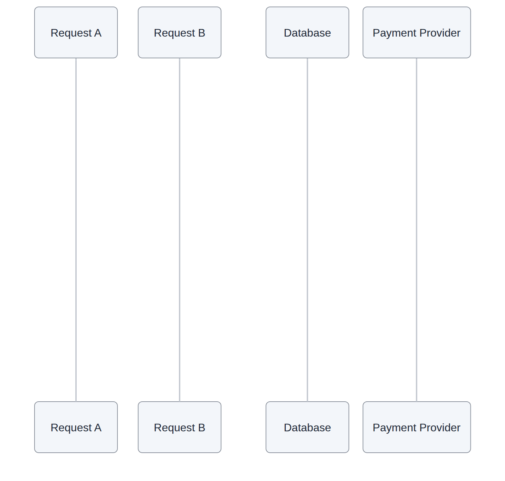
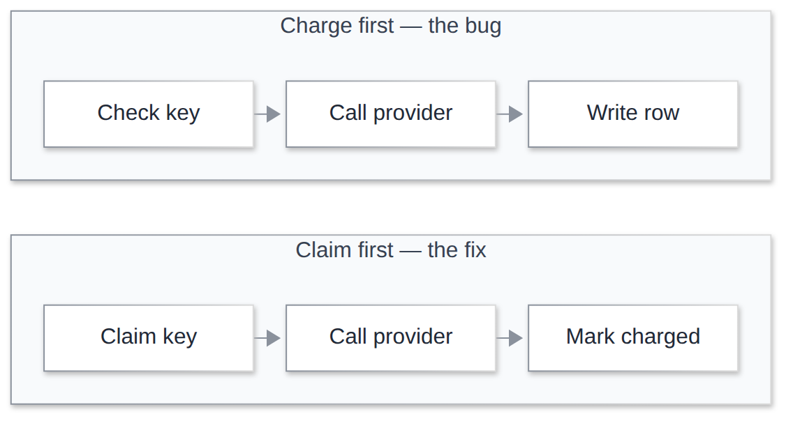
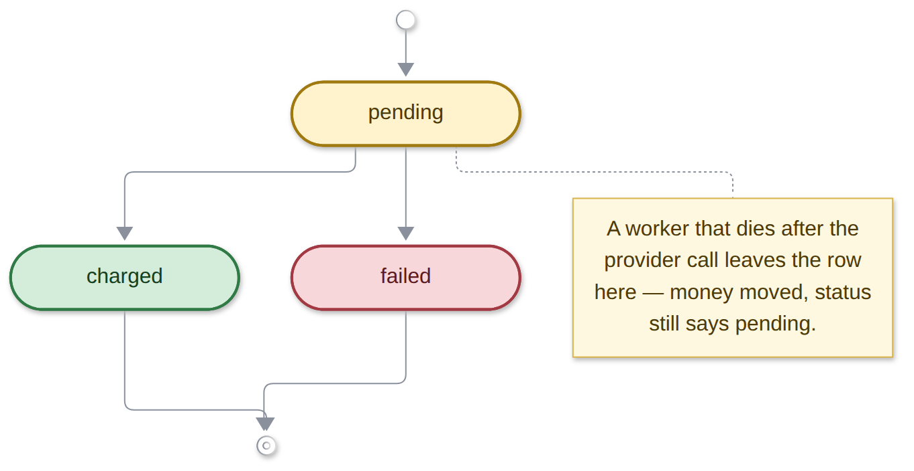
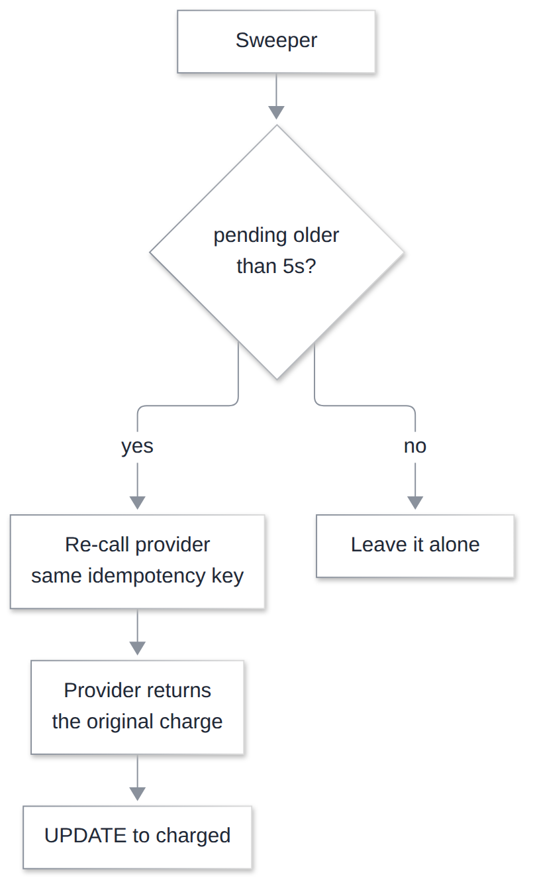

# System Design Interview: How Do You Make Sure a Payment API Never Charges a Customer Twice?

#### Most answers to this question stop one layer too early. Here's the layer underneath, and what happened when I actually ran it.

**By Tihomir Manushev**

*Sep 1, 2026 · 9 min read*

---

A payments team at a bike-share company, hiring a senior backend engineer. The interviewer is Ratko.

The usual answer to this one is "use an idempotency key with a unique constraint." The key is an ID for the payment attempt, so the server can tell that a retry is the same attempt. That answer isn't wrong, but it isn't enough, and the gap between the two is where real money goes missing.

Everything below ran on PostgreSQL 17.6, with eight concurrent requests hitting the same key. The numbers come from those runs, not from reasoning about them.

---

### The question

**Ratko:** A rider taps to pay for a bike rental. The app times out and retries. How do you make sure they're charged once?

**Tihomir:** The app sends an idempotency key with the request. It names the attempt, not the retry, so something like `RIDE-8842` stays the same however many times the app resends. If the server has seen that key before, it returns the first result instead of charging again.

**Ratko:** And what does the server actually do with the key?

**Tihomir:** First, the pieces it leans on. The provider call is a normal HTTP request to Stripe or Adyen, and the other two helpers just build a response:

```python
def charge_provider(idempotency_key: str) -> str:
    """POST /charges at the payment provider. Returns their charge id."""
    ...


def already_charged() -> str: ...
def in_flight_or_done() -> str: ...
```

Then the handler: look the key up, and if it's new, charge and save a row.

```python
def handle_purchase(conn, KEY: str) -> str:
    with conn.cursor() as cur:
        cur.execute("SELECT payment_id FROM ride_payment WHERE idempotency_key = %s", (KEY,))

        if cur.fetchone():
            return already_charged()

    ref = charge_provider(KEY)          # money moves here

    with conn.cursor() as cur:
        cur.execute(
            "INSERT INTO ride_payment (idempotency_key, rider_id, amount_cents, provider_ref)"
            " VALUES (%s, %s, %s, %s)", (KEY, 4471, 350, ref))

    conn.commit()

    return "confirmed"
```

**Ratko:** Looks reasonable. Now eight retries land at the same moment.

---

### The first trap

**Tihomir:** Then all eight run the lookup, the `SELECT`, before any of them gets to the `INSERT`.



None of them finds a row, so all eight call the provider.

**Ratko:** All eight? Not just two?

**Tihomir:** All eight. I ran it with eight threads held behind a barrier, which is just a starting gate, so they all go at once:

```
requests sent:      8
payment rows:       8
times money moved:  8
```

One ride, paid for eight times.

**Ratko:** Eight rows for one key. How do you stop that?

**Tihomir:** A unique constraint on `idempotency_key`. Then the database refuses a second row with the same key.

---

### The second trap

**Ratko:** Run it again with the constraint on.

**Tihomir:** Same eight requests:

```
  1 x 201 charged
  7 x 500 unique violation
payment rows:       1
times money moved:  8
```

**Ratko:** One row. So it worked?

**Tihomir:** One row, and eight charges.

**Ratko:** How? Seven of them failed.

**Tihomir:** They failed at the `INSERT`, and by then they'd already called the provider. That call is an HTTP request to someone else's system, and it doesn't roll back when my transaction does.

**Ratko:** But the table looks right.

**Tihomir:** It looks perfect, and that's what makes this version dangerous. Someone checks the data, sees one payment row and closes the ticket. Meanwhile the rider paid $28.00 for a $3.50 ride, and nothing in the schema disagrees.

**Ratko:** Most answers stop right here.

**Tihomir:** Because the unique constraint feels like the finish line. It only is if the whole operation happens inside the transaction, and a payment doesn't.

---

### The third trap

**Ratko:** Then make the database stricter. Does `SERIALIZABLE` fix it?

**Tihomir:** No, but I ran it anyway. `SERIALIZABLE` is Postgres's strictest mode: transactions behave as if they ran one after another, and any that can't get cancelled. Same eight requests, same code:

```
  1 x 201 charged
  7 x 40001 serialization failure
payment rows:       1
times money moved:  8
```

**Ratko:** Exactly the same.

**Tihomir:** Because the isolation level only decides what Postgres does with transactions that run at the same time, and the charge isn't in Postgres. It correctly cancelled seven of the eight, after all eight had spent the rider's money.

**Ratko:** So no isolation level saves you?

**Tihomir:** None of them can. The provider call happens outside the system that gives the guarantee.

---

### The fix

**Ratko:** Then what's the real answer?

**Tihomir:** Flip the order. Claim the key before calling the provider, not after.



The insert becomes the lock: whoever writes the row first is the only one allowed to charge.

```python
def handle_purchase(cur, KEY: str) -> str:
    cur.execute(
        "INSERT INTO ride_payment (idempotency_key, rider_id, amount_cents, status)"
        " VALUES (%s, %s, %s, 'pending')"
        " ON CONFLICT (idempotency_key) DO NOTHING"
        " RETURNING payment_id", (KEY, 4471, 350))
    claimed = cur.fetchone()

    if claimed is None:
        return in_flight_or_done()      # someone else owns this key

    ref = charge_provider(KEY)

    cur.execute("UPDATE ride_payment SET status='charged', provider_ref=%s"
                " WHERE payment_id=%s", (ref, claimed[0]))

    return "confirmed"
```

**Ratko:** It's the same constraint as before. Why does it work now?

**Tihomir:** Because now it decides who's allowed to call the provider, instead of recording who already did. `ON CONFLICT DO NOTHING ... RETURNING` means "insert unless the key exists, and tell me if you did", so exactly one caller gets a row back. Everyone else gets `None` and stops before spending anything.

**Ratko:** With the same eight at once?

**Tihomir:** Same eight, and this time there's one charge:

```
  1 x 201 charged
  7 x 409 in flight / already done
payment rows:       1
times money moved:  1
```

---

### The fourth trap

**Ratko:** Your worker calls the provider, and the provider succeeds. Then the worker gets killed before the `UPDATE`.

**Tihomir:** Then the row is stranded.



I killed the process at exactly that point:

```
 idempotency_key | status  | provider_ref | real_charges
-----------------+---------+--------------+--------------
 RIDE-2001       | pending | (none)       |            1
```

The money moved, but the status still says `pending`.

**Ratko:** And the app retries.

**Tihomir:** And gets a `409`, "in flight or already done", forever.

```
  8 x 409 in flight / already done
```

The claim is doing its job, because it won't let anyone charge again. But nothing will ever finish it.

**Ratko:** So your fix made a new problem.

**Tihomir:** Yeah. I swapped "charged twice" for "charged once and stuck." That's better, but it isn't finished.

---

### Closing the window

**Ratko:** A payment stuck forever isn't acceptable either. How does it get unstuck?

**Tihomir:** With a sweeper, a background job that picks up rows that have sat in `pending` too long.



```python
def sweep(cur) -> None:
    cur.execute("SELECT payment_id, idempotency_key FROM ride_payment"
                " WHERE status='pending' AND created_at < now() - interval '5 seconds'"
                " FOR UPDATE SKIP LOCKED")

    for payment_id, key in cur.fetchall():
        ref = charge_provider(key)      # safe: the provider dedupes on this key
        cur.execute("UPDATE ride_payment SET status='charged', provider_ref=%s"
                    " WHERE payment_id=%s", (ref, payment_id))
```

For each one, it calls the provider again with the same idempotency key.

**Ratko:** Hold on. That provider may have charged already.

**Tihomir:** It might have, and that's fine only because the provider dedupes on the key: if it's seen the key, it hands back the first charge instead of making a new one. The whole design rests on that. It's why the key has to travel all the way to the provider instead of stopping at my database.

**Ratko:** Does every provider do that?

**Tihomir:** Stripe, Adyen and PayPal all support it. If yours doesn't, you can't build this, and you're back to a reconciliation file: their list of charges, matched against your table.

**Ratko:** So what happens to the stuck one?

**Tihomir:** The sweeper finds it and closes it:

```
stuck payments found: 1
  reconciled RIDE-2001 -> ch_70

 idempotency_key | status  | provider_ref | real_charges
-----------------+---------+--------------+--------------
 RIDE-2001       | charged | ch_70        |            1
```

Still one real charge. And `FOR UPDATE SKIP LOCKED` makes a second copy of the sweeper skip any row the first one has locked, so two of them never work on the same payment.

---

### What it costs

**Ratko:** What did all this cost you?

**Tihomir:** Throughput. I ran `pgbench`, Postgres's load-testing tool, with 8 clients for 20 seconds, comparing a plain insert with the claim plus the update:

| | latency | tps |
|---|---|---|
| Plain `INSERT` | 1.356 ms | 5,901 |
| Claim + `UPDATE` | 1.709 ms | 4,680 |

That's about **21% fewer transactions per second**.

**Ratko:** 21% for one extra statement?

**Tihomir:** It isn't nothing, and I wouldn't call it free. Most of it is the second round trip to the database, the `UPDATE` that closes the claim, and it adds about 0.35 ms to every payment.

**Ratko:** Anything besides speed?

**Tihomir:** Disk. The unique index came to 3.9 MB, on a table of 8.9 MB.

**Ratko:** That's almost half the table again.

**Tihomir:** About 44%, measured at 93,561 rows.

**Ratko:** Would you take that trade?

**Tihomir:** For payments, without thinking twice. For a notification service, probably not: a duplicate push notification is an annoyance, and 21% of your throughput is real money at scale.

**Ratko:** So it depends.

**Tihomir:** On what a duplicate costs you. That's a product question more than an architecture one.

---

### Conclusion

**Ratko:** Okay. Give me the short version.

**Tihomir:** Four things.

**Claim the key before you charge, not after.** The unique constraint has to decide who calls the provider, not record who already did.

**Send the key to the provider too.** Your database can stop a second attempt, but only the provider can make a repeated one harmless.

**Expect to be killed between the two writes.** A `pending` status and a sweeper are the difference between "charged once" and "charged once and stuck."

**Know the price.** About 21% less throughput and an index 44% the size of the table, both measured. That's cheap for payments, and maybe not for anything else.

The usual answer stops at the unique constraint because that's where the database's part of the problem ends. The harder half lives between your transaction and an outside system that has never heard of it, and no isolation level will close that gap for you.
