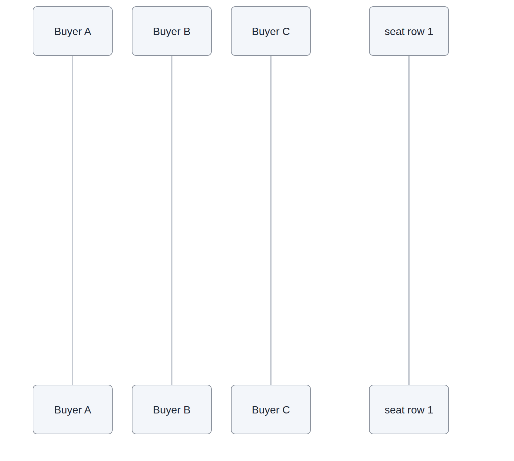
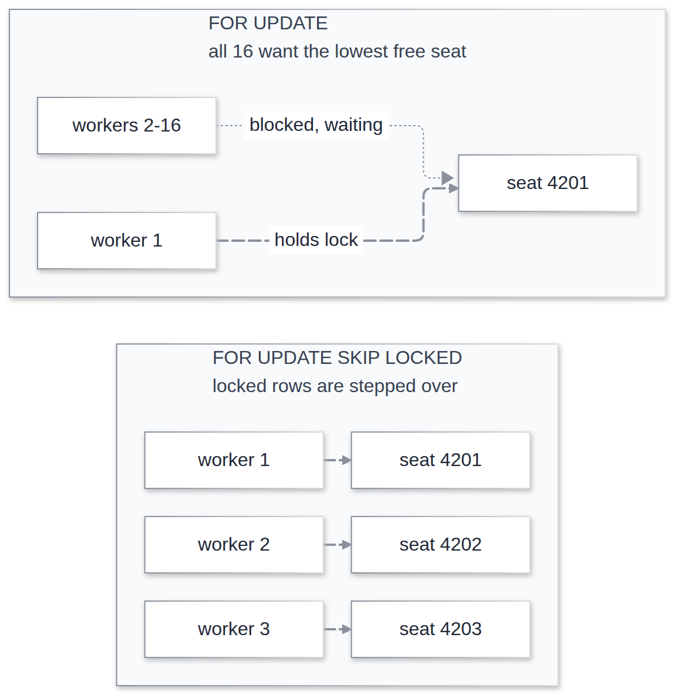
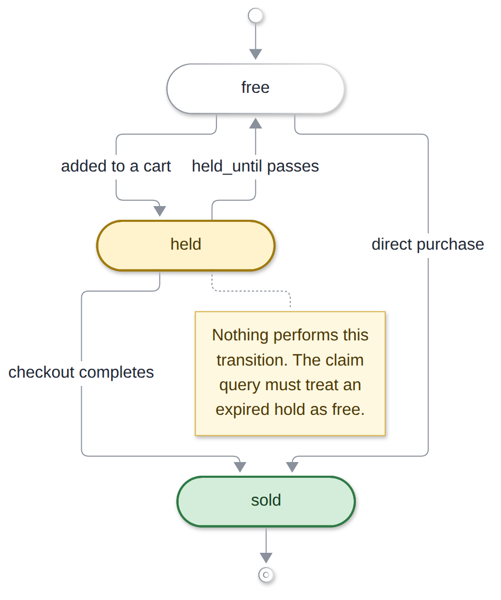

# System Design Interview: How Would You Stop a Concert Ticket System From Overselling the Last Seat?

#### Stopping the oversell takes one line of SQL. The interview is about what that line breaks next

**By Tihomir Manushev**

*Sep 3, 2026 · 9 min read*

---

A ticketing platform, hiring a staff engineer for the on-sale team. The interviewer is Amara.

Overselling is the classic concurrency question: two people try to buy the same seat at the same moment. The usual answer is "wrap it in a transaction." It sounds right, and it doesn't hold up on a real on-sale. What makes the question good is that every fix causes the next problem.

Everything below ran on PostgreSQL 17.6 against a 234,000-seat schema (50 shows), on a Ryzen 5 3600.

---

### The question

**Amara:** Tickets go on sale at ten. Fifty thousand people are on the page, and there's one seat left in the front row. Two of them tap "buy" in the same millisecond. What does your code do?

**Tihomir:** The obvious thing. It checks whether the seat is free, and if it is, it marks it sold and records the order.

```python
def buy_seat(conn, seat_id: int, order_ref: str) -> str:
    with conn.cursor() as cur:
        cur.execute("SELECT status FROM seat WHERE seat_id = %s", (seat_id,))
        if cur.fetchone()[0] != "free":
            return "sold out"
        cur.execute("UPDATE seat SET status='sold', order_ref=%s WHERE seat_id=%s",
                    (order_ref, seat_id))
    conn.commit()
    return "confirmed"
```

**Amara:** Two is easy to get lucky with. Make it ten people, same instant, same seat. How many tickets do you sell?

---

### The first trap

**Tihomir:** Ten, I'd guess. Every one of them reads `free` before any of them gets to write.



**Amara:** You'd guess?

**Tihomir:** Fair, so I ran it. Ten threads wait at a barrier, a gate that lets them all go at once, and each one tries to buy the seat.

```
  10 x confirmed
seat status:        sold
order that owns it: ORD-005
tickets promised:   10
seats available:    1
```

**Tihomir:** Ten confirmation emails for one seat. Nine of those people fly to another city and find someone sitting in their chair.

**Amara:** Wrap it in a transaction, then. That's what they're for.

**Tihomir:** That was my first instinct too, and on its own it changes nothing. Postgres defaults to a mode called `READ COMMITTED`, where each statement sees whatever was committed when it started. So all ten reads were honest: the seat really was free when each of them looked.

**Amara:** So the database didn't get it wrong.

**Tihomir:** No, my code did. It asks a question, then acts on the answer a millisecond later, as if nothing could have changed in between.

**Amara:** How do you get rid of that millisecond?

**Tihomir:** I stop asking first. The condition goes inside the write, so checking and selling happen in one statement.

```python
def buy_seat(cur, seat_id: int, order_ref: str) -> str:
    cur.execute(
        "UPDATE seat SET status='sold', order_ref=%s"
        " WHERE seat_id=%s AND status='free'", (order_ref, seat_id))
    return "confirmed" if cur.rowcount == 1 else "sold out"
```

**Tihomir:** `rowcount` is how many rows the update changed. One means you got the seat, zero means someone beat you to it. Here are the same ten buyers.

```
  1 x confirmed
  9 x sold out
seat status:        sold
order that owns it: ORD-009
```

**Amara:** One sale and nine "sold out". With no transaction and no lock?

**Tihomir:** A single statement already happens all at once or not at all, and the lock it takes on the row lasts microseconds. `SELECT FOR UPDATE` would work too: it locks the row as it reads it, hands it to the app to decide, and only then writes.

**Amara:** That's still correct.

**Tihomir:** It is, but that's three trips between the app and the database while holding a lock. The conditional update is one trip, and it never waits on my code.

---

### The second trap

**Amara:** Nobody picks a specific seat, though. They click "best available." Sixteen checkout workers, all asking for the lowest-numbered free seat in the same show. Now what?

**Tihomir:** Now they all find the same row. Each worker locks the first free seat, marks it sold and commits.

```sql
BEGIN;
SELECT seat_id FROM seat WHERE show_id = 7 AND status = 'free'
 ORDER BY seat_id LIMIT 1 FOR UPDATE;
-- mark it sold
COMMIT;
```

**Tihomir:** One worker gets the lock. The other fifteen wait on that exact row, find it's gone once the first one commits, and start over. It's correct, but it's a queue.



**Amara:** How slow a queue?

**Tihomir:** I measured it with pgbench, the load tester that ships with Postgres. Sixteen clients sell out the same 4,680-seat show on every run, so the work is identical. Then I ran it again with `SKIP LOCKED` added.

| | latency | tps |
|---|---|---|
| `FOR UPDATE` | 9.42 ms | 1,698 |
| `FOR UPDATE SKIP LOCKED` | 1.30 ms | 12,278 |

**Amara:** Seven times the transactions per second, from two extra words?

**Tihomir:** Yes, and I didn't expect that much. `SKIP LOCKED` tells the search to step over rows another transaction has locked instead of waiting behind them. Worker one takes seat 4201, and worker two doesn't wait for it, it takes 4202.

**Amara:** And nobody ends up with the same seat?

**Tihomir:** Nobody. Both versions sold all 4,680 seats, with zero oversells.

**Amara:** Then what did you give up?

**Tihomir:** Strict order. With plain `FOR UPDATE`, buyers are served in the order they arrived, and each one really does get the best seat left. With `SKIP LOCKED`, a buyer can get 4203 while 4201 is locked for a moment and then released.

**Amara:** Would anyone notice?

**Tihomir:** Not in a venue, where those seats are side by side. But where first come, first served is the whole point, it's the wrong tool.

---

### The third trap

**Amara:** Your buyer picks a seat and goes to checkout. Card details, the bank's 3-D Secure check, the works. What's the seat doing meanwhile?

**Tihomir:** It has to be held, or two people type in card details for the same seat and one gets turned down at the end. So it goes to `held`, with a `held_until` time a few minutes out.

**Amara:** And then they close the tab.

**Tihomir:** Then the seat's held by nobody. My sale only takes seats `WHERE status='free'`, so it stays that way.



**Amara:** Even after `held_until` has passed?

**Tihomir:** I checked, with a two-second hold to keep the test quick.

```
held by CART-441: rowcount=1
next buyer, immediately:      unavailable
next buyer, after expiry:     unavailable
seat state: ('held', 'CART-441', expired=True)
```

**Tihomir:** The hold expired and the seat still can't be sold. On a sold-out show, that's revenue sitting in an abandoned browser tab.

**Amara:** So run a job that sweeps expired holds back to free.

**Tihomir:** That's the reflex, and I'd rather not. A sweeper is one more moving part, and while it's behind, the seat stays stuck. The expiry time is already in the row, so the sale just has to believe it.

```python
RECLAIM = ("UPDATE seat SET status='sold', order_ref=%s, held_until=NULL"
           " WHERE seat_id=%s"
           "   AND (status='free' OR (status='held' AND held_until < now()))")
```

```
with the reclaiming predicate: confirmed
seat state: ('sold', 'ORD-779')
```

**Tihomir:** Now the next buyer who wants the seat takes it, at the moment they want it. No sweeper, no lag, nothing to page anyone about.

**Amara:** And nothing else has to change.

**Tihomir:** Something does, actually. I only noticed when I looked at how Postgres was running the query.

---

### What the fix broke

**Amara:** It's one extra `OR`. What could that break?

**Tihomir:** The index. Finding a free seat was fast because of a partial index, which is an index that only contains some rows, here just the free seats.

```sql
CREATE INDEX seat_free_idx ON seat (show_id, seat_id) WHERE status = 'free';
```

**Tihomir:** The new condition also matches held seats, and that index leaves them out on purpose. So the planner, the part of Postgres that decides how to run a query, stops using it.

```
 Limit (actual time=0.561..0.561 rows=1 loops=1)
   Buffers: shared hit=946
   ->  Index Scan using seat_pkey on seat
         Filter: ((show_id = 7) AND ((status = 'free') OR ((status = 'held') AND (held_until < now()))))
         Rows Removed by Filter: 468
 Execution Time: 0.582 ms
```

**Amara:** 946 buffers to find one seat?

**Tihomir:** 946 pages read from Postgres's cache, throwing away 468 rows on the way. The fix is to widen the index to cover both states a buyer can take.

```sql
CREATE INDEX seat_claimable_idx ON seat (show_id, seat_id)
    WHERE status IN ('free','held');
```

```
 Limit (actual time=0.045..0.046 rows=1 loops=1)
   Buffers: shared hit=4 read=3
   ->  Index Scan using seat_claimable_idx on seat
         Index Cond: (show_id = 7)
 Execution Time: 0.064 ms
```

**Amara:** From 946 buffers down to seven.

**Tihomir:** And from about 0.58 ms to 0.06. A partial index only helps while its condition matches the query's, and I changed the query without thinking about the index.

**Amara:** Why not put `held_until` in the index as well?

**Tihomir:** Because `now()` keeps moving, and an index condition can't. So the time check stays a filter, but it only runs on seats that are already free or held.

---

### What it costs

**Amara:** So what does all of this cost you?

**Tihomir:** First, `SKIP LOCKED` gives up strict fairness for seven times the throughput. Second, the wider index holds held seats as well as free ones, so it's bigger than the one it replaced.

**Amara:** Anything less obvious?

**Tihomir:** A buyer can lose a seat while they're still paying, if their hold runs out mid-payment. How long a hold lasts is a product decision, though, not an engineering one.

**Amara:** Where does this stop working?

**Tihomir:** When one row really is the bottleneck. General admission is the case: 50,000 tickets in one pool is one counter, and every buyer fights over it no matter how clever the SQL is.

**Amara:** Every buyer on one row.

**Tihomir:** Right, so the pool has to be split into buckets, or moved out of the database. I haven't built that, and I'd want to measure how far one row goes before assuming I need it.

---

### Conclusion

**Amara:** If you had to boil it down for the team?

**Tihomir:** Four things.

**Put the condition in the write.** Checking first and writing later sold ten tickets for one seat; the same check inside a single `UPDATE ... WHERE status='free'` sold exactly one, with no transaction and no explicit lock.

**`SKIP LOCKED` is what makes "best available" scale.** 1,698 transactions a second against 12,278 on identical work, and the only thing given up is strict arrival order.

**Expiry belongs in the query, not in a background job.** A hold past its deadline is already free; teaching the sale to see that removes a sweeper and the gap whenever it falls behind.

**A partial index has to match the query.** Changing the `WHERE` clause quietly cost 946 buffers per lookup until the index was widened to match.

The standard answer, a transaction, misses that Postgres's default still lets ten buyers read the same free seat. Every fix after it is one line of SQL, and each one broke something only a measurement found.
