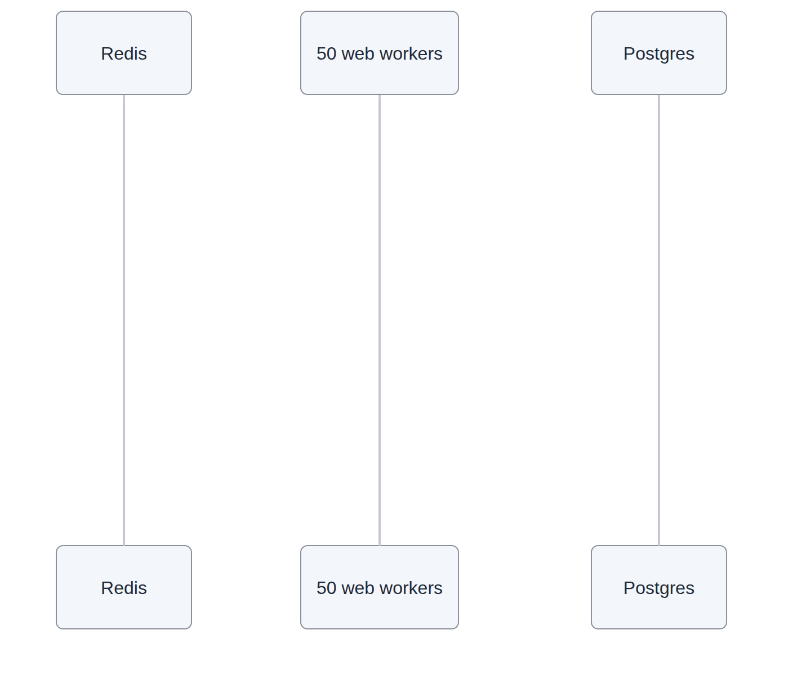
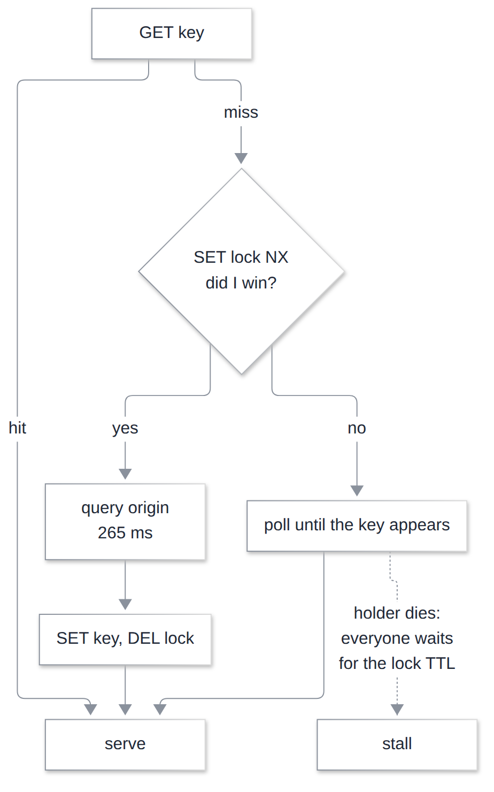
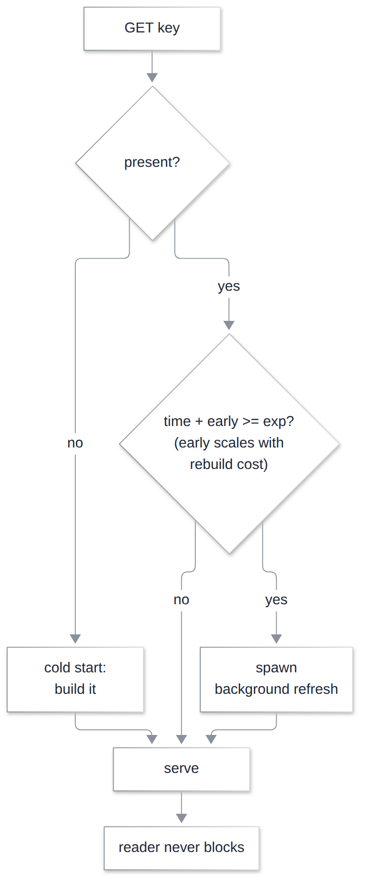

# System Design Interview: Your Cache Expires and the Database Falls Over. What Happened?

#### A 265 ms query took 5,046 ms the moment its cache key expired. The obvious fix swaps that outage for a smaller wait that never goes away

**By Tihomir Manushev**

*Sep 4, 2026 · 9 min read*

---

A platform team at a job board, hiring a senior engineer. The interviewer is Haruki.

Ask how to make a slow page faster, and almost everyone says: add a cache. That's usually right. What the answer leaves out is the second after the cached copy expires, when every request finds it gone at once, and that's the second that pages you.

Everything below ran on PostgreSQL 17.6 and Redis 7, against three million job postings, with fifty concurrent readers on a Ryzen 5 3600.

---

### The question

**Haruki:** Your trending-roles dashboard adds up every job posting from the last thirty days. That query takes 265 milliseconds, and it's on the home page. What do you do?

**Tihomir:** Cache it. Nobody needs a hiring dashboard that's accurate to the second, so a copy that's a few seconds old is fine.

**Haruki:** How does the copy get there?

**Tihomir:** The simplest way, cache-aside: read the key from Redis, and if it's missing, run the query and write the result back. I'd give it a short TTL, a time-to-live, so Redis deletes it after five seconds and the next reader builds a fresh one. Here's the setup every version shares.

```python
import json
import math
import random
import threading
import time

import psycopg2
import redis

PG = "host=127.0.0.1 port=5432 dbname=jobboard user=postgres password=demo"
R = redis.Redis(host="127.0.0.1", port=6379, decode_responses=True)

KEY = "dashboard:trending"
LOCK = "dashboard:trending:lock"
TTL = 5

TRENDING_SQL = """
SELECT role_family, city,
       count(*) AS openings,
       round(avg(salary_cents)/100000.0, 1) AS avg_k,
       round(100.0 * count(*) FILTER (WHERE is_remote) / count(*), 1) AS remote_pct
FROM posting
WHERE posted_at >= now() - interval '30 days'
GROUP BY role_family, city
ORDER BY openings DESC
LIMIT 20
"""


def query_origin() -> str:
    """The 265 ms aggregate over three million postings, as JSON."""
    conn = psycopg2.connect(PG)

    try:
        with conn.cursor() as cur:
            cur.execute(TRENDING_SQL)
            return json.dumps(cur.fetchall(), default=str)
    finally:
        conn.close()
```

**Tihomir:** And the simple reader on top of it.

```python
def naive_reader():
    hit = R.get(KEY)

    if hit is not None:
        return hit

    value = query_origin()
    R.set(KEY, value, ex=TTL)

    return value
```

**Haruki:** Fifty workers hitting that for twenty seconds. What do you expect?

**Tihomir:** Around fifty thousand requests, nearly all served from Redis in well under a millisecond. And four database queries, one each time the key expires.

**Haruki:** Run it.

---

### The first trap

**Tihomir:** A hundred database queries. That's twenty-five every time the key expired, not one.

```
plain cache-aside, TTL=5s, 50 readers, 20s
  requests served:        50247
  origin queries:         100   (25.0 per expiry)
  origin query p50 / max: 5046 ms / 5448 ms
  cache-hit p99:          2.1 ms
  non-hit p50 / p99:      5079 ms / 5466 ms
```

**Haruki:** Five thousand milliseconds? You said the query takes 265.

**Tihomir:** It does, when it runs alone. Here twenty-five copies of the same query ran at the same moment, all competing for the same database, and each one came out about nineteen times slower.



**Haruki:** Why twenty-five at once?

**Tihomir:** Because they all miss together. The key expires, every request in flight finds it gone, and each one sends the identical query. People call that a cache stampede, and the annoying part is that nothing broke: the cache expired, which is exactly what I told it to do.

**Haruki:** And the users?

**Tihomir:** Twenty-five of them waited about five and a half seconds for a home page. Every time the key expires, for as long as the site is up.

**Haruki:** Then raise the TTL. Fewer expiries, fewer stampedes.

**Tihomir:** That was my first thought too, so I ran the same reader for thirty seconds with two TTLs.

| TTL | origin queries | per expiry | worst reader wait |
|---|---|---|---|
| 2 s | 200 | 13.3 | 6,009 ms |
| 10 s | 100 | 33.3 | 7,781 ms |

**Haruki:** The longer one halved the queries. Isn't that the win?

**Tihomir:** For the database's total load, yes. But each stampede got two and a half times bigger, because more readers pile up while the slow rebuild runs. And the worst wait went from about six seconds to almost eight, so I'd traded a few small stampedes for fewer, bigger ones.

---

### The obvious fix, and what it costs

**Haruki:** Then only let one of them rebuild.

**Tihomir:** Right, a rebuild lock. Redis's `SET NX` only writes a key if it doesn't exist yet, so exactly one reader wins and runs the query. Everyone else waits for the new value to show up.

```python
def locked_reader():
    hit = R.get(KEY)

    if hit is not None:
        return hit

    if R.set(LOCK, "1", nx=True, ex=30):        # I won the right to rebuild
        try:
            R.set(KEY, query_origin(), ex=TTL)
        finally:
            R.delete(LOCK)
    else:
        while R.get(KEY) is None:               # everyone else waits for it
            time.sleep(0.02)

    return R.get(KEY)
```

```
rebuild lock, TTL=5s, 50 readers, 20s
  requests served:        90222
  origin queries:         4   (1.0 per expiry)
  origin query p50 / max: 284 ms / 307 ms
  non-hit p50 / p99:      285 ms / 323 ms
```

**Haruki:** One query per expiry. And it's fast again.

**Tihomir:** 284 milliseconds, once it isn't fighting twenty-four copies of itself. And with nobody stuck for five seconds, the same workers served about ninety thousand requests.

**Haruki:** So you're done.

**Tihomir:** No, look at the last line. Anyone who shows up during a rebuild still waits about 285 milliseconds, on a page that's otherwise served in two. I turned a five-second outage into a smaller wait that comes back every time the key expires.



**Haruki:** And if the reader holding the lock dies halfway through?

**Tihomir:** Then nobody rebuilds, and nobody's allowed to, until the lock itself expires.

**Haruki:** How long is that?

**Tihomir:** Thirty seconds, the TTL I put on the lock. So the worst case of my fix is the whole fleet stuck for thirty seconds on the home page, waiting on a dead worker.

---

### The actual answer

**Haruki:** So the lock saved the database, not the reader. What saves the reader?

**Tihomir:** Not rebuilding at the moment it expires. The value is allowed to be a few seconds old anyway, so refresh it before the deadline, in the background, and keep serving the old copy while that runs.

**Haruki:** How does a reader know the deadline's close?

**Tihomir:** The cached entry carries it. Next to the result it stores the moment it stops being fresh and how long it took to build, and Redis's own expiry stays only as a backstop.

```python
FRESH_FOR = 5.0                # after this the value is stale, but still served
HARD_TTL = 60                  # Redis only evicts if refreshes stop completely
EARLY_REFRESH_FACTOR = 1.0     # beta, from the XFetch paper; 1.0 is its default


def store(payload: str, build_seconds: float) -> None:
    """Cache the value with when it goes stale and what it cost to build."""
    R.set(KEY, json.dumps({
        "payload": payload,
        "fresh_until": time.time() + FRESH_FOR,
        "build_seconds": build_seconds,
    }), ex=HARD_TTL)


def refresh() -> None:
    """Rebuild the value. One caller at a time; the rest simply skip it."""
    if not R.set(LOCK, "1", nx=True, ex=30):
        return

    try:
        started = time.perf_counter()
        payload = query_origin()
        store(payload, time.perf_counter() - started)
    finally:
        R.delete(LOCK)
```

**Haruki:** And the read path?

**Tihomir:** It never waits. It reads the entry, decides whether to start a refresh in the background, and returns the stored result either way.

```python
def swr_reader():
    raw = R.get(KEY)

    if raw is None:                          # cold start: nothing to serve yet
        refresh()
        return json.loads(R.get(KEY))["payload"]

    entry = json.loads(raw)

    # How far ahead of the deadline this reader is willing to volunteer.
    # Scales with the rebuild cost; the log of a random number makes every
    # reader pick a different moment, so they do not all volunteer at once.
    head_start = entry["build_seconds"] * EARLY_REFRESH_FACTOR * -math.log(random.random())

    if time.time() + head_start >= entry["fresh_until"]:
        threading.Thread(target=refresh, daemon=True).start()

    return entry["payload"]                  # served immediately, fresh or not
```

**Haruki:** What's the logarithm doing in there?

**Tihomir:** `head_start` is how long before the deadline this reader is willing to rebuild. It grows with `build_seconds`, so an expensive value gets refreshed further ahead than a cheap one.

**Haruki:** And the random number?

**Tihomir:** That's the whole trick. Without it, all fifty readers would decide to refresh at the same instant, which is just the stampede moved earlier. `-math.log(random.random())` gives every reader a different head start on every request, so usually one crosses the line alone, a second or two before the deadline.

**Haruki:** And if two cross it together?

**Tihomir:** `refresh()` still takes the lock, so the second one returns without running the query. Everyone else keeps getting the old value in the meantime.

**Haruki:** Where does `EARLY_REFRESH_FACTOR` come from?

**Tihomir:** It's beta from XFetch, the algorithm in *Optimal Probabilistic Cache Stampede Prevention* by Vattani, Chierichetti and Lowenstein, VLDB 2015. Their rule is `now - delta * beta * log(rand()) >= expiry`, where `delta` is how long the last rebuild took. My line is the same rule, rearranged into a head start.

**Haruki:** Would you tune it?

**Tihomir:** Higher means earlier refreshes and more queries; lower is cheaper and riskier. The paper argues 1.0 is close to optimal, and I had no measurement of my own to justify moving it.



```
early refresh + serve stale, 50 readers, 20s
  requests served:        95872
  origin queries:         8   (2.0 per expiry)
  origin query p50 / max: 291 ms / 326 ms
  cache-hit p99:          1.7 ms
  non-hit p50 / p99:      2 ms / 31 ms
```

**Haruki:** So nobody waits?

**Tihomir:** Almost nobody. Even among requests that weren't a plain cache hit, 99% finished within 31 milliseconds, against 5,466 for the simple version. And the slow ones are the cold start at the beginning of the run, not a stampede. Here are all three side by side.

| | requests served | origin queries | origin p50 | worst reader wait |
|---|---|---|---|---|
| plain cache-aside | 50,247 | 100 | 5,046 ms | 5,466 ms |
| rebuild lock | 90,222 | 4 | 284 ms | 323 ms |
| early refresh + stale | 95,872 | 8 | 291 ms | 31 ms |

---

### What it costs

**Haruki:** Eight queries where the lock ran four. You doubled the database load.

**Tihomir:** I did, because the refresh fires early and sometimes twice. That's the price of nobody waiting, and it's cheap here, since each query took about 290 milliseconds without a crowd fighting it.

**Haruki:** And the readers get old data.

**Tihomir:** A little, since the refresh starts before the deadline. But how old is acceptable is now a product decision someone has to write down, not a side effect of the TTL. For a hiring dashboard it's obviously fine; for an account balance it obviously isn't.

**Haruki:** And the code?

**Tihomir:** It got harder. Cache-aside fits in one small function; this is an entry format, a background thread, a lock, and a tuning constant I'd have to justify to whoever's on call.

**Haruki:** When wouldn't you bother?

**Tihomir:** When there's no single hot key, one that every request touches, like this dashboard. If the cache holds a million user profiles, no single expiry has fifty readers waiting on it, and plain cache-aside is fine.

**Haruki:** Would you run it across many servers?

**Tihomir:** Not without testing it, and I haven't. This was one Redis, fifty threads, one machine, and the lock is a single `SET NX` with no fencing, so nothing stops a second refresh if the first hangs past the lock's thirty seconds. That's harmless here because rebuilding twice gives the same result, but I wouldn't reuse this shape for anything that writes.

---

### Conclusion

**Haruki:** If you had to sum it up?

**Tihomir:** Four things.

**The cache didn't fail. It expired, and every reader found it gone at once.** Twenty-five copies of a 265 ms query ran together, and each took 5,046 ms.

**A longer TTL made it worse.** Going from 2 to 10 seconds halved the total queries, but each stampede grew 2.5 times and the worst wait went from 6.0 to 7.8 seconds.

**A rebuild lock protects the database, not the reader.** One query per expiry, but anyone arriving during a rebuild still waits 285 ms, and a dead lock holder can stall everyone for thirty seconds.

**Refresh before it expires, and serve the old copy meanwhile.** The worst wait dropped from 5,466 ms to 31 ms, for twice the queries of the lock and a written-down limit on how stale is too stale.

The question gets asked because the simple answer is genuinely right: a cache does fix the 265 ms query, for almost every request. The trouble is all in the moment the key goes away, and you only see it if you measure that moment.
