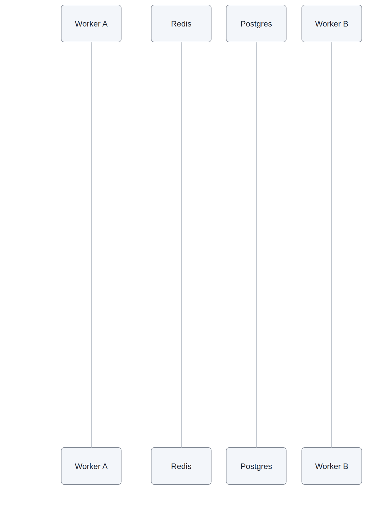
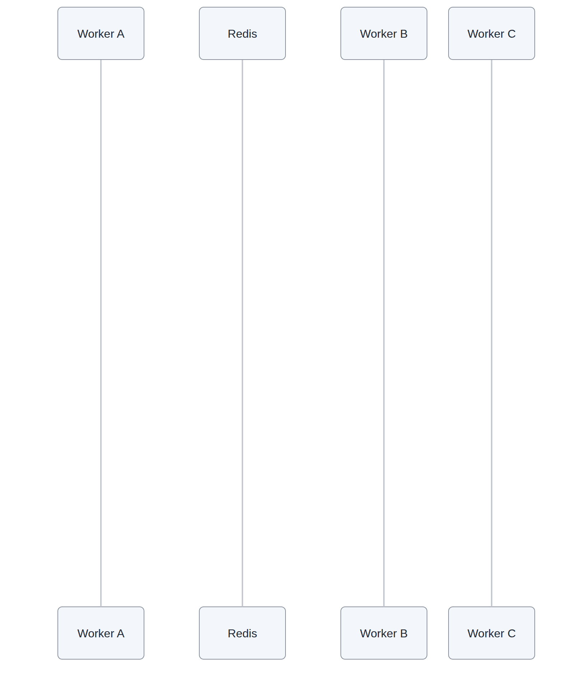
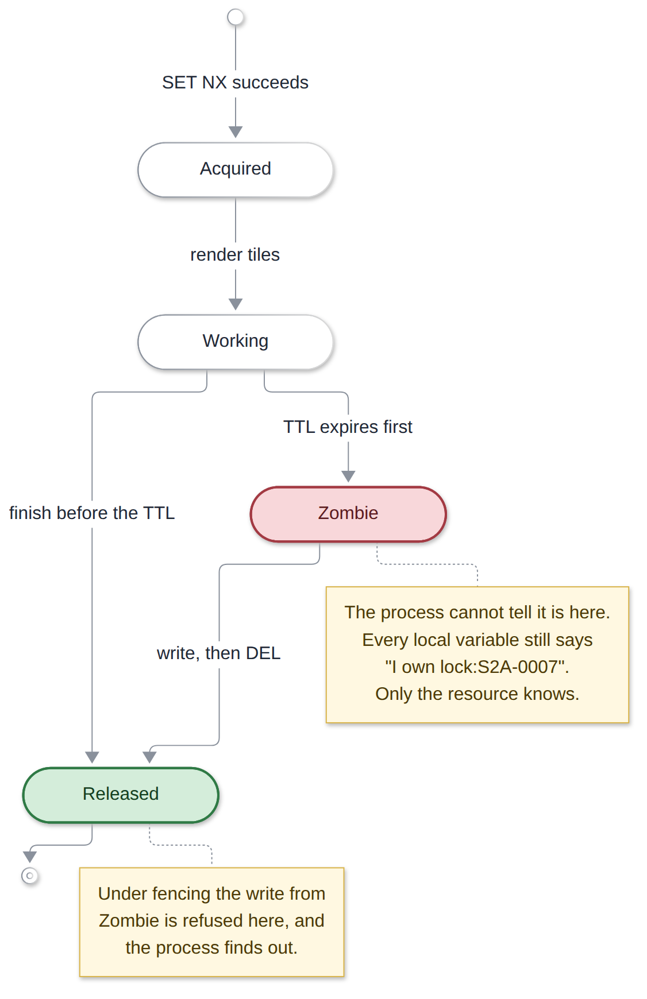
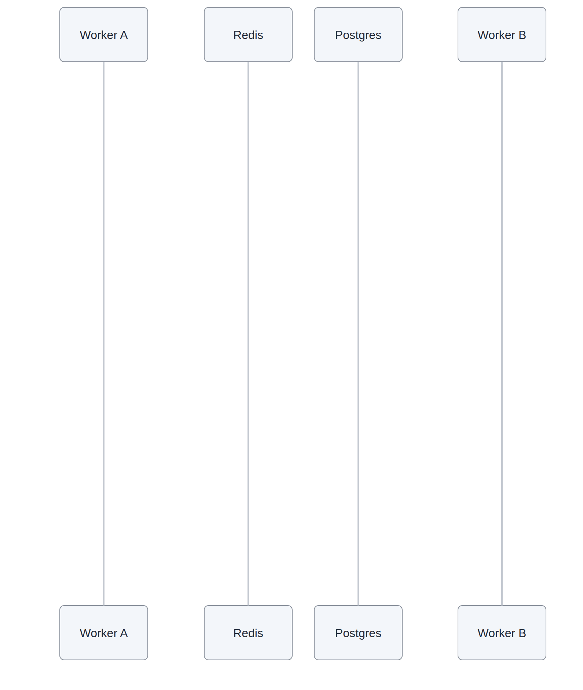

# System Design Interview: Two Workers Hold the Same Lock. How Is That Possible?

#### A Redis lock with an expiry gave 24 scenes two owners at once, and the watchdog everyone adds doesn't fix it

**By Tihomir Manushev**

*Sep 5, 2026 · 9 min read*

---

A data platform team at a satellite imagery company, hiring a senior backend engineer. The interviewer is Ingrid.

The usual answer to "only one worker at a time" is one line of Redis: `SET key value NX PX 30000`. It creates the key only if nobody holds it, and deletes it after 30 seconds. It looks correct, but the lock can expire while the worker holding it is still using it, and nothing tells that worker it has lost it.

Everything below ran on Redis 7.4.11 and PostgreSQL 17.6, six worker processes on a Ryzen 5 3600, Python 3.12.

---

### The question

**Ingrid:** Scenes come down from the satellite, and each one has to be tiled exactly once. Six worker processes all poll the same list of pending scenes. How do you stop two of them tiling the same scene?

**Tihomir:** A lock per scene in Redis. `NX` means the key is only created if nobody has it, so exactly one worker wins. `PX` gives it an expiry in milliseconds, so a crashed worker can't block a scene forever. Here's the shared setup, with a loop of hashing standing in for the tiling.

```python
import hashlib
import threading
import time
import uuid

import psycopg2
import redis

PG = "host=127.0.0.1 port=5442 dbname=scenes user=postgres password=demo"
LOCK_TTL_MS = 2000
ROUNDS_PER_SECOND = 25000

pool = redis.from_url("redis://127.0.0.1:6399/0", decode_responses=True)


def connect_db():
    """One autocommit connection per worker process."""
    conn = psycopg2.connect(PG)
    conn.autocommit = True

    return conn


def render_tiles(scene_id: str, worker_id: str, seconds: float) -> str:
    """Stands in for tiling a scene: roughly `seconds` of hashing."""
    digest = hashlib.sha256(f"{scene_id}:{worker_id}".encode())
    block = bytes(65536)

    for _ in range(int(seconds * ROUNDS_PER_SECOND)):
        digest.update(hashlib.sha256(block).digest())

    return digest.hexdigest()[:16]
```

**Ingrid:** And the worker?

**Tihomir:** The way almost everyone writes it: take the lock, tile the scene, write the row, delete the key.

```python
def process_naive(scene_id: str, worker_id: str, work_seconds: float) -> bool:
    """Take the lock, tile the scene, write the result, release."""
    key = f"lock:scene:{scene_id}"
    me = str(uuid.uuid4())

    if not pool.set(key, me, nx=True, px=LOCK_TTL_MS):
        return False

    conn = connect_db()

    try:
        checksum = render_tiles(scene_id, worker_id, work_seconds)

        with conn.cursor() as cur:
            cur.execute("""
                INSERT INTO scene_product (scene_id, checksum, written_by)
                VALUES (%s, %s, %s)
                ON CONFLICT (scene_id) DO UPDATE
                SET checksum = EXCLUDED.checksum,
                    written_by = EXCLUDED.written_by,
                    updated_at = now()
                """, (scene_id, checksum, worker_id))

        return True
    finally:
        conn.close()
        pool.delete(key)
```

**Ingrid:** Your expiry is two seconds. How long does a scene take?

**Tihomir:** Between 0.4 and 1.2 seconds in my lab, so there's plenty of room. That room is the whole argument for this design.

**Ingrid:** Plenty of room, as long as the worker keeps running.

---

### The first trap

**Tihomir:** So I stopped them. I froze workers with `SIGSTOP`, a signal that pauses the whole process until it's told to continue. In real life that's a long garbage-collection pause, a virtual machine losing its CPU, or a machine swapping to disk.

**Ingrid:** For how long?

**Tihomir:** Thirty percent of jobs froze for 2.2 to 3.4 seconds.

**Ingrid:** Longer than the expiry.

**Tihomir:** On purpose. Eighty scenes arrived over 45 seconds, and I logged every time a worker took or released a lock, so I could count the overlaps directly.

```
naive SET NX PX, 6 workers, ttl=2000ms, stall=2.2-3.4s
  work executions                    104
  stop-the-world stalls              32
  overlapping ownership pairs        24
  scenes with two live owners        24
  longest double ownership           2.31 s
  writes made without the lock       32
    ... of those, accepted           32
  survivor is not the last owner     16
```

**Ingrid:** Twenty-four scenes with two owners at once.

**Tihomir:** For as long as 2.31 seconds. I expected some work to run twice, but not this: on 16 scenes, the row in the database came from the wrong worker.

**Ingrid:** The frozen one?

**Tihomir:** Yes. It woke up, finished, and wrote its result over the newer one. Postgres accepted it, because to Postgres that's a perfectly ordinary `UPDATE`.



**Ingrid:** So Redis did nothing wrong.

**Tihomir:** Exactly what I asked. `PX 2000` means "delete this key in two seconds". It doesn't mean "tell the holder when it stops being the holder".

**Ingrid:** Can't the worker just check before it writes?

**Tihomir:** It can ask, but the answer is already old when it comes back. Nothing warns it, so its own variables still say it owns the lock.

**Ingrid:** Does it break anything besides the write?

**Tihomir:** The release. Seven times in that run, a worker woke up, finished, and its `DEL` removed a lock that now belonged to someone else. So a second worker lost its lock mid-job to a process that had nothing to do with it.



---

### Guarding the release

**Ingrid:** That one sounds easy to fix.

**Tihomir:** It is. Compare-and-delete: remove the key only if its value is still my random ID. It's a small Lua script, because Redis runs a script as one step, so nobody sneaks in between the check and the delete.

**Ingrid:** And the expiry?

**Tihomir:** While I was there, I added a watchdog, a background thread that pushes the expiry back every third of the lease. It does the same ownership check, so it can't bring back a lock it has already lost.

```python
UNLOCK_IF_MINE = """
if redis.call('get', KEYS[1]) == ARGV[1] then
  return redis.call('del', KEYS[1])
end
return 0
"""

EXTEND_IF_MINE = """
if redis.call('get', KEYS[1]) == ARGV[1] then
  return redis.call('pexpire', KEYS[1], ARGV[2])
end
return 0
"""

unlock_if_mine = pool.register_script(UNLOCK_IF_MINE)
extend_if_mine = pool.register_script(EXTEND_IF_MINE)


def heartbeat(key: str, me: str, stop: threading.Event) -> None:
    """Renews the lease every third of the TTL until told to stop."""
    while not stop.wait(LOCK_TTL_MS / 3000):
        extend_if_mine(keys=[key], args=[me, LOCK_TTL_MS])
```

**Ingrid:** Did it help?

**Tihomir:** Deleting someone else's lock went from seven to zero, and it stays zero. That bug is really fixed, with four lines. The rest barely moved.

```
compare-and-delete + watchdog, same conditions
  scenes with two live owners        18
  writes made without the lock       27
    ... of those, accepted           27
  unlocked someone else's lock       0
  survivor is not the last owner     12
```

**Ingrid:** Twelve scenes still ended up with the wrong row.

**Tihomir:** And 18 still had two owners. The watchdog wins when a worker is just slow, and it does nothing for the frozen worker, which is the case I built the lab around.

---

### The second trap

**Ingrid:** Nothing? Keeping the lock alive is the watchdog's whole job.

**Tihomir:** But it's a thread inside the process that's failing. I tested that alone: one lock, a two-second expiry, five seconds of work, with and without the watchdog, and the delay caused two ways.

```
does the watchdog keep the lock alive? (ttl=2000ms, work=5s)
  slow but running           watchdog=False  lock still mine at the end: False
  slow but running           watchdog=True   lock still mine at the end: True
  SIGSTOP (stop-the-world)   watchdog=False  lock still mine at the end: False
  SIGSTOP (stop-the-world)   watchdog=True   lock still mine at the end: False
```

**Ingrid:** The last row says false with the watchdog on.

**Tihomir:** Because a frozen process has a frozen watchdog. `SIGSTOP` stops every thread, and so does a long garbage-collection pause. The watchdog only helps while the process is still running, which is when I didn't really need it.

**Ingrid:** Then make the expiry longer.

**Tihomir:** That's what I said the first time this caught me. A longer expiry makes the overlap rarer, but now a crashed worker's scene sits stuck for the whole lease.

**Ingrid:** How long is long enough?

**Tihomir:** As long as the longest pause, and I can't know the longest pause. No expiry makes the guarantee true; some just make it fail less often.



**Ingrid:** Then what can you actually promise?

**Tihomir:** Honestly, I'd been solving the wrong problem. I don't need Redis to promise that only one worker runs. I need an old worker's write to not land.

---

### Fencing tokens

**Ingrid:** How do you stop it landing?

**Tihomir:** A fencing token. Every time a worker takes the lock, it also gets a number from a per-scene counter with `INCR`, so each new owner's number is bigger than the last one's. That number travels with the write.

**Ingrid:** And the database checks it?

**Tihomir:** Postgres keeps the highest number it has accepted for each scene and refuses anything lower. That's one extra column and one `WHERE` clause.

```sql
CREATE TABLE scene_product (
    scene_id    text PRIMARY KEY,
    checksum    text NOT NULL,
    written_by  text NOT NULL,
    fence_token bigint NOT NULL DEFAULT 0,
    updated_at  timestamptz NOT NULL DEFAULT now()
);
```

```python
def process_fenced(scene_id: str, worker_id: str, work_seconds: float) -> bool:
    """Same lock, plus a token the write has to justify itself with."""
    key = f"lock:scene:{scene_id}"
    me = str(uuid.uuid4())

    if not pool.set(key, me, nx=True, px=LOCK_TTL_MS):
        return False

    token = pool.incr(f"fence:scene:{scene_id}")
    stop = threading.Event()
    beat = threading.Thread(target=heartbeat, args=(key, me, stop), daemon=True)
    beat.start()
    conn = connect_db()

    try:
        checksum = render_tiles(scene_id, worker_id, work_seconds)

        with conn.cursor() as cur:
            cur.execute("""
                INSERT INTO scene_product (scene_id, checksum, written_by,
                                           fence_token)
                VALUES (%s, %s, %s, %s)
                ON CONFLICT (scene_id) DO UPDATE
                SET checksum = EXCLUDED.checksum,
                    written_by = EXCLUDED.written_by,
                    fence_token = EXCLUDED.fence_token,
                    updated_at = now()
                WHERE scene_product.fence_token < EXCLUDED.fence_token
                """, (scene_id, checksum, worker_id, token))
            return cur.rowcount == 1        # False means: you are stale
    finally:
        stop.set()
        beat.join(timeout=1)
        conn.close()
        unlock_if_mine(keys=[key], args=[me])
```

**Ingrid:** What's the `WHERE` doing on the conflict branch?

**Tihomir:** `ON CONFLICT DO UPDATE` means insert the row, or update it if it already exists. With a `WHERE`, the update only happens when the condition holds; otherwise the row stays as it was and `rowcount` comes back zero.

**Ingrid:** So there's no check and then a write.

**Tihomir:** Right, it's one statement that either moves the row forward or refuses. There's no gap between deciding and doing, and that gap is what broke everything else.

```
fencing tokens, same conditions
  scenes with two live owners        22
  writes made without the lock       30
    ... of those, accepted           16
  writes rejected by the db          14
  survivor is not the last owner     0
```

**Ingrid:** Zero wrong rows.

**Tihomir:** Zero. Fourteen old writes bounced off the database. Sixteen more writes happened without the lock and were accepted, and that's correct.

**Ingrid:** Accepted without the lock is correct?

**Tihomir:** Those workers held the newest token, so there was no newer result to overwrite. Their lock had just expired around them.



**Ingrid:** And the 22 scenes with two owners?

**Tihomir:** Still 22. Fencing doesn't stop the work running twice: I paid for the CPU twice and threw one result away. What it stops is the wrong result winning.

---

### What it costs

**Ingrid:** That extra counter isn't free.

**Tihomir:** One more Redis call per lock and eight bytes per row. Over three thousand writes, the median went from 0.874 ms to 1.005 ms, about 15%, and nearly all of it is that extra call.

**Ingrid:** And the slow end?

**Tihomir:** The 99th percentile went from 1.40 ms to 1.80 ms. Against a job that takes 900 milliseconds, nobody will notice.

**Ingrid:** So the real price is somewhere else.

**Tihomir:** The thing you write to has to cooperate. This works because Postgres can compare the token in the same statement that writes.

**Ingrid:** What if it's a plain object store?

**Tihomir:** If it has no conditional write, there's nowhere to put the check. Checking from the client doesn't work either, because the gap between reading and writing comes back.

**Ingrid:** What haven't you measured?

**Tihomir:** Redis itself failing. This was one Redis node, and if it fails over to a copy that hasn't caught up, two workers can get the same lock with no expiry involved. Redlock, the multi-node version, exists for that, and it's argued about.

**Ingrid:** Does fencing cover that case?

**Tihomir:** It should, because a token from the stale copy still loses to the highest one Postgres has seen. But I haven't run a failover, so I won't give you a number for it.

**Ingrid:** Anything else you're guessing at?

**Tihomir:** A worker that gets a token and dies before writing. The counter skips a number and nothing breaks, because the numbers only have to go up, not leave no gaps. I'd still write that down before someone reads the counter as a job count.

---

### Conclusion

**Ingrid:** If you had to sum it up?

**Tihomir:** Four things.

**The expiry ends the lock, not the work.** Six workers, a two-second expiry and ordinary pauses put two live owners on 24 of 80 scenes, for as long as 2.31 seconds.

**A watchdog only survives the failures where you didn't need it.** It kept the lock through five seconds of slow work and lost it to `SIGSTOP` every time, because the pause freezes the watchdog too.

**Compare-and-delete is still worth four lines.** Deleting someone else's lock went from seven times to zero.

**Fencing tokens let the database decide whose write counts.** Without them, 32 writes landed without the lock; with them, 14 old writes were refused and no scene kept the wrong row, for 0.131 ms and eight bytes per row.

The question gets asked because `SET NX PX` really is the right tool, and nothing here replaces it. What the usual answer gets wrong is where the guarantee lives. A lock in Redis tells you who *should* be working; only the thing you write to can decide whose work counts.
