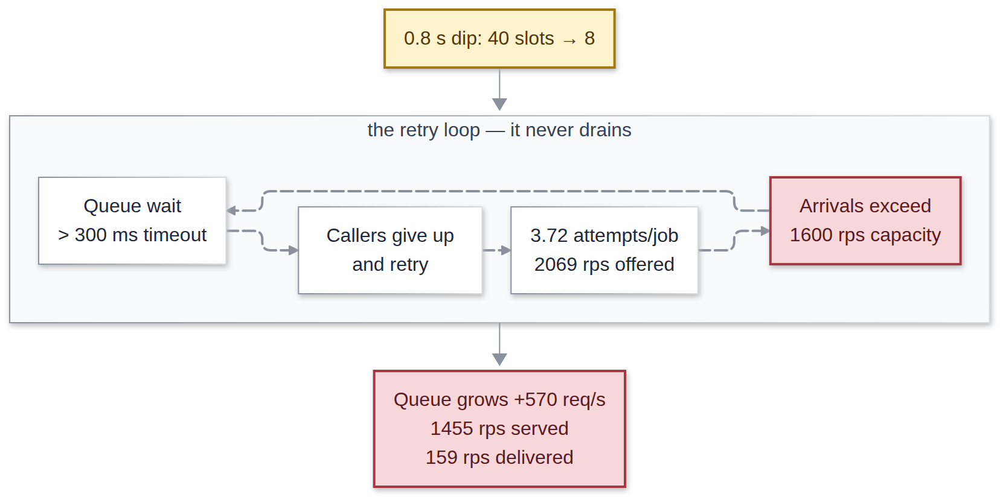
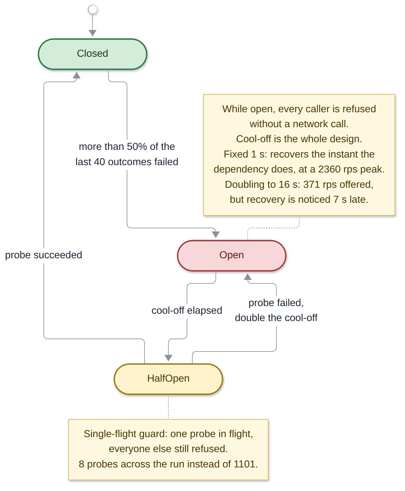
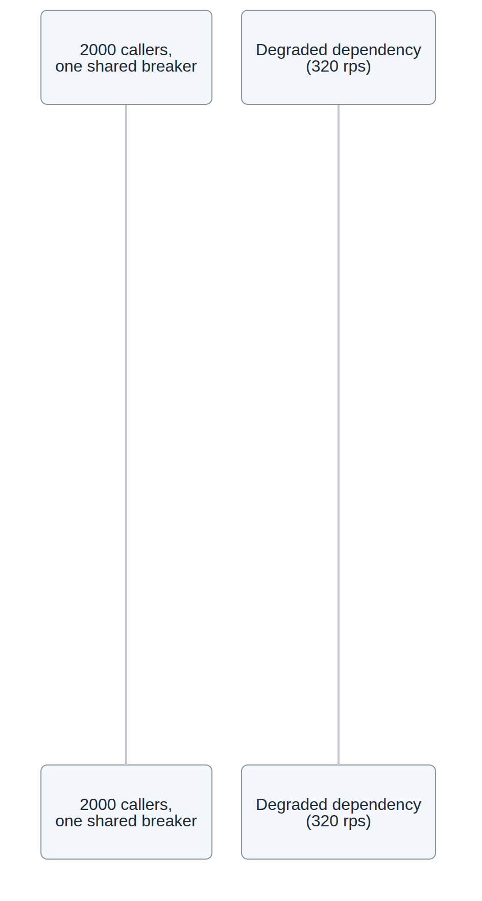

# System Design Interview: Your Downstream Recovers and Immediately Falls Over Again. Why?

#### An 800-millisecond slowdown caused 53 seconds of failures. Jitter, the fix everyone reaches for, made it slightly worse

**By Tihomir Manushev**

*Sep 10, 2026 · 9 min read*

---

An integrations team at a freight-forwarding platform, hiring a senior backend engineer. The interviewer is Mateo.

Ask how to handle a shaky service and almost everyone first says: retry, and wait a little longer each time. What that leaves out is that a retry isn't a repair. It's more traffic, sent to the thing that's already struggling, so the callers decide how long the outage lasts.

Everything below ran on Python 3.12 and aiohttp 3.9.1, 2000 concurrent callers against a single-process rate service, on a Ryzen 5 3600.

---

### The question

**Mateo:** Every order in our system asks a pricing service for carrier rates. Two thousand callers, one service. The service slows down for less than a second. What do you do?

**Tihomir:** Retry. Each attempt gets a timeout, and the wait between attempts doubles so I'm not hammering it. That's exponential backoff, and I've shipped it more than once.

**Mateo:** What does the service look like in your test?

**Tihomir:** Forty slots at 25 milliseconds a lookup, so 1600 requests a second. It never turns work away, it just queues it. The incident is one line: eight slots for 800 milliseconds.

```python
import asyncio


HEALTHY_SLOTS = 40
DEGRADED_SLOTS = 8
WORK_SECONDS = 0.025


class SlotPool:
    """Concurrency limit for the rate service. Nothing sheds load."""

    def __init__(self, capacity: int):
        self.capacity = capacity
        self.in_use = 0
        self.waiting = 0
        self.gate = asyncio.Condition()

    async def acquire(self) -> None:
        async with self.gate:
            self.waiting += 1

            try:
                while self.in_use >= self.capacity:
                    await self.gate.wait()
            finally:
                self.waiting -= 1

            self.in_use += 1

    async def release(self) -> None:
        async with self.gate:
            self.in_use -= 1
            self.gate.notify(1)

    async def resize(self, capacity: int) -> None:
        """The incident: 40 slots become 8 for 800 ms, then 40 again."""
        async with self.gate:
            self.capacity = capacity
            self.gate.notify(capacity)


async def quote(pool: SlotPool) -> str:
    """One rate lookup: queue for a slot, then do the work."""
    await pool.acquire()

    try:
        await asyncio.sleep(WORK_SECONDS)
        return "ok"
    finally:
        await pool.release()
```

**Mateo:** And the callers?

**Tihomir:** The way almost everyone writes them: a 300-millisecond timeout and up to five attempts.

```python
import aiohttp

QUOTE_URL = "http://127.0.0.1:8091/quote"
ATTEMPT_TIMEOUT = 0.300
MAX_ATTEMPTS = 5
BACKOFF_BASE = 0.100
BACKOFF_CAP = 2.000


def backoff(attempt: int) -> float:
    """Textbook exponential backoff: 100, 200, 400, 800 ms."""
    return min(BACKOFF_CAP, BACKOFF_BASE * (2 ** (attempt - 1)))


async def call_once(session: aiohttp.ClientSession) -> bool:
    """One attempt. A timeout and a 503 are the same thing to the caller."""
    try:
        async with session.get(QUOTE_URL) as resp:
            await resp.read()
            return resp.status == 200
    except (aiohttp.ClientError, asyncio.TimeoutError):
        return False


async def fetch_rate(session: aiohttp.ClientSession) -> bool:
    """The answer everyone gives: retry with exponential backoff."""
    for attempt in range(1, MAX_ATTEMPTS + 1):
        if await call_once(session):
            return True

        if attempt < MAX_ATTEMPTS:
            await asyncio.sleep(backoff(attempt))

    return False
```

**Mateo:** How busy is it on a normal day?

**Tihomir:** 1200 requests a second, 75% of what it can handle, and no queue to speak of. That spare quarter is the only reason this design looks safe.

---

### The first trap

**Mateo:** Then run the dip.

**Tihomir:** The service was healthy again at 6.8 seconds. My callers were still failing at 60 seconds, when I stopped the run.

```
exponential backoff, no jitter — 0.8 s of degradation
  attempts per job                   3.72
  sustained arrivals, t=10-55 s      2069 rps
  served by the pool                 1455 rps
  delivered to a caller who waited    159 rps
  failed jobs                       18880 of 33667
  last failure                       60.0 s (run ended)
  queue depth at t=7 s                1251
  queue depth at t=60 s              31741
```

**Mateo:** Hold on. The service recovered, and the queue still went from 1251 to 31741?

**Tihomir:** And it never turned around: roughly 570 more every second, for 53 seconds. I expected a bump, not that.

**Mateo:** Why didn't it drain once the slots came back?

**Tihomir:** The dip pushed queue waits past my 300-millisecond timeout, and every timeout turned into a retry. Each job ended up making 3.72 attempts.

**Mateo:** Against a service that does 1600 a second.

**Tihomir:** So it was getting about 2,070 a second and could never catch up. After 6.8 seconds the service wasn't the problem. I was.



**Mateo:** So the retries fill the queue, and the queue makes more retries.

**Tihomir:** And nothing in that loop pushes back. The slowdown only has to cross the timeout once; a 10-second outage behaved the same way.

**Mateo:** The pool still served 1455 a second. Who got those answers?

**Tihomir:** Mostly nobody. 82.6% of the work it finished was for a caller who'd already timed out and moved on.


**Mateo:** Doesn't the timeout cancel the request?

**Tihomir:** No, it's just a stopwatch on the caller's side. It stops the waiting, not the work. The request keeps its place in line, gets served two seconds later, and the answer goes to a connection nobody's reading.

---

### Jitter

**Mateo:** Fix it.

**Tihomir:** The standard advice is full jitter. Instead of every caller waiting exactly 200 milliseconds before its second retry, each waits a random time between zero and 200, so they stop arriving in lockstep.

```python
import random


def backoff_jittered(attempt: int) -> float:
    """Full jitter: sleep somewhere inside the window, not on its edge."""
    window = min(BACKOFF_CAP, BACKOFF_BASE * (2 ** (attempt - 1)))

    return random.uniform(0, window)
```

**Mateo:** Did it help?

**Tihomir:** It made things slightly worse.

```
                        no jitter    full jitter
  attempts per job           3.72           3.86
  sustained arrivals      2069 rps       2183 rps
  dead work                 82.6%          83.1%
  failed jobs              18880          21964
  queue at t=60 s          31741          37612
  recovered                 never          never
```

**Mateo:** Three thousand more failed jobs. Why didn't it help at all?

**Tihomir:** Because jitter changes *when* retries arrive, not *how many*. My traffic was never a spike. It was a steady 2069 a second against 1600, and spreading it out leaves the same gap.

**Mateo:** Okay, that's why it isn't better. Why is it worse?

**Tihomir:** A random wait is, on average, half the full one. So callers came back sooner and squeezed in more attempts, 3.86 instead of 3.72.

**Mateo:** So jitter's useless.

**Tihomir:** No, it's just not the fix here. It's for everyone showing up at the same instant: a shared cron job, a cache expiring everywhere at once, clients reconnecting after a deploy. I reached for it out of reflex, and this was a volume problem.

---

### The second trap

**Mateo:** Then cut the volume.

**Tihomir:** With a retry budget. Every success puts a fifth of a token into a shared bucket, and every retry takes a whole token out. If the service is failing outright, nothing goes in, so retries stop on their own.

```python
class RetryBudget:
    """Retries are paid for by successes, so a total outage stops them."""

    def __init__(self, ratio: float = 0.2, opening: float = 10.0,
                 ceiling: float = 100.0):
        self.tokens = opening
        self.ratio = ratio
        self.ceiling = ceiling

    def deposit(self) -> None:
        """A success buys a fifth of a future retry."""
        self.tokens = min(self.ceiling, self.tokens + self.ratio)

    def withdraw(self) -> bool:
        """A retry costs a whole token, or it does not happen."""
        if self.tokens < 1.0:
            return False

        self.tokens -= 1.0

        return True


async def fetch_rate_budgeted(session: aiohttp.ClientSession,
                              budget: RetryBudget) -> bool:
    """The first attempt is free. Every retry has to be affordable."""
    for attempt in range(1, MAX_ATTEMPTS + 1):
        if attempt > 1 and not budget.withdraw():
            return False

        if await call_once(session):
            budget.deposit()
            return True

        if attempt < MAX_ATTEMPTS:
            await asyncio.sleep(backoff_jittered(attempt))

    return False
```

**Mateo:** Same 800-millisecond dip?

**Tihomir:** For that, it's the whole fix. The bucket ran dry in under a second, retries stopped, and everything was clean at 8 seconds, 1.2 after the service recovered.

```
retry budget — 0.8 s of degradation
  attempts per job                    1.00
  peak arrivals                    1840 rps
  queue depth, worst bucket             612
  dead work                            2.7%
  failed jobs                          1751 of 70868
  recovered                             8 s
```

**Mateo:** Now make the outage ten seconds.

**Tihomir:** Then it's not the whole fix. The service came back at 16 seconds, and my callers were clean at 32.

```
retry budget — 10 s of degradation
  peak arrivals                    2480 rps
  queue depth, worst bucket            7244
  dead work                           37.0%
  failed jobs                         24369 of 66518
  recovered                            32 s
```

**Mateo:** Sixteen seconds late. With retries capped, what's still filling the queue?

**Tihomir:** First attempts. Two thousand callers kept sending one request each into a slow pool, and every one timed out. By recovery 7244 were waiting, about five seconds of dead work before a live caller gets an answer.

**Mateo:** And those callers never retried.

**Tihomir:** No, about 24,000 jobs failed on their only attempt. Honest, but it's a third of my traffic.

---

### Closing the window

**Mateo:** So stop sending.

**Tihomir:** That's a circuit breaker, one per service, shared by every caller in the process. It watches the last forty results, and if more than half failed, it opens: calls fail right away, without touching the network.

**Mateo:** For how long?

**Tihomir:** For a cool-off. Then it goes half-open and lets exactly one request through as a test, a probe. If that works, the breaker closes again.

```python
import time


class Breaker:
    """One breaker per dependency, shared by every caller in the process."""

    def __init__(self, size: int = 40, threshold: float = 0.5,
                 cool_off: float = 1.0, doublings: int = 4):
        self.outcomes: list[int] = []
        self.size = size
        self.threshold = threshold
        self.cool_off = cool_off
        self.doublings = doublings
        self.state = "closed"
        self.opened_at = 0.0
        self.strikes = 0
        self.probing = False

    def wait_time(self) -> float:
        """Cool-off doubles on every consecutive trip, up to a ceiling."""
        base = self.cool_off * (2 ** min(self.strikes, self.doublings))

        return base * (0.5 + random.random())

    def allow(self) -> bool:
        """False means: fail this call now, without touching the network."""
        if self.state == "closed":
            return True

        if self.state == "open":
            if time.monotonic() - self.opened_at < self.wait_time():
                return False

            self.state = "half-open"
            self.probing = False

        if self.probing:
            return False

        self.probing = True

        return True

    def record(self, ok: bool) -> None:
        """In half-open, one probe decides — not the rolling window."""
        if self.state == "half-open":
            self.probing = False

            if ok:
                self.state, self.strikes = "closed", 0
                self.outcomes.clear()
            else:
                self.state, self.opened_at = "open", time.monotonic()
                self.strikes += 1

            return

        self.outcomes.append(1 if ok else 0)
        del self.outcomes[:-self.size]

        if len(self.outcomes) == self.size:
            if (self.size - sum(self.outcomes)) / self.size > self.threshold:
                self.state, self.opened_at = "open", time.monotonic()
                self.strikes += 1
                self.outcomes.clear()
```

```python
async def fetch_rate_protected(session: aiohttp.ClientSession,
                               budget: RetryBudget,
                               breaker: Breaker) -> bool:
    """The budget caps the volume; the breaker stops the traffic outright."""
    for attempt in range(1, MAX_ATTEMPTS + 1):
        if attempt > 1 and not budget.withdraw():
            return False

        if not breaker.allow():
            return False

        ok = await call_once(session)
        breaker.record(ok)

        if ok:
            budget.deposit()
            return True

        if attempt < MAX_ATTEMPTS:
            await asyncio.sleep(backoff_jittered(attempt))

    return False
```

**Mateo:** Ten seconds down again?

**Tihomir:** This time the service is left alone: 371 requests a second against the 320 it can serve, and only 1.7% of its work wasted.

**Mateo:** And when did it recover?

**Tihomir:** That's the catch. At 23 seconds, seven seconds later than it should have.



**Mateo:** Seven seconds of outage you caused yourself.

**Tihomir:** With the part nobody tunes, the cool-off. Mine doubled after every trip in a row, up to sixteen seconds, so when the service came back the breaker wasn't going to look again for another fifteen.

**Mateo:** Then cool off for a fixed second.

**Tihomir:** I tried it, and it noticed right away: clean at 16 seconds, with no failures for jobs started after recovery. But in that run I'd also let every caller send a probe instead of one at a time, and the service paid for it.

```
half-open admits everyone, fixed 1 s cool-off
  offered load during the outage      401 rps
  peak arrivals                      2360 rps
  probes                             1101
  worst queue depth                  1000
  recovered                            16 s
```



**Mateo:** 1101 probes, to ask one question?

**Tihomir:** In bursts: about 450 requests over 400 milliseconds, then 700 milliseconds of nothing, over and over. Every caller shares one breaker, so they all flip at once.

**Mateo:** Into a service that's still slow.

**Tihomir:** So every burst queues and times out, and the breaker learns nothing a single request couldn't tell it.

**Mateo:** So keep the one-probe rule and the short cool-off.

**Tihomir:** One probe at a time, cool-off capped at two seconds. Eight probes in the whole run instead of 1101, and clean at 21 seconds.

---

### What it costs

**Mateo:** What does the breaker cost you?

**Tihomir:** It refused 10,975 requests without trying them. Failed jobs came to 14,266, against 18,880 for plain backoff.

**Mateo:** So fewer failures.

**Tihomir:** Fewer, but it chose them. Some refused requests would have worked; they were turned away because forty of their neighbours didn't.

**Mateo:** And when the service is fine?

**Tihomir:** Nothing I could measure. The median stayed at 26 milliseconds under every policy, and checking the breaker is one comparison against a clock.

**Mateo:** What about a tiny blip?

**Tihomir:** That's the real cost. A 400-millisecond hiccup can trip it, and then it stays open for the whole cool-off, so the shortest outage you get is the cool-off.

**Mateo:** What haven't you measured?

**Tihomir:** Two things. This is one breaker in one process; I haven't run a hundred processes with a breaker each. Honestly, I don't know whether they'd smooth out the pulse or sync up on the outage the way mine did.

**Mateo:** And the second?

**Tihomir:** The fix I want most and didn't build: deadline propagation. The caller sends how much time it has left with the request, so the server can drop expired work instead of spending 82% of its capacity answering closed connections.

---

### Conclusion

**Mateo:** Sum it up for me.

**Tihomir:** Nothing I did made the service faster. Every number moved because the callers sent less. Four things.

**A retry is extra traffic, and the callers decide how long the outage lasts.** An 800-millisecond slowdown became 53 seconds of failures: 3.72 attempts per job meant 2069 requests a second against 1600 of capacity.

**Jitter changes when retries arrive, not how many.** Every number got a little worse: 3.86 attempts per job, 37612 queued. It's for everyone arriving at once, and this was never a spike.

**A retry budget stops retries and leaves first attempts alone.** It fixed the short dip outright, but ran 16 seconds late on a ten-second outage, because two thousand first attempts still queued.

**A breaker's cool-off is the design, and it should send one probe at a time.** A cool-off doubling to sixteen seconds cost seven seconds of outage, and letting everyone probe sent 450-request bursts. With both fixed: eight probes, clean at 21 seconds.

The question gets asked because retrying really is the right instinct: a dropped packet, a replica failing over or a rolling restart are all fixed by trying again. What the standard answer misses is that backoff only decides how far apart the attempts are, and what keeps an outage going is how many there are. A service that's down isn't helped by anyone asking more often, and only the caller can ask less.
