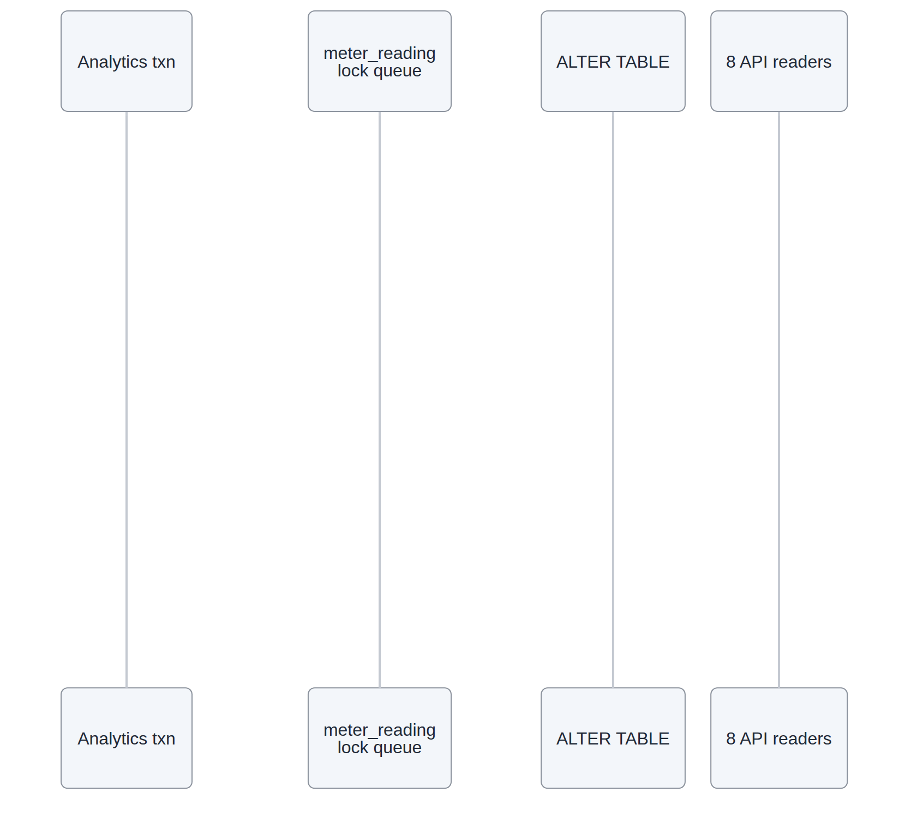
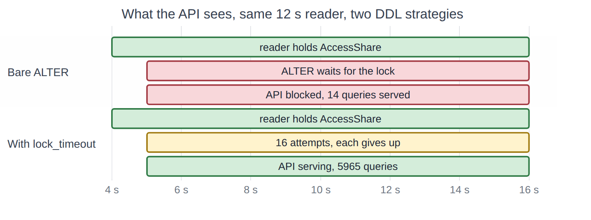
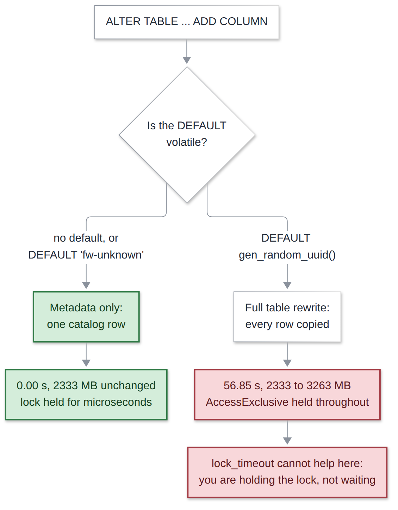
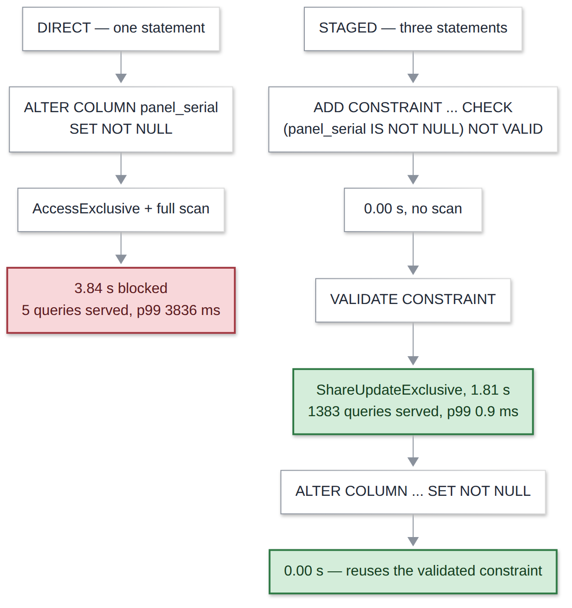

# System Design Interview: How Do You Add a Column to a 200-Million-Row Table Without Downtime?

#### The `ALTER` did its work in 0.00 seconds and still took the API down for eleven. The table was never the problem; the line it waited in was

**By Tihomir Manushev**

*Sep 19, 2026 · 9 min read*

---

A platform team at a solar-monitoring company, hiring a senior backend engineer. The interviewer is Priya.

Everyone knows the answer: in modern Postgres, adding a column is instant, however big the table. That's true, and it's why this migration keeps causing outages. The instant part is a small bookkeeping change, but first the statement has to wait for a lock, and every query that shows up meanwhile gets stuck behind it.

Everything below ran on PostgreSQL 17.6 in Docker, a 20-million-row table of 1.3 GB, and eight concurrent readers, on a Ryzen 5 3600.

---

### The question

**Priya:** Our readings table has 200 million rows and takes 4,000 selects a second. Product wants a `firmware_tag` column on it. How would you do the migration?

**Tihomir:** One statement: `ALTER TABLE meter_reading ADD COLUMN firmware_tag text`. Since Postgres 11 that only touches the catalog, where Postgres describes your tables, so the row count doesn't matter. I'd run it in the deploy window and move on.

**Priya:** You've actually tried that?

**Tihomir:** On a smaller copy. Here's the table.

```sql
CREATE TABLE meter_reading (
    reading_id   bigserial PRIMARY KEY,
    inverter_id  int          NOT NULL,
    read_at      timestamptz  NOT NULL,
    watt_hours   numeric(9,2) NOT NULL,
    dc_volts     numeric(6,2) NOT NULL
);
CREATE INDEX meter_reading_inverter_read_at
    ON meter_reading (inverter_id, read_at);
```

**Priya:** And what's hitting it while you migrate?

**Tihomir:** Eight workers running the API's everyday query: the latest reading for one inverter, straight off the index.

```python
import random
import threading
import time

import psycopg

DSN = "host=127.0.0.1 port=5461 dbname=postgres user=postgres password=demo"
INVERTERS = 40000


def read_latest(conn: psycopg.Connection) -> None:
    """One API-shaped lookup: newest reading for a random inverter."""
    with conn.cursor() as cur:
        cur.execute("SELECT watt_hours FROM meter_reading "
                    "WHERE inverter_id = %s "
                    "ORDER BY read_at DESC LIMIT 1",
                    (random.randint(1, INVERTERS),))
        cur.fetchall()


def traffic_worker(stop: threading.Event,
                   samples: list[tuple[float, float]], t0: float) -> None:
    """Steady load, recording when each query started and how long it took."""
    with psycopg.connect(DSN, autocommit=True) as conn:
        while not stop.is_set():
            started = time.monotonic()
            read_latest(conn)
            samples.append((started - t0, (time.monotonic() - started) * 1000))
            time.sleep(0.01)
```

**Priya:** How does it look before you touch anything?

**Tihomir:** About 780 queries a second, and nothing waits for anything.

**Priya:** How fast is each one?

**Tihomir:** Half finish in 0.22 ms, and the slowest one in a hundred, the p99, takes 0.54 ms.

---

### The first trap

**Priya:** Now an analyst starts a report at the same moment. It reads for twelve seconds and writes nothing. Run your `ALTER`.

**Tihomir:** I did, and it was an outage.

```
bare ALTER, one 12 s analytics transaction, 8 readers
  ALTER wall time                     11.03 s
  ALTER work once it had the lock      0.00 s
  peak backends waiting on the table      9
  seconds with at least one waiter     11.0
  queries served during the ALTER         14
  p50 before / during / after   0.22 / 11016.88 / 0.23 ms
```

**Priya:** Eleven seconds, for a statement that did no work?

**Tihomir:** The work itself took 0.00 seconds. Everything else was waiting, and only 14 queries got through the whole time.

**Priya:** The report only reads, and your `ALTER` only touches the catalog. Why does the API care?

**Tihomir:** Because of the line, not the report. The analyst holds `AccessShare`, the lock every plain read takes. My `ALTER` needs `AccessExclusive`, which shares the table with nobody, so it waits for the report to finish.

**Priya:** Fine, your `ALTER` waits. But the API's reads don't conflict with the report.

**Tihomir:** They don't, but they arrive after my `ALTER`, and Postgres hands out locks in order. Nobody gets to skip ahead of a waiting request, so every reader queues behind my statement.

```
 pid |                     query                      |        mode         | granted
-----+------------------------------------------------+---------------------+---------
 184 | SELECT pg_sleep($1)                            | AccessShareLock     | t
 185 | ALTER TABLE meter_reading ADD COLUMN firmware_ | AccessExclusiveLock | f
 179 | SELECT watt_hours FROM meter_reading WHERE inv | AccessShareLock     | f
 180 | SELECT watt_hours FROM meter_reading WHERE inv | AccessShareLock     | f
 181 | SELECT watt_hours FROM meter_reading WHERE inv | AccessShareLock     | f
 177 | SELECT watt_hours FROM meter_reading WHERE inv | AccessShareLock     | f
 176 | SELECT watt_hours FROM meter_reading WHERE inv | AccessShareLock     | f
 182 | SELECT watt_hours FROM meter_reading WHERE inv | AccessShareLock     | f
 178 | SELECT watt_hours FROM meter_reading WHERE inv | AccessShareLock     | f
 183 | SELECT watt_hours FROM meter_reading WHERE inv | AccessShareLock     | f
```

**Priya:** One lock granted, nine waiting.

**Tihomir:** And eight of them are API reads that would've gone straight through without my `ALTER` in front. Honestly, that caught me: the outage lasts exactly as long as the analyst's report.



**Priya:** So check that no long transactions are running before you deploy.

**Tihomir:** Everyone says that, and I can't enforce it. A dashboard, a backup, a crashed worker that left a transaction open: I can't vouch for the whole fleet at deploy time.

**Priya:** Then what can you control?

**Tihomir:** How long I'm willing to wait.

---

### Bounding the wait

**Priya:** By default Postgres will wait as long as it takes.

**Tihomir:** Unless you set `lock_timeout`. If the lock isn't free within a quarter of a second, the statement gives up, and I sleep and try again. I set it only on the migration's own session, never on the connection pool.

```python
def add_column_with_retry(sql: str, timeout_ms: int = 250,
                          attempts: int = 60) -> int | None:
    """Try the DDL, but never queue for more than timeout_ms at a time."""
    for attempt in range(1, attempts + 1):
        try:
            with psycopg.connect(DSN, autocommit=True) as conn:
                with conn.cursor() as cur:
                    cur.execute(f"SET lock_timeout = {timeout_ms}")
                    cur.execute(sql)

            return attempt
        except psycopg.errors.LockNotAvailable:
            time.sleep(0.5)

    return None
```

**Priya:** With the same analyst still running?

**Tihomir:** The migration took a bit longer, and the API barely noticed.

```
                              bare ALTER   lock_timeout 250 ms
  attempts                             1                    16
  wall time to succeed             11.03 s              11.38 s
  seconds with at least one waiter    11.0                   3.7
  queries served in that window         14                  5965
  p99 during                    11022.22 ms            243.16 ms
  errors returned to clients             0                     0
```



**Priya:** Sixteen tries, and it still got in?

**Tihomir:** Every try timed out while the report ran, and one got in right after it finished. Meanwhile the API served 5,965 queries in that window instead of 14.

**Priya:** Your p99 is still 243 milliseconds, though.

**Tihomir:** Each try builds the same line, just a short one, and the readers behind it wait too. Add those up and it's 3.7 seconds of slow requests instead of 11 seconds of nothing.

**Priya:** So make the timeout smaller.

**Tihomir:** Each try would hurt less, but it'd also have less chance of ever getting the lock.

**Priya:** And if it never gets it?

**Tihomir:** Then the migration fails and the deploy stops, which is why I cap the attempts. The failure went from "the API is down" to "the migration didn't run", and that one I can retry at 3 a.m.

---

### The second trap

**Priya:** Product's back. They want the column filled with a unique identifier for every row.

**Tihomir:** Then my first answer was wrong. "Instant" was never about `ADD COLUMN`; it's about the default.

**Priya:** What's the difference?

**Tihomir:** A constant default is stored once, in the catalog, and old rows read it from there. `gen_random_uuid()` gives every row its own value, so Postgres writes a whole new copy of the table.

```
20M rows, 2333 MB total, each statement timed with traffic running
  ADD COLUMN firmware_tag text                       0.00 s   2333 -> 2333 MB
  ADD COLUMN ... DEFAULT 'fw-unknown'                0.00 s   2333 -> 2333 MB
  ADD COLUMN ... DEFAULT gen_random_uuid()::text    56.85 s   2333 -> 3263 MB
  ALTER COLUMN watt_hours TYPE numeric(12,2)         0.00 s   3263 -> 3263 MB
```

**Priya:** Almost a minute. What did the API see?

**Tihomir:** Almost nothing. Only 160 queries got through in that minute, and the slowest one waited 56,634 ms, basically the whole rewrite.

**Priya:** Your `lock_timeout` should've caught that.

**Tihomir:** I expected it to, and it doesn't. The timeout limits how long you wait to get a lock, not how long you hold it. I got this one in milliseconds and then sat on it for a minute.



**Priya:** So how do you fill the column?

**Tihomir:** Add it with no default, which is a catalog change. Then backfill: fill the existing rows in small batches, each in its own short transaction.

**Priya:** And new rows?

**Tihomir:** After the backfill I add the default. That only touches the catalog too, and it applies to rows inserted from then on.

**Priya:** Your last line says making `watt_hours` a wider `numeric` cost nothing. Is every type change free?

**Tihomir:** No, and that's a trap of its own. Postgres skips the rewrite only when the bytes on disk stay the same, like more `numeric` precision, or `varchar(n)` to a longer `varchar` or `text`. Going the other way, or `int` to `bigint`, rewrites the table and every index. In a migration file the two look identical, so I check each conversion.

---

### Making it NOT NULL

**Priya:** Last thing. The backfill's done and now you want the column `NOT NULL`.

**Tihomir:** The obvious statement reads all 20 million rows to check, holding `AccessExclusive` throughout. That's the first trap again.

```
  ALTER COLUMN panel_serial SET NOT NULL
      3.84 s, 5 queries served, p99 3836.76 ms
```

**Priya:** Under four seconds. Is that so bad?

**Tihomir:** For the API it's almost four seconds of nothing. Five queries got through.

**Priya:** What's the version that doesn't block?

**Tihomir:** Split the check from the enforcement. First add a `CHECK` constraint marked `NOT VALID`, meaning "enforce this on new rows, but don't look at the old ones yet." That reads nothing, so it's instant.

**Priya:** And the old rows?

**Tihomir:** `VALIDATE CONSTRAINT` scans them under `ShareUpdateExclusive`, a lock that lets reads and writes carry on. Then `SET NOT NULL` finds a validated constraint that already proves the point, and skips its own scan.

```sql
ALTER TABLE meter_reading
    ADD CONSTRAINT panel_serial_present
    CHECK (panel_serial IS NOT NULL) NOT VALID;      -- 0.00 s
ALTER TABLE meter_reading VALIDATE CONSTRAINT panel_serial_present;
ALTER TABLE meter_reading ALTER COLUMN panel_serial SET NOT NULL;
```

```
  ADD CONSTRAINT ... NOT VALID    0.00 s      0 queries blocked
  VALIDATE CONSTRAINT             1.81 s   1383 queries served, p99 0.9 ms
  SET NOT NULL                    0.00 s      0 queries blocked
```

**Priya:** So the scan still happens.

**Tihomir:** It does, for about 1.8 seconds. The difference is that the API served 1,383 queries during it, where the direct version served five.

**Priya:** And how slow were they?

**Tihomir:** A p99 of 0.9 ms, barely above normal. Nobody here cares how much work the migration does, only how long the API was blocked.



---

### What it costs

**Priya:** You turned one line into a project.

**Tihomir:** Pretty much. Four statements across three deploys, plus a backfill job with its own batching and its own monitoring.

**Priya:** Anything left behind?

**Tihomir:** The `CHECK` constraint, which duplicates the `NOT NULL` and should be dropped. And every migration now needs `lock_timeout` and a retry loop, which is real code in the tooling, not a line in a runbook.

**Priya:** What didn't you measure?

**Tihomir:** My table was 20 million rows, not 200. The lock line doesn't care about rows, but the rewrite and the scan do, so that 56.85-second rewrite would take roughly ten times as long.

**Priya:** Your traffic only read, too.

**Tihomir:** Right. Writers take `RowExclusive`, which also conflicts with `AccessExclusive`, so I'd expect the same line, but I haven't run it.

**Priya:** What about replicas?

**Tihomir:** That one worries me. The `AccessExclusive` lock goes into the WAL, the log every standby replays, so each replica takes it too and can cancel queries or stall replay, depending on `max_standby_streaming_delay`. A migration nobody notices on the primary can be an outage on a replica, and I haven't measured that at all.

---

### Conclusion

**Priya:** If you had a minute to explain this to the team?

**Tihomir:** Four things.

**The line is the outage, not the rewrite.** An `ALTER` that did 0.00 seconds of work blocked the table for 11.03 seconds, because nine sessions queued behind one 12-second report and Postgres doesn't let anyone skip the line.

**`lock_timeout` turns an outage into a retry.** Sixteen tries at 250 ms each let the API serve 5,965 queries in that window instead of 14, and the worst case became "the deploy failed."

**"Instant" describes the default, not the statement.** A constant default lives in the catalog; `gen_random_uuid()` rewrote 20 million rows in 56.85 seconds, grew the table by 930 MB and held the lock the whole time, and `lock_timeout` can't help when you're the one holding it.

**`NOT VALID` then `VALIDATE` costs one more statement and keeps the API up.** The scan took 1.81 seconds under a lock that blocks nothing, against 3.84 seconds under one that blocks everything.

This question gets asked because the modern answer really is right: adding a column doesn't rewrite your table anymore. What it leaves out is that getting the lock and doing the work are separate problems with separate fixes. Everyone optimises the work, and the work was already fast.
