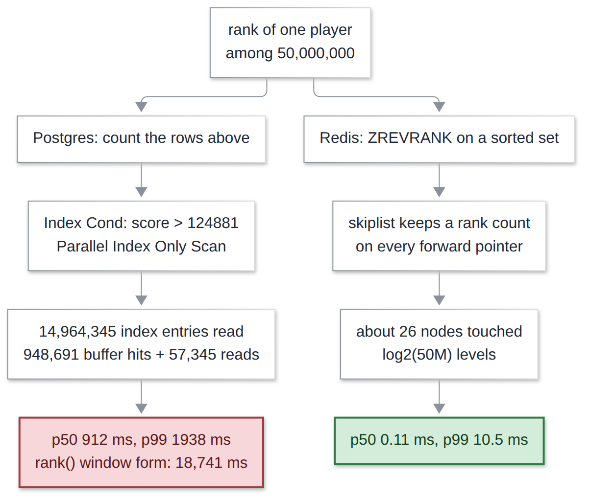
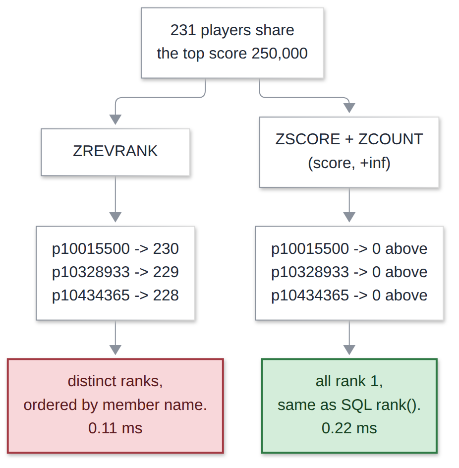
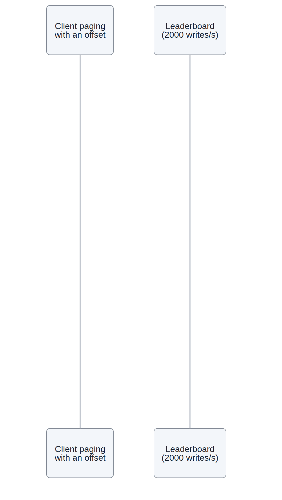
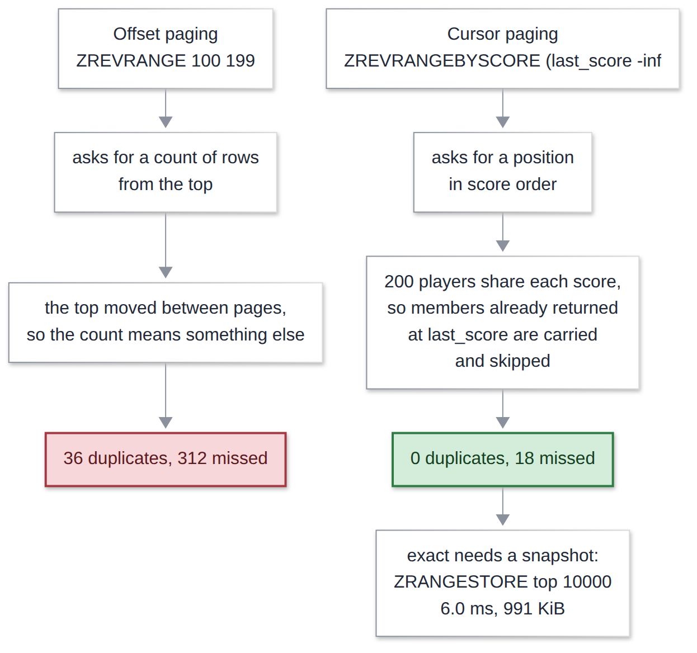

# System Design Interview: How Would You Show a Player Their Rank Among 50 Million Players?

#### Counting the players above you read nearly 15 million index entries to produce one number. The fix answers in 0.11 ms and ranks tied players alphabetically

**By Tihomir Manushev**

*Sep 21, 2026 · 9 min read*

---

A live-ops team at a mobile puzzle-game studio, hiring a senior backend engineer. The interviewer is Kwame.

Rank looks like the cheapest number on a profile screen: one integer, from a column you already index. The usual answer is to count the players above you and add one. It's short, and its cost hides well: it reads one index entry per player ahead of you, which for a typical player is half the table.

Everything below ran on PostgreSQL 17.6 and Redis 8 in Docker, 50 million players, on a Ryzen 5 3600.

---

### The question

**Kwame:** Fifty million players, each with a score. Every one of them opens a profile screen that shows their rank. How would you work it out?

**Tihomir:** Count the players with a higher score and add one. With an index on the score, Postgres can answer that from the index alone, without touching the table. I've shipped exactly this.

```sql
CREATE TABLE player_score (
    player_id  bigint PRIMARY KEY,
    handle     text   NOT NULL,
    score      int    NOT NULL,
    updated_at timestamptz NOT NULL DEFAULT now()
);
CREATE INDEX player_score_desc ON player_score (score DESC, player_id);
```

```sql
SELECT count(*) + 1 FROM player_score
WHERE score > (SELECT score FROM player_score WHERE player_id = $1);
```

**Kwame:** On fifty million rows, though. How long does one player wait?

**Tihomir:** I timed it for 40 random players, and it's worse than I expected.

```
rank of one player among 50,000,000, 40 random players
method                        p50 ms    p99 ms    max ms   calls
postgres count(*) above       911.97   1937.66   1937.66      40
postgres rank() window      18740.59  19828.92  19828.92       5
redis ZREVRANK                  0.11     10.50     10.50      40
```

**Kwame:** Nearly a second? From the index alone?

**Tihomir:** That was my reaction too. Reading only the index tells you where it reads, not how much.

```
->  Parallel Index Only Scan using player_score_desc on player_score
      (actual time=2.656..667.149 rows=4988115 loops=3)
      Index Cond: (score > (InitPlan 1).col1)
      Heap Fetches: 0
      Buffers: shared hit=948691 read=57345
```

**Tihomir:** Postgres split the work over three workers, and each one counted 4,988,115 entries. That's nearly 15 million entries, and about a million 8 KB blocks touched, for one number.

**Kwame:** And a player in the middle of the pack?

**Tihomir:** Twenty-five million players above them, and Postgres visits an entry for every one. Skipping the table doesn't make the count any shorter.



**Kwame:** And `rank()`? Almost nineteen seconds?

**Tihomir:** `rank()` is SQL's ranking function, and it ranks all 50 million players, then throws away every row but yours. It's the neatest SQL in the file and the slowest.

---

### The sorted set

**Kwame:** So you need something that doesn't count.

**Tihomir:** A Redis sorted set, which keeps its members in score order. Inside it's a skiplist, a linked list with express lanes, and every express link remembers how many members it jumps over.

**Kwame:** Why does that help?

**Tihomir:** Because your rank is just the jumps added up on the way down to you. That's about 26 steps for 50 million members, instead of 25 million.

```python
import redis

KEY = "leaderboard:global"
pool = redis.Redis(host="127.0.0.1", port=6389, decode_responses=True)


def rank_of(player_id: int) -> int | None:
    """Zero-based rank, best score first."""
    return pool.zrevrank(KEY, f"p{player_id}")


def submit(player_id: int, score: int) -> None:
    """One score update. O(log n), and it keeps rank queries correct."""
    pool.zadd(KEY, {f"p{player_id}": score})
```

**Kwame:** Twenty-six steps sounds good on paper.

**Tihomir:** It holds up: 0.11 ms at the median, against 911.97 for the count. Same answer, without counting anyone.

**Kwame:** The p99 was 10.5 ms, though.

**Tihomir:** That's my Python client and the network round trip, not the sorted set.

**Kwame:** Then the profile screen's done. What did it cost?

**Tihomir:** 4.50 GiB of RAM for 50 million members, which is 97 bytes each. Every member pays for a hash table entry, a skiplist node with its links, and its own name. The score is only eight bytes of that.

**Kwame:** You said same answer. What's the rank of a player tied with four hundred others?

---

### The first trap

**Tihomir:** Then the number's arbitrary, and I only found out by running it. With 50 million players on 250,000 possible scores, about 200 players share each score.

**Kwame:** And at the very top?

**Tihomir:** 231 players on the top score. Here are three of them.

```
the 231 players on score 250,000:
  p10015500    ZREVRANK  230   ZCOUNT above    0
  p10328933    ZREVRANK  229   ZCOUNT above    0
  p10434365    ZREVRANK  228   ZCOUNT above    0
```

**Kwame:** So the best player in the game is ranked 231st.

**Tihomir:** One of them is, and which one depends on the name. When scores are equal, a sorted set orders members alphabetically, so every tied player gets a different rank. Postgres's `rank()` says all 231 are first.

**Kwame:** Which one's right?

**Tihomir:** Neither, really. It's a product question, and the bug is that nobody asked it. Either everyone tied shares first place and the next score is 232nd, which is called competition rank, or you number them in one fixed order, which is ordinal rank.

**Kwame:** Alphabetical is a fixed order.

**Tihomir:** Not one I'd defend. First place shouldn't go to whoever's player id happens to sort last.



**Kwame:** Then give me competition rank out of Redis.

**Tihomir:** Instead of asking for my position, I ask for my score and count the members with a higher one. Two commands instead of one, and it matches `rank()` exactly.

```python
def competition_rank(player_id: int) -> int | None:
    """Rank that gives every tied player the same number, like SQL rank()."""
    score = pool.zscore(KEY, f"p{player_id}")
    if score is None:
        return None
    return pool.zcount(KEY, f"({score}", "+inf") + 1
```

```
ZREVRANK (ordinal)              p50   0.11 ms   p99   1.18 ms
ZSCORE + ZCOUNT (competition)   p50   0.22 ms   p99   0.87 ms
```

**Kwame:** Twice as slow.

**Tihomir:** Twice as slow and still 0.22 ms, for two round trips. And all 231 top players get rank 1.

**Kwame:** What if product wants ordinal rank?

**Tihomir:** Then I'd fold a tiebreaker into the score itself, like when the player reached it. Ties get broken by time instead of by name.

---

### The second trap

**Kwame:** The client also wants the top 10,000, a hundred at a time. Scores keep changing, about two thousand a second.

**Tihomir:** Then the pages won't line up, and I measured it: half the updates climb into the part being paged, and half drop out.

```
paging the top 10,000 in pages of 100, 2000 score updates/s into the same region
method                     rows   unique  dupes  missed   writes
ZREVRANGE + offset        10000     9964     36     312     2000
cursor on (score, id)     10000    10000      0      18     2100
```

**Kwame:** 312 missed? Out of the top 10,000?

**Tihomir:** 312 players who were in the top 10,000 before I started and after I finished, and never showed up on a page. Paging by offset means "skip the first 200 rows", and the rows keep moving.

**Kwame:** Moving how?

**Tihomir:** Someone climbs above my page, everyone below shifts down one, and I fetch the same row twice. Someone drops out, everyone shifts up one, and a player slides back onto a page I've already read, so I never see them.



**Kwame:** And the cursor?

**Tihomir:** A cursor remembers where I stopped instead of how many rows I've read. I carry the last score I saw and pick up from there, and the duplicates went to zero.

```python
def page_after(cursor_score: float | str, seen_at_score: set[str],
               page: int = 100) -> list[tuple[str, float]]:
    """One page below a (score, member) cursor, ties carried across pages."""
    rows = pool.zrevrangebyscore(KEY, cursor_score, "-inf",
                                 start=0, num=page + len(seen_at_score),
                                 withscores=True)
    return [(m, s) for m, s in rows if m not in seen_at_score][:page]
```

**Kwame:** What's the `seen_at_score` set for?

**Tihomir:** Redis can only pick up from a score, and about 200 players share each one. Starting again at the last score returns that whole group, so I pass along the ones I've already shown and skip them.

**Kwame:** And without it?

**Tihomir:** That was my first version. It went round the same tie group forever and returned 200 unique players out of 10,000 rows.



**Kwame:** You still missed eighteen.

**Tihomir:** And a cursor can't fix that. A player who climbs above where I've already been can't appear, because I never go back. Exact pages need a snapshot: copy the top 10,000 into a temporary key with `ZRANGESTORE` and page that.

```
ZRANGESTORE top 10000    6.0 ms, 10,000 members, +991 KiB
```

**Kwame:** For every person who pages?

**Tihomir:** Six milliseconds and about a megabyte each time, yes. The pages agree with each other, but they're as old as the snapshot.

---

### Players near me

**Kwame:** Last screen: the five players above you and the five below.

**Tihomir:** That one's free in Redis and brutal in SQL.

```
eleven rows centred on a random rank, 40 samples
  redis ZREVRANGE rank-5..rank+5   p50      0.13 ms   p99      1.96 ms
  postgres ORDER BY ... OFFSET n   p50   1062.55 ms   p99   4191.94 ms
```

**Kwame:** Over a second in Postgres?

**Tihomir:** For a player at rank 25 million, `OFFSET` walks past 25 million index entries before it returns anything. A sorted set already knows every position, so a slice around your rank costs the same as a slice from the top.

---

### What it costs

**Kwame:** So Redis wins every screen. What's the catch?

**Tihomir:** 4.50 GiB of RAM, and a second system to run. The real scores stay in Postgres, and Redis is a copy I have to be able to rebuild, which took 330 seconds for 50 million members.

**Kwame:** Two copies of every score. Which one wins when they disagree?

**Tihomir:** Postgres. Every score update is now two writes, so I'd write Postgres first and treat a failed `ZADD` as a repair job, not an error the player sees.

**Kwame:** And how often is the rank you show wrong?

**Tihomir:** It's right when you read it and stale a moment later. That's fine for a profile screen, not for paying out a tournament. For that I'd snapshot at the deadline with the same `ZRANGESTORE` trick.

**Kwame:** What haven't you measured?

**Tihomir:** Sharding, and it's the hole in this design. Rank is global, so if you split players across servers, "how many are above me" means asking every server and adding up. Redis Cluster doesn't help, because it's still one key.

**Kwame:** So what happens at a hundred million?

**Tihomir:** I'd expect to need counters per score range on top, and I haven't built that.

**Kwame:** Anything else?

**Tihomir:** Saving to disk. I turned it off so the measurements were clean, and the pause while Redis snapshots a 4.5 GiB set is something I didn't measure.

---

### Conclusion

**Kwame:** Sum it up for me.

**Tihomir:** Four things.

**Counting the players above you gets slower with every player ahead of you.** Nearly 15 million index entries and 911.97 ms at the median for one number, and `rank()` took 18.7 seconds.

**A sorted set answers in 0.11 ms because it keeps the counts as it goes.** About 26 steps instead of 25 million rows, for 97 bytes a member and 4.50 GiB in total.

**`ZREVRANK` quietly breaks ties alphabetically.** 231 players share the top score and Redis gave each a different rank, while `ZSCORE` plus `ZCOUNT` costs 0.22 ms and matches SQL `rank()`.

**Offsets drift when scores move.** Paging the top 10,000 under 2,000 updates a second showed 36 players twice and never showed 312; a cursor made it 0 and 18, and a 6 ms snapshot closes the rest.

The usual query isn't wrong: it returns the right number every time. What it hides is that its cost grows with how many players are better than you, so it's slowest for exactly the players who are doing badly, and there are always more of those. Rank is something to keep up to date as scores change, not something to compute when asked.
