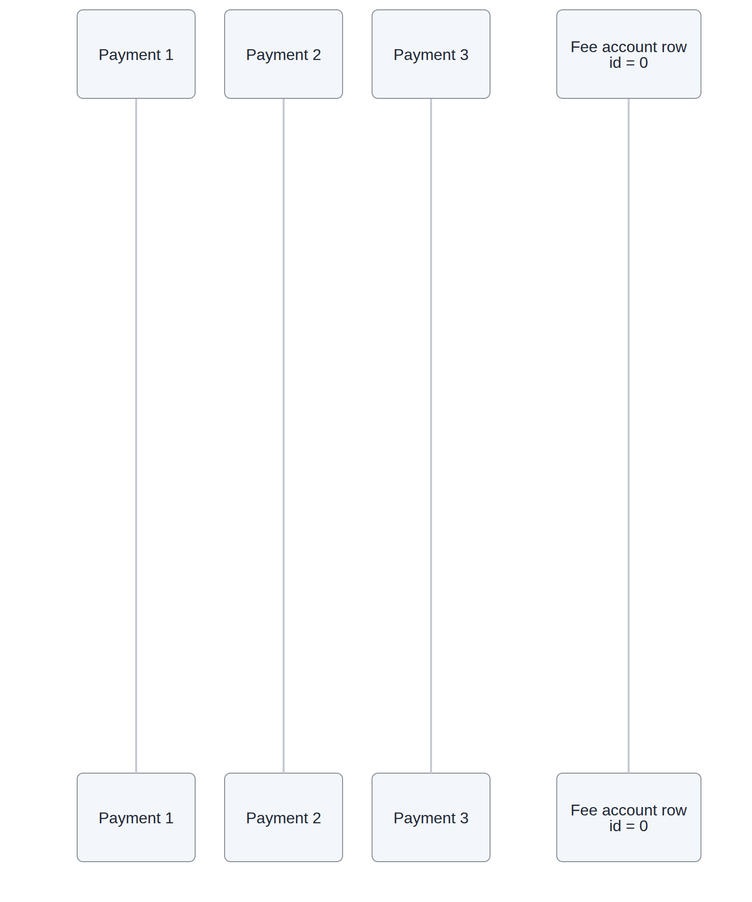
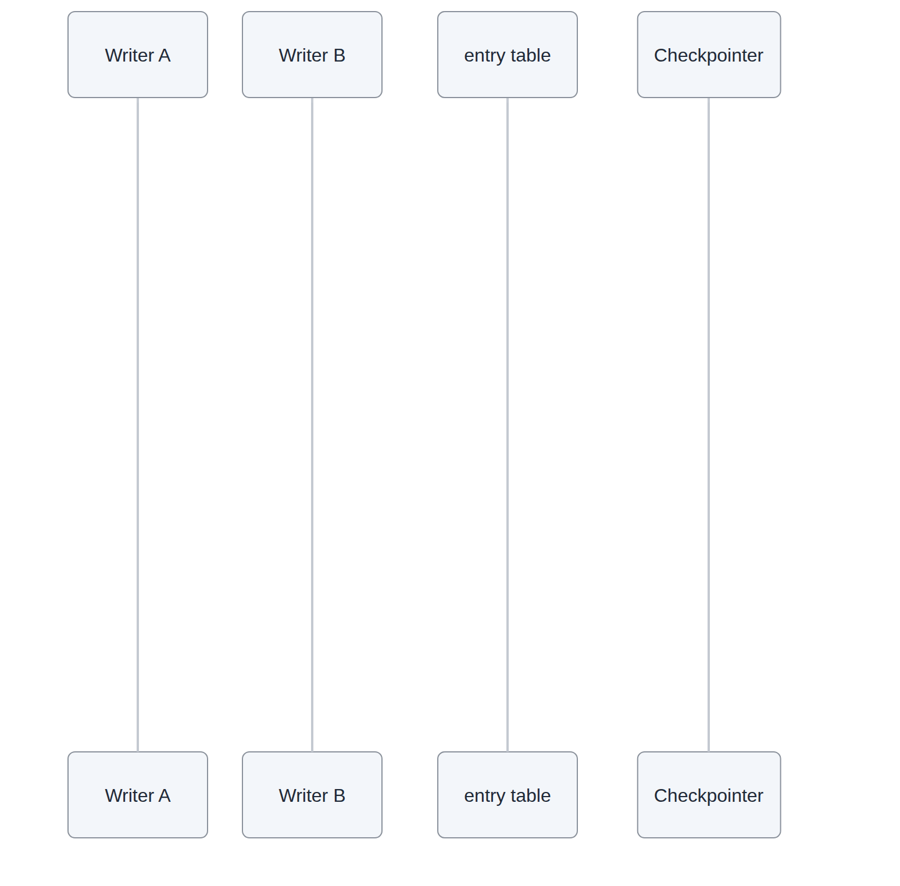
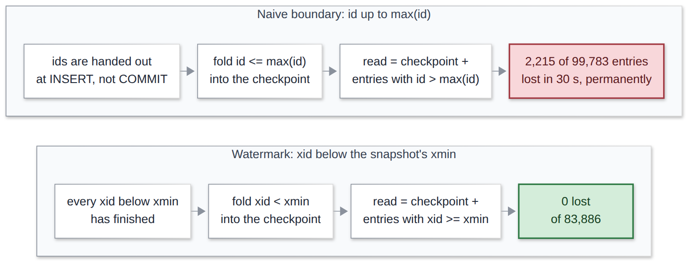

# System Design Interview: Where Does an Account Balance Actually Live?

#### One fee account made 32 clients exactly as fast as one. The checkpoint that fixed it lost 2,215 entries in 30 seconds, and nothing complained

**By Tihomir Manushev**

*Oct 3, 2026 · 8 min read*

---

A ledger team at a freelance marketplace, hiring a senior backend engineer. The interviewer is Leilani.

Where does a balance live? The usual answer is a column on the account, updated in the same transaction that writes the ledger row. That's right for a client's wallet, and wrong for the one account every payment touches. The usual way out is to work the balance out from the log and keep a checkpoint so the sum stays short, and that design has a race that loses money without raising an error.

Everything below ran on PostgreSQL 17.6 in Docker, with Python 3.12 and psycopg 3.2, on a Ryzen 5 3600 with an NVMe drive.

---

### The question

**Leilani:** Clients pay freelancers through us, and we keep two percent. So every payment takes money from a client's wallet, pays the freelancer and pays our fee account. Where does each balance live?

**Tihomir:** In a column on the account row, changed in the same transaction that adds the ledger entries. The withdrawal has the check built in: it only updates the row if the balance covers it, so an overdraft updates zero rows. Here's the script I ran through pgbench, Postgres's load tester.

```sql
\set wallet random(1, 1000000)
\set merchant random(1000001, 1010000)
\set amount random(100, 5000)
BEGIN;
UPDATE account SET balance = balance - :amount WHERE id = :wallet AND balance >= :amount;
UPDATE account SET balance = balance + :amount - :amount / 50 WHERE id = :merchant;
UPDATE account SET balance = balance + :amount / 50 WHERE id = 0;
INSERT INTO entry (account_id, amount)
VALUES (:wallet, -:amount), (:merchant, :amount - :amount / 50), (0, :amount / 50);
COMMIT;
```

**Leilani:** Why keep a column at all? The log already has every entry.

**Tihomir:** Because the no-overdraft rule needs something to lock. I sent eight 60-cent debits at the same moment to a wallet holding 100 cents, three times for each design.

```
SUM check, then append  debits accepted 8/8  balance 100 -> -380 cents
conditional UPDATE     debits accepted 1/8  balance 100 -> 40 cents
SUM check, then append  debits accepted 8/8  balance 100 -> -380 cents
conditional UPDATE     debits accepted 1/8  balance 100 -> 40 cents
SUM check, then append  debits accepted 8/8  balance 100 -> -380 cents
conditional UPDATE     debits accepted 1/8  balance 100 -> 40 cents
```

**Leilani:** Eight out of eight?

**Tihomir:** When each debit sums the log first and then appends, yes. All eight see 100 cents, all eight go through, and the wallet ends at minus 380.

**Leilani:** And the column?

**Tihomir:** One out of eight. The conditional `UPDATE` locks the row, so the other seven wait, and once the first one commits they see 40 cents and update nothing. So the column isn't just a copy of the log, it's the thing the rule locks.

---

### The first trap

**Leilani:** Now the fee account. How many payments touch it?

**Tihomir:** All of them. Every payment updates that one row.

**Leilani:** So they all queue for it.

**Tihomir:** That's what I wanted to see. I ran three rounds of 30-second tests with the setups mixed together, and the table shows the median, then every run. `pay_nofee` is the same payment without the fee, and `pay_hot_append` writes the fee as a new entry only.

```
pay_nofee         1 clients     327 tps    3.055 ms avg  fee-row wait      - ms   runs: 320 327 1597 
pay_nofee        32 clients    5515 tps    5.803 ms avg  fee-row wait      - ms   runs: 4992 5515 22029 
pay_hot_column    1 clients     327 tps    3.058 ms avg  fee-row wait  0.061 ms   runs: 326 327 502 
pay_hot_column    8 clients     355 tps   22.504 ms avg  fee-row wait 19.517 ms   runs: 304 355 451 
pay_hot_column   32 clients     325 tps   98.464 ms avg  fee-row wait 94.747 ms   runs: 295 325 455 
pay_hot_column   64 clients     315 tps  203.143 ms avg  fee-row wait 196.919 ms   runs: 275 315 390 
pay_hot_append    1 clients     343 tps    2.916 ms avg  fee-row wait      - ms   runs: 337 343 417 
pay_hot_append   32 clients    5382 tps    5.946 ms avg  fee-row wait      - ms   runs: 5363 5382 5974 
```

**Leilani:** 325 a second at 32 clients?

**Tihomir:** And 327 with one client on its own. Without the fee row, 32 clients did 5,515. I didn't expect the match to be that close.

**Leilani:** Where does the time go?

**Tihomir:** Waiting for the fee row. An average payment at 32 clients took about 98 ms, and 94.7 of those were spent in that queue.

**Leilani:** But why exactly one client's worth?

**Tihomir:** The lock is held until `COMMIT` returns, and `COMMIT` waits until the write-ahead log, the file every change goes to first, is on disk. Normally Postgres flushes many commits in one go, but with the lock only one fee payment is ever committing, so there's nothing to share. You get one flush per payment, however many clients you add.



**Leilani:** Some rows end in a much bigger number. 1,597?

**Tihomir:** That's the first round, before the drive slowed down. One client took about 0.6 ms a payment there, and then commits settled near 3 ms for the rest. I didn't dig into why, so every number I quote is a median.

---

### Append, don't update

**Leilani:** So how do you get the fee row out of the way?

**Tihomir:** Stop updating it. A credit can never be refused, so there's no rule to check and nothing that needs a lock. The fee becomes one more appended entry.

**Leilani:** And that's fast?

**Tihomir:** 5,382 payments a second at 32 clients, within 3% of having no fee at all.

**Leilani:** Then how do you read our balance?

**Tihomir:** `SUM` over its entries. That's always right, and it gets slower forever. I timed it on accounts with ten thousand up to ten million entries.

```
     entries    p50 ms    p99 ms
      10,000      1.10      1.29
     100,000      8.71      9.02
   1,000,000     86.02     88.79
  10,000,000    834.55    895.48
```

**Leilani:** 834 milliseconds at ten million?

**Tihomir:** And it grows in a straight line. At 5,382 payments a second, the fee account collects ten million entries in 31 minutes.

**Leilani:** So you can't sum the whole thing on every read.

**Tihomir:** No, so I'd keep a checkpoint: a stored balance covering every entry up to some point. A read adds only the entries after it, which I'll call the tail, and a background job moves the checkpoint forward every 50 ms.

```sql
WITH prev AS (
    SELECT balance, upto_id, included FROM checkpoint
    WHERE account_id = %(acct)s ORDER BY seq DESC LIMIT 1
), fresh AS (
    SELECT max(e.id) AS upto, coalesce(sum(e.amount), 0) AS amount, count(*) AS n
    FROM entry e, prev
    WHERE e.account_id = %(acct)s AND e.id > prev.upto_id
)
INSERT INTO checkpoint (account_id, seq, balance, upto_id, included)
SELECT %(acct)s, %(seq)s, prev.balance + fresh.amount,
       coalesce(fresh.upto, prev.upto_id), prev.included + fresh.n
FROM prev, fresh
```

---

### The second trap

**Leilani:** Up to what point?

**Tihomir:** The highest entry id the checkpoint has seen.

**Leilani:** Does that hold up with lots of writers?

**Tihomir:** I tested it. Thirty-two writers credited the fee account for 30 seconds while the checkpoint ran every 50 ms, and then I compared its balance with `SUM` over the whole log.

```
mode=naive writers=32 duration=30s checkpoint every 50 ms, 512 checkpoints
committed by writers :    99783 entries    5034118 cents
SUM over the log     :    99783 entries    5034118 cents
checkpoint + tail    :    97568 entries    4923979 cents
lost                 :     2215 entries     110139 cents
```

**Leilani:** It lost entries.

**Tihomir:** 2,215 out of 99,783, which is 110,139 cents. And nothing raised an error, which is the part that got me.

**Leilani:** Where did they go?

**Tihomir:** Ids are handed out at `INSERT`, but rows only become visible at `COMMIT`, and those don't happen in the same order. Say writer A takes id 101 and is still inside its transaction when B takes 102 and commits. The checkpoint sees 102, folds it in and records "up to 102".

**Leilani:** And then A commits.

**Tihomir:** And 101 is below the line. No later checkpoint or read ever looks there again.



**Leilani:** Wait a second before you checkpoint.

**Tihomir:** That shrinks the window without closing it, because any transaction open longer than the wait is lost the same way. I didn't run that version. The stall test later holds one open for 30 seconds, and I wouldn't ship a delay that covers that.

---

### Closing the window

**Leilani:** Then where do you draw the line?

**Tihomir:** At "finished", not "numbered". Postgres already tracks that: `pg_snapshot_xmin(pg_current_snapshot())` is the oldest transaction still running. I'll call it the watermark, because everything below it has committed or rolled back.

**Leilani:** How does an entry know which transaction wrote it?

**Tihomir:** I gave each entry an `xid8` column, the id of the transaction that wrote it, defaulting to `pg_current_xact_id()`. The checkpoint folds every entry below the watermark.

```sql
WITH prev AS (
    SELECT balance, below_xid, included FROM checkpoint
    WHERE account_id = %(acct)s ORDER BY seq DESC LIMIT 1
), mark AS (
    SELECT pg_snapshot_xmin(pg_current_snapshot()) AS below
), fresh AS (
    SELECT coalesce(sum(e.amount), 0) AS amount, count(*) AS n
    FROM entry e, prev, mark
    WHERE e.account_id = %(acct)s
      AND e.xid >= prev.below_xid AND e.xid < mark.below
)
INSERT INTO checkpoint (account_id, seq, balance, below_xid, included)
SELECT %(acct)s, %(seq)s, prev.balance + fresh.amount, mark.below,
       prev.included + fresh.n
FROM prev, mark, fresh
```

**Leilani:** Couldn't the watermark move between reading it and summing?

**Tihomir:** Not here. The checkpoint runs in `REPEATABLE READ`, so both come from the same snapshot, one frozen view of the data. A read then adds the entries at or above the stored watermark.

**Leilani:** Same 30 seconds, same 32 writers?

```
mode=watermark writers=32 duration=30s checkpoint every 50 ms, 479 checkpoints
committed by writers :    83886 entries    4231433 cents
SUM over the log     :    83886 entries    4231433 cents
checkpoint + tail    :    83886 entries    4231433 cents
lost                 :        0 entries          0 cents
```



**Leilani:** Zero.

**Tihomir:** Zero out of 83,886. An entry stays in the tail until its transaction has ended, and only then can the checkpoint fold it.

---

### What it costs

**Leilani:** What's the catch?

**Tihomir:** The watermark can't pass a transaction that's still open, so one forgotten session stops the checkpoint for everyone. I opened a transaction, wrote one row, and left it idle for 30 seconds.

```
  t s  tail entries  read p50 ms
    0            64         1.08
    5           152         2.33
   10         16909        11.00
   15         24416        12.96
   20         33374        21.03
   25         49160        31.16
   30         58322        36.33
   35           168         2.10
   40           141         1.29
```

**Leilani:** The tail went to 58,000.

**Tihomir:** And the read went from about 2 ms to 36. Five seconds after the commit, it was back to normal.

**Leilani:** Thirty seconds is short. What about an hour?

**Tihomir:** At this rate, roughly eight million entries in the tail. That's most of the way back to the 834 ms `SUM` the checkpoint was meant to avoid.

**Leilani:** So how do you stop that?

**Tihomir:** I'd set `idle_in_transaction_session_timeout`, which ends a session left idle inside a transaction, and alert on `age(backend_xid)`, how old the oldest open one is. Those are part of this design, not extras.

**Leilani:** And payouts? We do take money out of the fee account.

**Tihomir:** Credits can only raise that balance, so a payout only has to wait for other payouts. I'd take an advisory lock on the account, a lock Postgres holds by name rather than on a row, then read checkpoint plus tail under it. I haven't measured that path, and it's the first thing I'd load-test before shipping.

---

### Conclusion

**Leilani:** Okay. Give me the short version.

**Tihomir:** Four things.

**The balance column is where the overdraft rule lives.** One of eight debits sent at once got through, against eight of eight when the check read a `SUM`.

**One row in every payment makes 32 clients as fast as one.** 32 clients managed 325 payments a second, one client 327, and the same load without the fee row 5,515.

**A checkpoint has to stop at "finished", not at "numbered".** The highest id lost 2,215 entries in 30 seconds. The transaction watermark lost none.

**The watermark can't move past an open transaction.** Thirty idle seconds grew the tail to 58,322 entries.

The standard answer puts every balance in the same place. Here they live in two. Wallets keep a column, because they need a lock to refuse a debit. The fee account keeps a log, because it never refuses anything and can't afford the lock. So before deciding where a balance lives, ask which accounts are allowed to say no.
