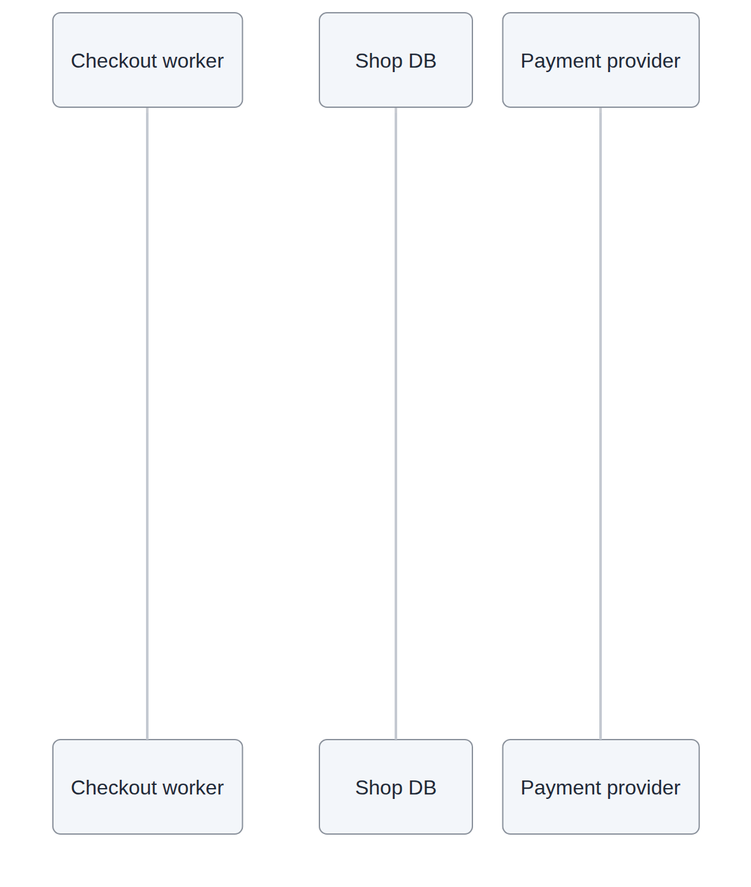
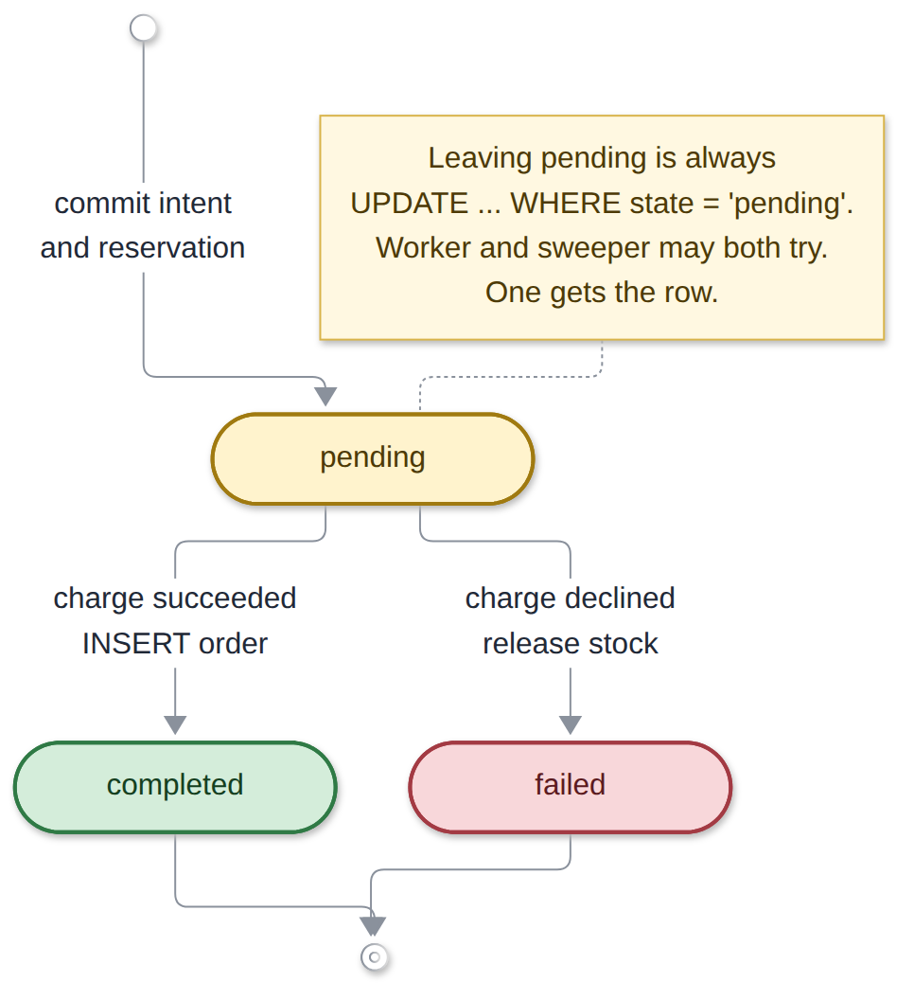
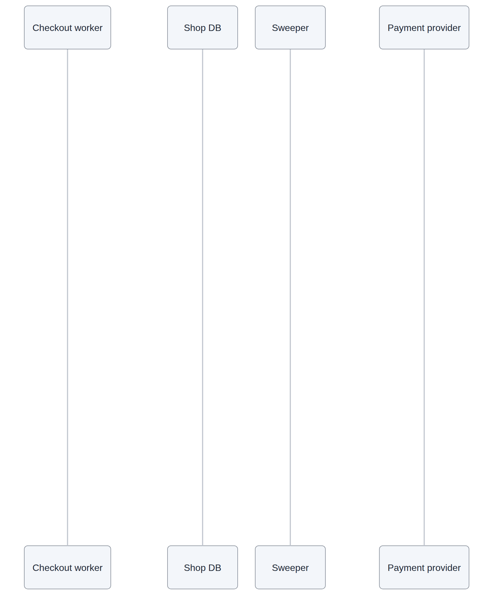
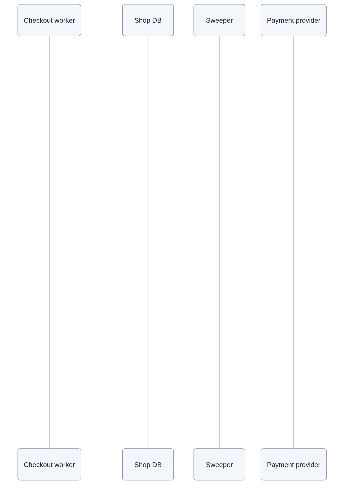

# System Design Interview: A Payment Succeeded but the Order Was Never Created. Now What?

#### Killing 119 workers left 114 customers charged with no order. The job written to clean that up made up to 52 of its own

**By Tihomir Manushev**

*Oct 11, 2026 · 9 min read*

---

A checkout team at an online furniture retailer, hiring a senior backend engineer. The interviewer is Yusuf.

The card was charged, and the order never showed up. The usual answer is a saga: split checkout into steps, and when a later step fails, undo the earlier ones. That's the right shape, and most answers stop there. The money actually gets lost in the cleanup job every saga needs, because that job has to guess what happened to a request that hasn't finished yet.

Everything below ran on PostgreSQL 17.6 in Docker, with Python 3.12 and psycopg 3.2, on a Ryzen 5 3600 with an NVMe drive. The payment provider ran as a separate process with its own database, and checkout workers were killed with SIGKILL while they worked.

---

### The question

**Yusuf:** A customer buys a sofa. We reserve the stock, charge the card through our payment provider, and create the order. How do you make sure it's all or nothing?

**Tihomir:** I'd start with one database transaction around all three. Reserve the stock, insert the order, charge the card, and commit only if the charge went through. If it's declined, the rollback puts the stock back.

**Yusuf:** How do you talk to the provider?

**Tihomir:** Plain HTTP, two calls. Each charge goes out with a key, and if the same key comes in twice, the provider hands back the first charge instead of making a second one. The other call looks a charge up by that key.

```python
import psycopg


class Declined(Exception):
    """The provider answered, and the answer was no."""


def charge(key: str, amount: int, card: str) -> dict:
    """POST /charges at the provider. The same key returns the same charge."""
    ...


def lookup(key: str) -> dict | None:
    """GET /charges?key=... at the provider; None if it has no such charge."""
    ...
```

**Tihomir:** And here's the checkout itself.

```python
RESERVE = ("UPDATE stock SET qty = qty - 1 "
           "WHERE sku = %s AND qty > 0 RETURNING qty")


def checkout_in_transaction(conn: psycopg.Connection, key: str, sku: str,
                            amount: int, card: str) -> str:
    """The obvious answer: one transaction around stock, order and charge."""
    with conn.transaction():
        if conn.execute(RESERVE, (sku,)).fetchone() is None:
            return "sold out"
        conn.execute(
            "INSERT INTO orders (checkout_key, sku, amount) "
            "VALUES (%s, %s, %s)", (key, sku, amount))
        result = charge(key, amount, card)
        if result["status"] != "succeeded":
            raise Declined(key)               # rolls back stock and order
        conn.execute(
            "UPDATE orders SET charge_id = %s WHERE checkout_key = %s",
            (result["id"], key))
    return "completed"
```

**Yusuf:** The provider isn't in your transaction, though.

**Tihomir:** No. A rollback undoes my side and can't touch theirs. I was okay with that because the charge is the last step, so the only thing that can come after it is the commit.

---

### The first trap

**Yusuf:** And if the process dies between the charge and the commit?

**Tihomir:** I ran that. Eight workers checked out nonstop for 60 seconds, and every 500 ms a script killed one at random and started a new one. Then I compared the provider's charges with our orders.

```
run                             kills  charged   orders no order   failed     slow
transaction                       119     3920     3806      114        0        0
transaction                       119     3952     3837      115        0        0
transaction                       119     3935     3821      114        0        0
```

**Yusuf:** 114 out of 119 kills?

**Tihomir:** Nearly every kill hurts. A checkout takes about 112 ms, and around 100 of those are spent waiting on the provider, so that's where a kill usually lands. Postgres sees the connection drop and rolls back, but by then the provider has the money.



**Yusuf:** So what does your database say happened?

**Tihomir:** Nothing at all. The order row went away with the rollback, so a cleanup job wouldn't even know to look.

**Yusuf:** Anything else wrong with it?

**Tihomir:** Yes, the stock row stays locked for the whole provider call. I measured what that does with eight threads, three rounds of 20 seconds each, and kept the middle result.

```
8 threads, 20 s per run, median of 3 interleaved rounds
handler     skus     checkouts/s   p50 ms   p99 ms
transaction spread          71.5    111.6    137.5
transaction hot              9.3    697.6   2720.3
```

**Tihomir:** Spread over 500 products, it does 71.5 checkouts a second, which is fine.

**Yusuf:** And a sofa on sale, with everyone buying it?

**Tihomir:** That's where it falls over. With all eight threads on the same product it drops to 9.3 a second, and the slowest 1% wait over 2.7 seconds. Each buyer queues behind the provider call of the buyer in front.

---

### Write the intent down first

**Yusuf:** So how do you fix it?

**Tihomir:** I split it into three steps, each committed on its own. First, I save a `pending` checkout row with the stock reservation, before calling anyone. Then I charge with the checkout's key, and then I move the row out of `pending`.

**Yusuf:** What if two processes try to finish the same checkout?

**Tihomir:** Only one wins. Every way out of `pending` is an update with `WHERE state = 'pending'`, so whoever gets there second changes nothing.

```python
def begin_checkout(conn: psycopg.Connection, key: str, sku: str,
                   amount: int, card: str) -> bool:
    """Step 1: commit the intent and the reservation before calling out."""
    with conn.transaction():
        if conn.execute(RESERVE, (sku,)).fetchone() is None:
            return False
        conn.execute(
            "INSERT INTO checkout (key, sku, amount, card, state) "
            "VALUES (%s, %s, %s, %s, 'pending')", (key, sku, amount, card))
    return True


def finish_checkout(conn: psycopg.Connection, key: str, result: dict,
                    by: str) -> bool:
    """Step 3: leave pending exactly once, for completed or failed."""
    with conn.transaction():
        if result["status"] == "succeeded":
            row = conn.execute(
                "UPDATE checkout SET state = 'completed', charge_id = %s, "
                "resolved_by = %s, resolved_at = clock_timestamp() "
                "WHERE key = %s AND state = 'pending' RETURNING sku, amount",
                (result["id"], by, key)).fetchone()
            if row:
                conn.execute(
                    "INSERT INTO orders (checkout_key, sku, amount, "
                    "charge_id) VALUES (%s, %s, %s, %s)",
                    (key, row[0], row[1], result["id"]))
        else:
            row = conn.execute(
                "UPDATE checkout SET state = 'failed', resolved_by = %s, "
                "resolved_at = clock_timestamp() "
                "WHERE key = %s AND state = 'pending' RETURNING sku",
                (by, key)).fetchone()
            if row:                           # compensate: release the stock
                conn.execute(
                    "UPDATE stock SET qty = qty + 1 WHERE sku = %s",
                    (row[0],))
    return row is not None


def checkout_saga(conn: psycopg.Connection, key: str, sku: str,
                  amount: int, card: str) -> str:
    """Intent, then the charge under the checkout's key, then the outcome."""
    if not begin_checkout(conn, key, sku, amount, card):
        return "sold out"
    result = charge(key, amount, card)       # step 2
    if not finish_checkout(conn, key, result, "worker"):
        return "already resolved"
    return "completed" if result["status"] == "succeeded" else "declined"
```



**Yusuf:** And when the worker dies right after the charge? Who finishes that one?

**Tihomir:** A sweeper, which is a background job that cleans up. Every 250 ms it picks up checkouts that have been pending for more than two seconds and asks the provider about each key. A charge means it completes the order; a decline, or no charge at all, means it fails the checkout and releases the stock.

```python
def resolve_by_lookup(conn: psycopg.Connection, key: str,
                      amount: int, card: str) -> None:
    """Ask the provider what happened to this key, decide from the answer."""
    found = lookup(key)
    finish_checkout(conn, key, found or {"status": "not found"}, "sweeper")
```

**Tihomir:** Same storm, same 119 kills.

```
run                             kills  charged   orders no order   failed     slow
saga/lookup 2s                    119     3913     3913        0        0        0
```

**Tihomir:** Nobody was charged without an order this time. The sweeper finished 110 checkouts and failed 6.

**Yusuf:** How long did those customers wait?

**Tihomir:** At most 2.32 seconds from the start of the checkout.

---

### The second trap

**Yusuf:** Say the provider answers the sweeper with a 404, no such charge. What does that mean?

**Tihomir:** That there's no charge.

**Yusuf:** Or that there isn't one yet.

**Tihomir:** Oh. Right, the charge request could still be on its way, held up by a resend, a load balancer retrying, or a queue at the provider. So I made 2% of provider requests take one to eight seconds to arrive and ran the storm three times.

```
run                             kills  charged   orders no order   failed     slow
saga/lookup 2s slow 2%            119     2750     2698       52       52       60
saga/lookup 2s slow 2%            119     2689     2644       45       45       62
saga/lookup 2s slow 2%            119     2714     2669       45       45       54
```

**Yusuf:** They're back.

**Tihomir:** That one caught me. Between 45 and 52 customers a run were charged for checkouts the sweeper had already marked failed, after their stock had gone back on sale. The kills didn't make these orphans, these charges with no order. My cleanup job did.

**Yusuf:** How do you know it was the slow requests?

**Tihomir:** The provider records how long each request was on the way before it arrived. I ran a separate 30-second storm and checked every orphan against that.

```
orphaned charges: 24
time in flight before the provider recorded them: min 2849 ms, max 7991 ms
```

**Tihomir:** All 24 had been on the way for close to three seconds or more, so each one landed after the sweeper had looked and found nothing. A normal request takes about 50 ms to arrive, and none of those are on the list.



**Yusuf:** Then wait five seconds instead of two.

```
run                             kills  charged   orders no order   failed     slow
saga/lookup 5s slow 2%            119     2766     2745       21       21       58
```

**Tihomir:** 21, down from about 47. A longer wait shrinks the window, but a request can be late by more than any wait you pick, and a lookup can't tell "late" from "never".

---

### Don't ask, send it again

**Yusuf:** So if the sweeper can't trust a 404, how does it decide?

**Tihomir:** It stops asking. It sends the same charge again, with the same key.

**Yusuf:** And charges them twice?

**Tihomir:** No, the provider stores charges under a unique key and ignores a second insert with the same one. Whichever request arrives first creates the charge, and the other one gets that charge back.

```python
def resolve_by_redrive(conn: psycopg.Connection, key: str,
                       amount: int, card: str) -> None:
    """Send the same charge again. The key makes it the same charge."""
    finish_checkout(conn, key, charge(key, amount, card), "sweeper")
```

```
run                             kills  charged   orders no order   failed     slow
saga/redrive 2s slow 2%           119     2847     2847        0        0       14
saga/redrive 2s slow 2%           119     2866     2866        0        0       30
saga/redrive 2s slow 2%           119     2711     2711        0        0       17
```

**Tihomir:** Zero in all three runs. And the slow column dropped from around 60 to between 14 and 30.

**Yusuf:** Why did that drop?

**Tihomir:** Because the sweeper's request usually got there first and created the charge. The slow one arrived later and found it already there.



**Yusuf:** The customer may have closed the tab after two seconds.

**Tihomir:** They pressed pay, and finishing the purchase is what they asked for. The sweeper charges the amount and card saved in the pending row, so it can't charge anything they didn't agree to.

**Yusuf:** So a pending checkout never fails?

**Tihomir:** Only when the provider says no. Releasing the stock, the undo step, runs after a clear decline, never after silence.

---

### What it costs

**Yusuf:** What does the extra commit cost a normal checkout?

**Tihomir:** Almost nothing: 112.3 ms for a typical checkout against 111.6.

**Yusuf:** And the sofa on sale?

**Tihomir:** That's where it wins. 71.2 checkouts a second against 9.3, because the reservation commits before the provider call starts, so nobody waits on the lock.

```
8 threads, 20 s per run, median of 3 interleaved rounds
handler     skus     checkouts/s   p50 ms   p99 ms
transaction spread          71.5    111.6    137.5
saga        spread          71.2    112.3    130.2
transaction hot              9.3    697.6   2720.3
saga        hot             71.2    112.6    130.7
```

**Yusuf:** So it's free?

**Tihomir:** Not quite. The real cost is time: an order the sweeper finishes shows up about 2.3 seconds after the checkout started, and 10.66 seconds in the worst run.

**Yusuf:** Why so long in that run?

**Tihomir:** One of the sweeper's own requests was slow, and everything queued behind it waited. By then the customer has already seen an error page, so the confirmation has to come from the order row, not the HTTP response.

**Yusuf:** And if they change their mind?

**Tihomir:** This design only moves forward, so it can't drop a checkout. Cancelling means a refund, which is another remote call that can fail, so it would need its own saved `refunding` state for the sweeper to retry. I haven't built that.

**Yusuf:** What else haven't you tested?

**Tihomir:** A resend after the provider has forgotten the key. At that point it becomes a brand-new charge, so the sweeper has to give up long before then.

---

### Conclusion

**Yusuf:** Okay. Sum it up for me.

**Tihomir:** Four things.

**A database transaction can't include a call to someone else's system.** 119 kills left 114 or 115 customers charged with no order and no trace in the shop.

**Save the intent before you call out.** With a pending row and a sweeper, the same kills left none.

**"No such charge" can mean "not yet" as easily as "never".** With 2% of requests slow, deciding from a lookup left 45 to 52 orphans a minute, and waiting five seconds still left 21.

**Recover forward, under the same key.** Sending the charge again made the sweeper's request and the late one the same charge: zero orphans in three runs, for 0.7 ms per checkout.

The usual answer says a saga undoes its steps when one fails. A call to another system doesn't fail cleanly, though. It goes quiet, and from the outside a slow request looks exactly like one that never arrived. Only undo after a clear answer, and until you get one, send the same request again under the same key.
