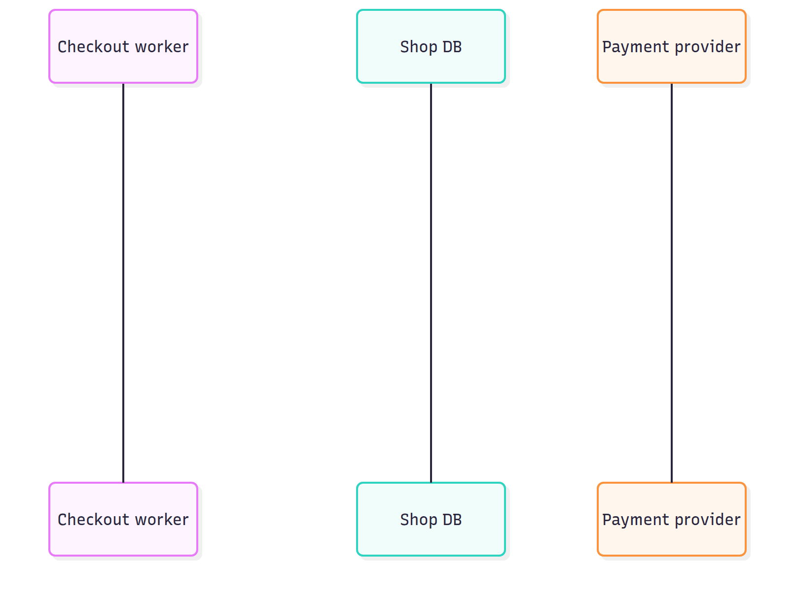
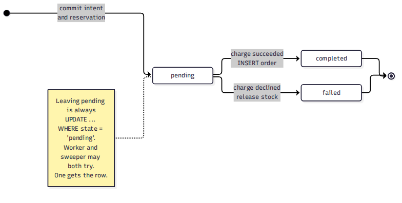
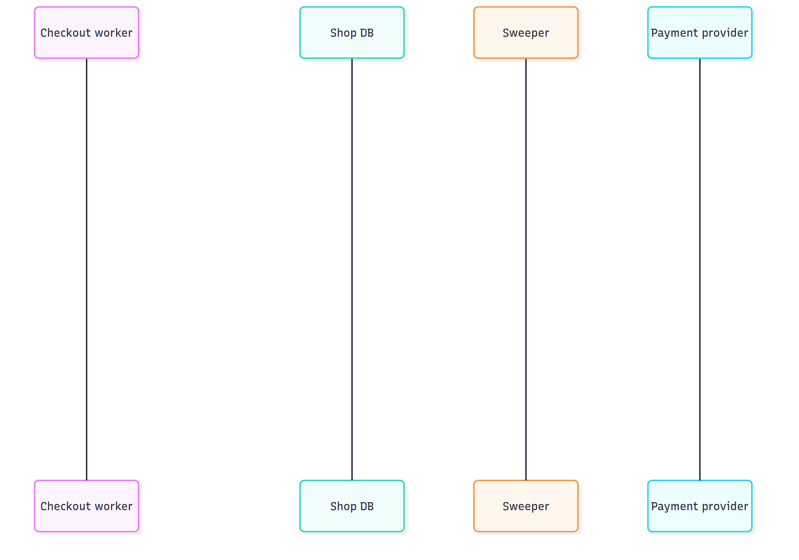
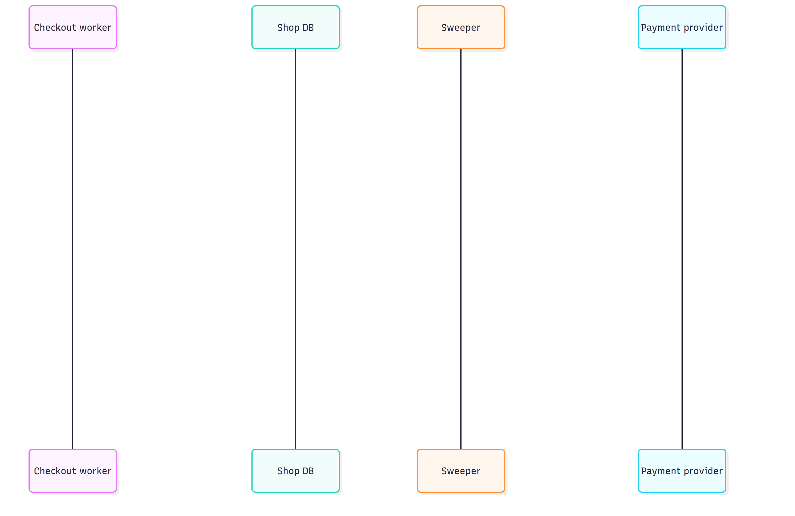

# System Design Interview: A Payment Succeeded but the Order Was Never Created. Now What?

#### 119 killed workers left 114 customers charged with no order, and the job written to recover them made up to 52 of its own

**By Tihomir Manushev**

*Oct 11, 2026 · 9 min read*

---

A checkout team at an online furniture retailer, hiring a senior backend engineer. The interviewer is Yusuf.

The standard answer here is a saga: break the checkout into steps, and undo the earlier steps when a later one fails. That's the right shape, and most answers stop there. The money gets lost in the recovery job every saga needs, because that job has to decide what happened to a request that hasn't finished yet.

Everything below ran on PostgreSQL 17.6 in Docker, with Python 3.12 and psycopg 3.2, on a Ryzen 5 3600 with an NVMe drive. The payment provider ran as a separate process with its own database, and checkout workers were killed with SIGKILL while they worked.

---

### The question

**Yusuf:** A customer buys a sofa. We reserve the stock, charge the card through our payment provider and create the order. How do you make that all-or-nothing?

**Tihomir:** One transaction around all three. Reserve the stock, insert the order, call the provider, and commit only if the charge went through. A decline raises, and the rollback returns the stock. The provider is plain HTTP, so first the two calls I make to it:

```python
import psycopg


class Declined(Exception):
    """The provider answered, and the answer was no."""


def charge(key: str, amount: int, card: str) -> dict:
    """POST /charges at the provider. The same key returns the same charge."""
    ...


def lookup(key: str) -> dict | None:
    """GET /charges?key=... at the provider; None if it has no such charge."""
    ...
```

**Tihomir:** And the handler.

```python
RESERVE = ("UPDATE stock SET qty = qty - 1 "
           "WHERE sku = %s AND qty > 0 RETURNING qty")


def checkout_in_transaction(conn: psycopg.Connection, key: str, sku: str,
                            amount: int, card: str) -> str:
    """The obvious answer: one transaction around stock, order and charge."""
    with conn.transaction():
        if conn.execute(RESERVE, (sku,)).fetchone() is None:
            return "sold out"
        conn.execute(
            "INSERT INTO orders (checkout_key, sku, amount) "
            "VALUES (%s, %s, %s)", (key, sku, amount))
        result = charge(key, amount, card)
        if result["status"] != "succeeded":
            raise Declined(key)               # rolls back stock and order
        conn.execute(
            "UPDATE orders SET charge_id = %s WHERE checkout_key = %s",
            (result["id"], key))
    return "completed"
```

**Yusuf:** The provider isn't in your transaction.

**Tihomir:** No. A rollback undoes my side and can't touch theirs. I accepted that because the charge is the last step, so the only thing that can follow it is a commit.

---

### The first trap

**Yusuf:** And when the process dies between the charge and the commit?

**Tihomir:** I ran that. Eight worker processes checked out continuously for 60 seconds while a harness sent SIGKILL to a random one every 500 ms and started a replacement. Then I compared the provider's charges with the shop's orders.

```
run                             kills  charged   orders no order   failed     slow
transaction                       119     3920     3806      114        0        0
transaction                       119     3952     3837      115        0        0
transaction                       119     3935     3821      114        0        0
```

**Tihomir:** 119 kills per run, and 114 or 115 customers charged with no order. Nearly every kill counts, because a checkout takes about 112 ms and around 100 of those are spent waiting on the provider. Postgres sees the connection drop and rolls back, and by then the provider has taken the money.



**Yusuf:** What does your database say happened?

**Tihomir:** Nothing. The order row went out with the rollback, so a recovery job would have nothing to find. The design has a second cost as well: the stock row stays locked for the whole provider call.

**Yusuf:** Numbers.

**Tihomir:** Eight threads, 20-second runs, median of three rounds.

```
8 threads, 20 s per run, median of 3 interleaved rounds
handler     skus     checkouts/s   p50 ms   p99 ms
transaction spread          71.5    111.6    137.5
transaction hot              9.3    697.6   2720.3
```

**Tihomir:** Spread over 500 products it does 71.5 checkouts a second. When all eight threads buy the same product, it drops to 9.3, with a p99 of 2,720 ms. Every buyer queues behind the provider call of the buyer in front.

---

### Write the intent down first

**Yusuf:** Fix it.

**Tihomir:** Three steps, each committed separately. Step one commits a `pending` checkout row together with the stock reservation, before anyone else is called. Step two is the charge, using the checkout's key as the idempotency key. Step three moves the row out of `pending`, always with `WHERE state = 'pending'`, so whichever process gets there first wins.

```python
def begin_checkout(conn: psycopg.Connection, key: str, sku: str,
                   amount: int, card: str) -> bool:
    """Step 1: commit the intent and the reservation before calling out."""
    with conn.transaction():
        if conn.execute(RESERVE, (sku,)).fetchone() is None:
            return False
        conn.execute(
            "INSERT INTO checkout (key, sku, amount, card, state) "
            "VALUES (%s, %s, %s, %s, 'pending')", (key, sku, amount, card))
    return True


def finish_checkout(conn: psycopg.Connection, key: str, result: dict,
                    by: str) -> bool:
    """Step 3: leave pending exactly once, for completed or failed."""
    with conn.transaction():
        if result["status"] == "succeeded":
            row = conn.execute(
                "UPDATE checkout SET state = 'completed', charge_id = %s, "
                "resolved_by = %s, resolved_at = clock_timestamp() "
                "WHERE key = %s AND state = 'pending' RETURNING sku, amount",
                (result["id"], by, key)).fetchone()
            if row:
                conn.execute(
                    "INSERT INTO orders (checkout_key, sku, amount, "
                    "charge_id) VALUES (%s, %s, %s, %s)",
                    (key, row[0], row[1], result["id"]))
        else:
            row = conn.execute(
                "UPDATE checkout SET state = 'failed', resolved_by = %s, "
                "resolved_at = clock_timestamp() "
                "WHERE key = %s AND state = 'pending' RETURNING sku",
                (by, key)).fetchone()
            if row:                           # compensate: release the stock
                conn.execute(
                    "UPDATE stock SET qty = qty + 1 WHERE sku = %s",
                    (row[0],))
    return row is not None


def checkout_saga(conn: psycopg.Connection, key: str, sku: str,
                  amount: int, card: str) -> str:
    """Intent, then the charge under the checkout's key, then the outcome."""
    if not begin_checkout(conn, key, sku, amount, card):
        return "sold out"
    result = charge(key, amount, card)       # step 2
    if not finish_checkout(conn, key, result, "worker"):
        return "already resolved"
    return "completed" if result["status"] == "succeeded" else "declined"
```



**Yusuf:** Who finishes the checkouts whose worker died?

**Tihomir:** A sweeper. Every 250 ms it collects checkouts that have been pending for more than two seconds and asks the provider about each key. A charge means it completes the order. A decline, or no charge at all, means it fails the checkout and releases the stock.

```python
def resolve_by_lookup(conn: psycopg.Connection, key: str,
                      amount: int, card: str) -> None:
    """Ask the provider what happened to this key, decide from the answer."""
    found = lookup(key)
    finish_checkout(conn, key, found or {"status": "not found"}, "sweeper")
```

**Tihomir:** Same storm, same 119 kills.

```
run                             kills  charged   orders no order   failed     slow
saga/lookup 2s                    119     3913     3913        0        0        0
```

**Tihomir:** Nobody was charged without an order. The sweeper completed 110 checkouts and failed 6, every one within 2.32 seconds of the checkout starting.

---

### The second trap

**Yusuf:** What does a 404 from the provider mean?

**Tihomir:** That there's no charge.

**Yusuf:** Or that there isn't one yet.

**Tihomir:** Right. A request can still be on its way, held up by a retransmit, a load balancer retrying, or a queue at the provider. I made 2% of provider requests take one to eight seconds to arrive and ran the storm three times.

```
run                             kills  charged   orders no order   failed     slow
saga/lookup 2s slow 2%            119     2750     2698       52       52       60
saga/lookup 2s slow 2%            119     2689     2644       45       45       62
saga/lookup 2s slow 2%            119     2714     2669       45       45       54
```

**Tihomir:** 52, 45 and 45 customers were charged for checkouts the sweeper had already marked failed, after their stock had been released for someone else to buy. The kills didn't create these orphans. The recovery job did.

**Yusuf:** How do you know they were the slow ones?

**Tihomir:** The provider records how long each request spent in flight before it arrived. I ran a separate 30-second storm and checked every orphan against that.

```
orphaned charges: 24
time in flight before the provider recorded them: min 2849 ms, max 7991 ms
```

**Tihomir:** All 24 had been in flight for close to three seconds or more, so each one arrived after the sweeper had looked and found nothing. A normal request takes about 50 ms to arrive, and not one of them is in the list.



**Yusuf:** Wait five seconds instead of two.

```
run                             kills  charged   orders no order   failed     slow
saga/lookup 5s slow 2%            119     2766     2745       21       21       58
```

**Tihomir:** 21 instead of about 47. A longer threshold narrows the window, but a request can be delayed past any threshold you pick, and a lookup can't tell late from never.

---

### Don't ask, send it again

**Yusuf:** Then how does the sweeper decide?

**Tihomir:** Not from an absence. It sends the same charge again under the same key. The provider stores charges under a unique key with `ON CONFLICT DO NOTHING`, so the sweeper's request and the late one become the same charge: whichever arrives first creates it, and the other gets it back.

```python
def resolve_by_redrive(conn: psycopg.Connection, key: str,
                       amount: int, card: str) -> None:
    """Send the same charge again. The key makes it the same charge."""
    finish_checkout(conn, key, charge(key, amount, card), "sweeper")
```

```
run                             kills  charged   orders no order   failed     slow
saga/redrive 2s slow 2%           119     2847     2847        0        0       14
saga/redrive 2s slow 2%           119     2866     2866        0        0       30
saga/redrive 2s slow 2%           119     2711     2711        0        0       17
```

**Tihomir:** Zero in all three runs. The slow column falls from around 60 to between 14 and 30, and the reason is in the diagram. The sweeper's request usually arrived first and recorded the charge, so the slow one found it already there.



**Yusuf:** The customer may have closed the tab after two seconds.

**Tihomir:** They pressed pay, and finishing the purchase is what they asked for. The re-drive charges the amount and card that were stored in the pending row, so it can't charge anything the customer didn't agree to. What it can't do is let them change their mind, and that comes back under cost.

**Yusuf:** So a pending checkout never fails?

**Tihomir:** Only when the provider says no. The compensation, releasing the stock, runs after a definite decline, never after silence.

---

### What it costs

**Yusuf:** What does it cost?

**Tihomir:** On the request path, one extra commit: 112.3 ms at p50 against 111.6. With a hot product it's a gain, 71.2 checkouts a second against 9.3, because the reservation commits before the provider call starts.

```
8 threads, 20 s per run, median of 3 interleaved rounds
handler     skus     checkouts/s   p50 ms   p99 ms
transaction spread          71.5    111.6    137.5
saga        spread          71.2    112.3    130.2
transaction hot              9.3    697.6   2720.3
saga        hot             71.2    112.6    130.7
```

**Tihomir:** The real cost is time. An order the sweeper completes appears about 2.3 seconds after the checkout started, and 10.66 seconds in the worst run, where one of the sweeper's own requests was slow and held up everything queued behind it. By then the customer whose worker died has already seen an error page, so the confirmation has to come from the order row, not from the HTTP response.

**Yusuf:** And a checkout you want to abandon?

**Tihomir:** This design only moves forward, so it can't abandon one. Cancelling means a refund, which is another remote call that can fail, so it would need its own persisted `refunding` state for the sweeper to retry. I haven't built that, and I haven't tested a re-drive after the provider has forgotten the key, when it would become a brand-new charge. The sweeper has to give up long before that point.

---

### Conclusion

**Yusuf:** Summary.

**Tihomir:** Four lines.

**A transaction can't contain a call to another system.** 119 kills left 114 or 115 customers charged with no order and no trace in the shop.

**Commit the intent before calling out.** With a pending row and a sweeper, the same kills left none.

**A 404 can mean not yet as easily as never.** With 2% of requests slow, deciding from a lookup created 45 to 52 orphans a minute, and waiting five seconds still left 21.

**Recover forward, under the same key.** Re-sending the charge made the sweeper's request and the late one the same charge: zero orphans in three runs, for 0.7 ms per checkout.

The standard answer says a saga compensates when a step fails. A remote step doesn't fail cleanly, though. It goes quiet, and from outside, a slow request looks exactly like one that never arrived. Compensate only after a definite answer, and until you have one, repeat the same request under the same key.
