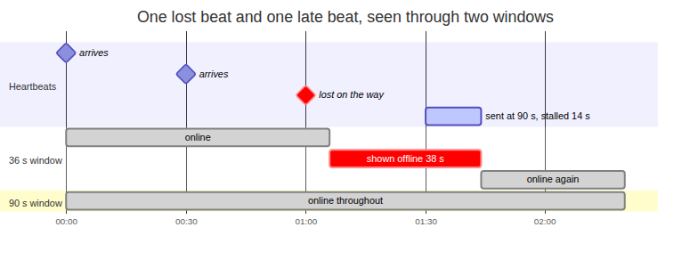
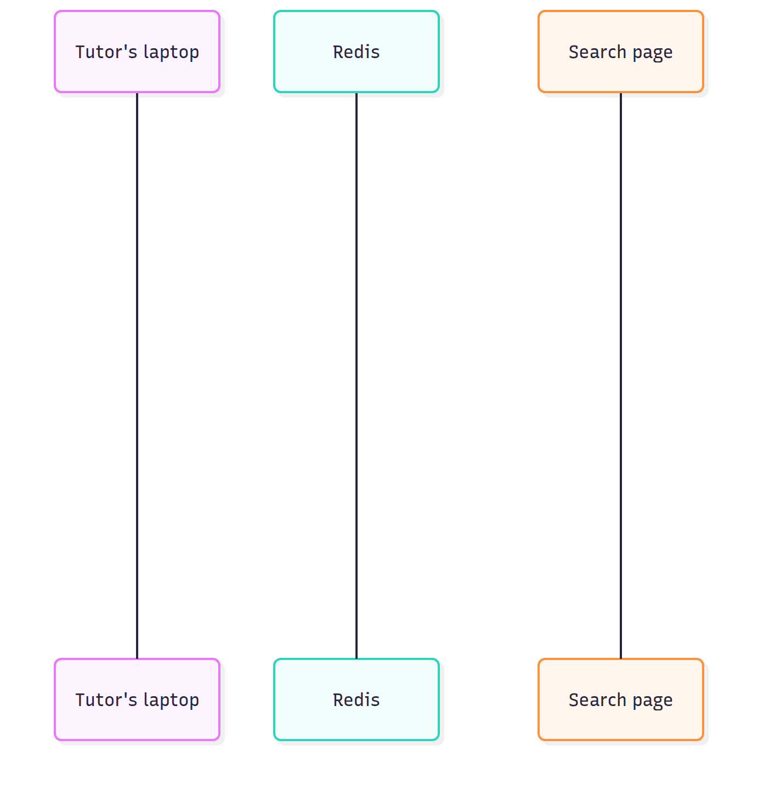
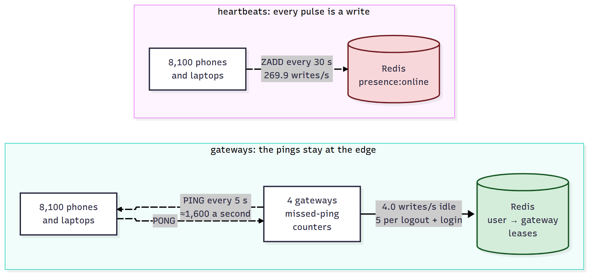
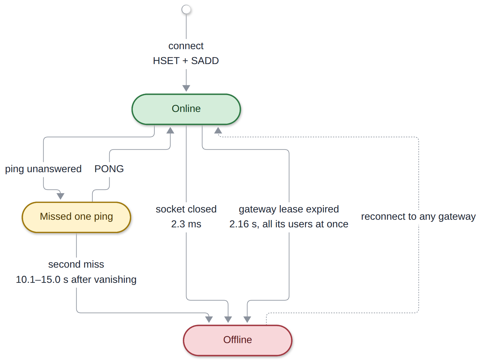

# System Design Interview: How Do You Know Which of Your Users Are Online Right Now?

#### 8,100 users doing nothing still sent 269.9 heartbeats a second, and the green dot couldn't tell a lost packet from a closed laptop

**By Tihomir Manushev**

*Oct 16, 2026 · 9 min read*

---

A realtime team at a language-tutoring marketplace, hiring a senior backend engineer. The interviewer is Chiara.

Who's online right now? The usual answer is a heartbeat: every app checks in every 30 seconds, and anyone heard from recently counts as online. That works, but it hides two costs. You pay a write for every connected user whether they do anything or not, and "recently" is a time limit that guesses whether a silent user has left.

Everything below ran on PostgreSQL 17.6 and Redis 8.4 in Docker, with Python 3.12.3, psycopg 3.2 and redis-py 5.2, on a Ryzen 5 3600 with an NVMe drive.

---

### The question

**Chiara:** Students want to see which tutors are online right now: the green dot. We have a million accounts and about 300,000 connected at peak. How would you know who's online?

**Tihomir:** A heartbeat. Every connected app checks in every 30 seconds and updates a `last_seen` column. Anyone seen in the last 60 seconds is online, and since search needs that fast, `last_seen` gets an index.

```sql
CREATE INDEX accounts_last_seen ON accounts (last_seen);

-- every 30 s, from every connected client
UPDATE accounts SET last_seen = now() WHERE user_id = $1;

-- the green dots
SELECT count(*) FROM accounts
WHERE last_seen > now() - interval '60 seconds';
```

**Chiara:** 300,000 people every 30 seconds. How many writes is that?

**Tihomir:** 10,000 a second.

**Chiara:** At four in the morning?

**Tihomir:** The same, as long as they stay connected. That's the odd part: the rate follows how many people are connected, not anything they're doing.

---

### The first trap

**Chiara:** 10,000 updates a second on one table. Did you try it?

**Tihomir:** I did, with a million accounts and Postgres's own load tool, pgbench, sending 10,000 updates a second for three minutes. Twice with the index, twice without.

```
config     round   HOT updates   WAL bytes/heartbeat   indexes MB   autovacuums
no index       1         98.6%                   206     21 -> 21            0
no index       2         97.5%                   228     21 -> 21            0
index          1          0.0%                   361     28 -> 44            3
index          2          0.0%                   367     28 -> 42            2
```

**Chiara:** The index rows say 0% HOT. What's HOT?

**Tihomir:** A Postgres shortcut: if no indexed column changes, it writes the new row version next to the old one and skips the indexes. Every heartbeat changes `last_seen`, so with the index, not one got the shortcut.

**Chiara:** And what does losing it cost?

**Tihomir:** Every heartbeat adds an entry to both indexes and writes 61 to 75% more WAL, the log that lets Postgres survive a crash. The indexes grew 14 to 16 MB during the run.

**Chiara:** But the index makes the green dots fast.

**Tihomir:** I expected that too. Here's the count, timed during the heartbeats.

```
online count during 10,000 heartbeats/s, 20 runs each
no index   Parallel Seq Scan                                        37.1 ms average
index      Index Only Scan, Heap Fetches: 164809 of 162412 rows     39.8 ms average
```

**Chiara:** Slower with the index?

**Tihomir:** A bit, about 40 ms against 37. The index can skip the table only on pages Postgres has marked unchanged, and every heartbeat clears that mark. So it read the table for every row anyway.

**Chiara:** So the index buys you nothing?

**Tihomir:** Nothing for the read, and it costs every heartbeat.

**Chiara:** Can Postgres even hold 10,000 a second?

**Tihomir:** That's the number I don't trust. Flat out, both did about 18,000 a second for 30 seconds, but the first long run fell to about 4,000 after two minutes, and every run after it stayed there, index or not.

**Chiara:** That sounds like Postgres hitting a wall.

**Tihomir:** I thought so too, but it was waiting on the disk to confirm each commit, and this drive measured 1.76 ms per flush afterwards. That's my disk, not Postgres. The real lesson is that every heartbeat is a crash-safe commit of data nobody needs after a crash.

---

### Take it out of the database

**Chiara:** Then where would you put it?

**Tihomir:** Redis, in one sorted set: a list of names, each with a score. A heartbeat is a `ZADD` with the time as the score, and a search page reads all its tutors' scores at once with `ZMSCORE`.

**Chiara:** Why is that cheaper?

**Tihomir:** No old row versions and no crash log. A heartbeat just overwrites a number in memory.

```python
import redis.asyncio as aioredis


async def online_by_window(r: aioredis.Redis, users: list[str], now: float,
                           window: float) -> dict[str, bool]:
    """Online = last heartbeat inside the window. One round trip."""
    scores = await r.zmscore("presence:online", users)
    return {u: s is not None and s > now - window
            for u, s in zip(users, scores)}
```

**Chiara:** Same number of writes, though.

**Tihomir:** Exactly the same. I left 8,100 users idle for a minute: 269.9 writes a second, one each every 30 seconds.

**Chiara:** Can Redis take that?

**Tihomir:** Easily. But the rate never drops when people stop doing things.

---

### The second trap

**Chiara:** A tutor closes their laptop. When does the dot go grey?

**Tihomir:** When the 60 seconds run out, so somewhere between 30 and 60 seconds after they leave.

**Chiara:** That's on a clean network. What about a bad one?

**Tihomir:** I simulated that: 2,000 clients, 3% of heartbeats lost, and 5% arriving 2 to 20 seconds late, like a phone on a train.

**Chiara:** And some of them leave?

**Tihomir:** 200 left without saying goodbye. I sped time up ten times, so each window size got 30 simulated minutes.

```
window   flaps per user-hour   shown online after leaving (p50 / max)
36 s                    7.57          20.2 s / 44.5 s
60 s                    0.85          44.1 s / 68.4 s
90 s                    0.02          73.8 s / 98.2 s
120 s                   0.00        103.7 s / 128.0 s
```

**Chiara:** What's a flap?

**Tihomir:** Someone who's still there turning grey and then green again. At 36 seconds it happens 7.57 times per user per hour, and each one is two events pushed to every student watching that tutor. One lost heartbeat followed by one late one is enough.



**Chiara:** Then make the window longer.

**Tihomir:** At 90 seconds, three heartbeats, the flicker is gone. But a tutor who left 74 seconds ago still shows as available, so a student books a lesson with nobody there.

**Chiara:** So which one do you pick?

**Tihomir:** Neither, honestly. Both come from one cause: elapsed time is the only signal, and it can't tell a lost packet from a closed laptop.



---

### Ask the connection

**Chiara:** What else could tell you?

**Tihomir:** The connection. The app already holds a WebSocket, a connection that stays open, to one of our gateway servers, and the gateway sees the moment it closes. It can also ping its own connections without touching Redis.

**Chiara:** So what does Redis store?

**Tihomir:** Only changes. A connect records which gateway the user is on, and a clean close or two unanswered pings deletes that record.

**Chiara:** And if the gateway itself dies?

**Tihomir:** Each gateway renews a three-second lease every second: a key that expires unless it's refreshed. A user counts as online only while their gateway's lease is alive.

```python
import asyncio
import os
import random
import time

import redis.asyncio as aioredis

PING_S = float(os.environ.get("PING_S", "5"))   # gateway -> client ping
MISSES = 2                                       # unanswered pings = gone
LEASE_MS = 3000
RENEW_S = 1.0
WHERE = "presence:where"                         # hash: user -> gateway

RELEASE = """
if redis.call('HGET', KEYS[1], ARGV[1]) == ARGV[2] then
    redis.call('HDEL', KEYS[1], ARGV[1])
end
redis.call('SREM', KEYS[2], ARGV[1])
"""


class Gateway:
    def __init__(self, gw_id: str, r: aioredis.Redis) -> None:
        self.gw_id = gw_id
        self.r = r
        self.members = f"gw:{gw_id}:users"
        self.conns: dict[str, tuple[asyncio.StreamWriter, list[int]]] = {}
        self.release = r.register_script(RELEASE)

    async def claim(self, uid: str) -> None:
        async with self.r.pipeline(transaction=True) as pipe:
            pipe.hset(WHERE, uid, self.gw_id).sadd(self.members, uid)
            await pipe.execute()

    async def offline(self, uid: str, reason: str) -> None:
        self.conns.pop(uid, None)
        await self.release(keys=[WHERE, self.members], args=[uid, self.gw_id])
        print(f"{time.time():.3f} offline {uid} {reason}", flush=True)

    async def pinger(self) -> None:
        await asyncio.sleep(random.uniform(0, PING_S))  # gateways out of phase
        while True:
            for uid, (writer, missed) in list(self.conns.items()):
                if missed[0] >= MISSES:
                    await self.offline(uid, "no-pong")
                    writer.close()
                else:
                    missed[0] += 1
                    writer.write(b"PING\n")
            await asyncio.sleep(PING_S)

    async def lease(self) -> None:
        while True:
            await self.r.set(f"gw:{self.gw_id}:alive", 1, px=LEASE_MS)
            await asyncio.sleep(RENEW_S)
```

**Tihomir:** The connection handler calls `claim` on hello, resets `missed` on every answered ping, and calls `offline` when the socket closes. The release script deletes the record only if it still names this gateway, so a lagging gateway can't send someone offline after they've reconnected elsewhere.

**Chiara:** What does a read look like now?

**Tihomir:** Two round trips: which gateway each tutor is on, then whether those gateways are alive.

```python
async def online_by_gateway(r: aioredis.Redis,
                            users: list[str]) -> dict[str, bool]:
    """Online = mapped to a gateway whose lease is alive. Two round trips."""
    gateways = await r.hmget(WHERE, users)
    distinct = sorted({g for g in gateways if g})
    leases = await r.mget([f"gw:{g}:alive" for g in distinct])
    alive = dict(zip(distinct, leases))
    return {u: bool(g and alive.get(g)) for u, g in zip(users, gateways)}
```

**Chiara:** Numbers.

**Tihomir:** Same 8,100 users, on four gateways that ping every 5 seconds. Then 50 logged out cleanly. Another 50 I paused with SIGSTOP, which freezes a process but leaves its sockets open, like a phone going into a tunnel.

```
8100 users connected across 4 gateways, ping every 5 s
idle 60 s: 239 writes = 4.0/s  (exists 240, set 239, smembers 60)
1000 logouts + 1000 logins: 5000 writes = 5.0 per logout-login pair (lease renewals excluded: 2)
logout of 50: 50 offline, p50 2.3 ms, max 3.3 ms
vanish of 50: 50 offline, p50 12.4 s, min 10.1 s, max 15.0 s
```

**Chiara:** Four writes a second, with nobody doing anything?

**Tihomir:** Four, all lease renewals. The same users heartbeating wrote 269.9.

**Chiara:** And the people who left?

**Tihomir:** A logout went grey in 2.3 ms instead of most of a minute. The frozen phones got caught after two missed pings, in 10 to 15 seconds.



**Chiara:** The pings are heartbeats.

**Tihomir:** They are, fair. But they go to the gateway, which already holds the connection, so about 1,600 pings a second cost Redis nothing.

---

### What it costs

**Chiara:** What does it cost you?

**Tihomir:** Reads, first. Two round trips take 452 µs at the median for 50 tutors, against 344 µs for the sorted set.

**Chiara:** What else?

**Tihomir:** A gateway dying. I froze one that held 2,000 users, so nothing closed their sockets, and checked 200 of them every 50 ms.

```
gateway gw4 frozen with 2000 users; sample of 200: 200 seen offline, first at 2.16 s, all by 2.16 s; 200 back online, offline for p50 13.5 s, max 14.8 s
  writes in the 30 s after the freeze: 10090 (lease renewals 89)
  1792114653.838 janitor cleared gw4: 2000 users
```

**Chiara:** All at the same moment?

**Tihomir:** All 2,000 at 2.16 seconds, because one lease covers the whole gateway. That's right, too: none of those users could reach us.

**Chiara:** And then they all come back.

**Tihomir:** About 13.5 seconds later, when their apps gave up on the silent gateway and reconnected elsewhere. So it's a burst: everyone goes grey, then green, and Redis took 10,090 writes in 30 seconds.



**Chiara:** And at 300,000 users?

**Tihomir:** Idle, it's one write per gateway per second. The rest is churn, people logging out and back in, at five writes each time.

**Chiara:** How much churn?

**Tihomir:** I don't have real numbers. If 1% of users reconnected every minute, that's 250 writes a second, but it's a guess and I wouldn't size anything on it.

**Chiara:** What haven't you run?

**Tihomir:** Pinging hundreds of thousands of sockets from one gateway. And users with no open connection at all, like a mobile app in the background: those still need a rule based on time.

---

### Conclusion

**Chiara:** Give me the short version.

**Tihomir:** Four things.

**A heartbeat's write rate comes from who's connected, not from what they do.** 8,100 users doing nothing still wrote 269.9 times a second.

**In Postgres, an index on `last_seen` makes every heartbeat dearer and the read no faster.** No update got the HOT shortcut, WAL grew 61 to 75%, and the count still went to the table for every row.

**A time window can't tell a lost packet from a closed laptop.** At 36 seconds it flickers 7.57 times per user-hour, and at 90 seconds it shows people who left 74 seconds ago.

**Let the connection decide, and write only when something changes.** Four writes a second at idle, a logout grey in 2.3 ms, and a frozen phone caught in 10 to 15 seconds.

The usual answer treats presence as data you keep fresh by rewriting it. It's really an event: a connection opens, closes or goes quiet, and only the gateway holding that connection sees it happen. So record the change, instead of asking every user to keep proving they're still there.
