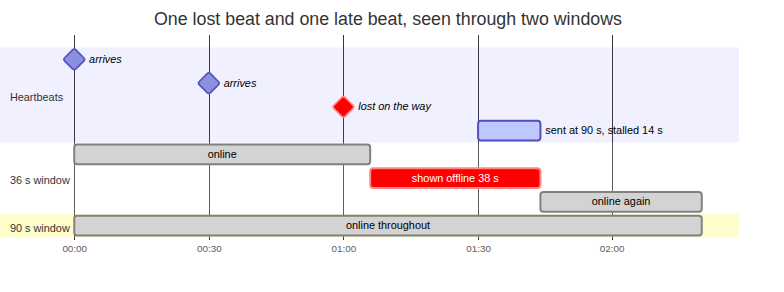
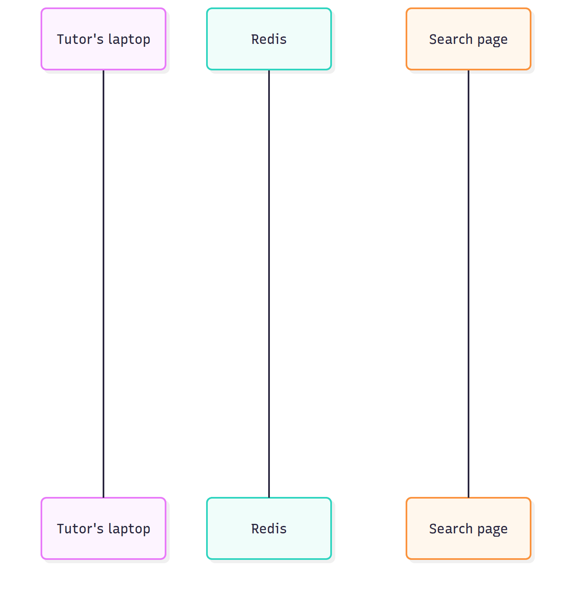
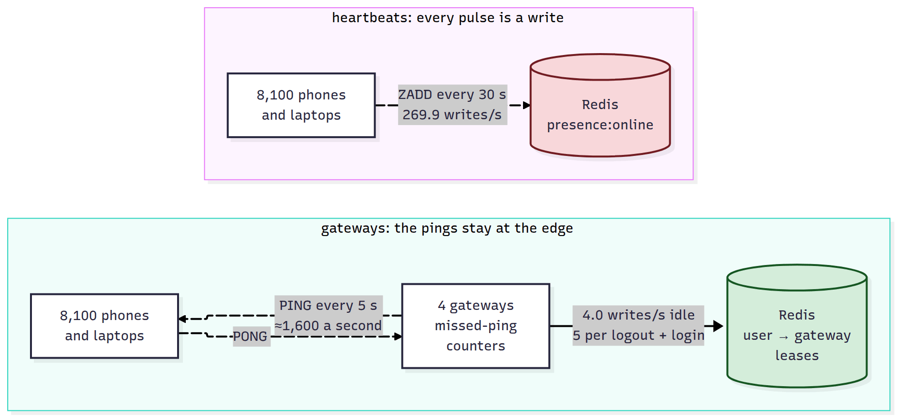
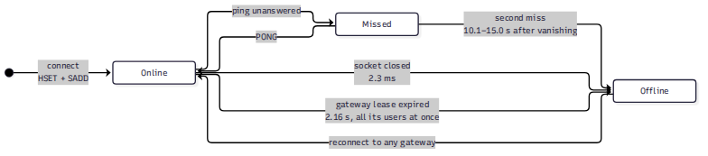

# System Design Interview: How Do You Know Which of Your Users Are Online Right Now?

#### 8,100 idle users still wrote 269.9 heartbeats a second, and the time window behind every green dot couldn't tell a lost packet from a closed laptop

**By Tihomir Manushev**

*Oct 16, 2026 · 9 min read*

---

A realtime team at a language-tutoring marketplace, hiring a senior backend engineer. The interviewer is Chiara.

The standard answer is a heartbeat: every client reports in every 30 seconds, and anyone heard from recently counts as online. That works, and it hides two costs. The write rate depends on how many people are connected rather than on anything they do, and "recently" is a time window that has to guess whether a silent client has left.

Everything below ran on PostgreSQL 17.6 and Redis 8.4 in Docker, with Python 3.12.3, psycopg 3.2 and redis-py 5.2, on a Ryzen 5 3600 with an NVMe drive.

---

### The question

**Chiara:** Students search for tutors, and they want to see who's online now: a green dot. We have a million accounts and about 300,000 connected at peak. How do you know who's online?

**Tihomir:** Every connected client sends a heartbeat every 30 seconds, and the heartbeat updates a `last_seen` column. Anyone seen in the last 60 seconds is online. The search page needs the online users quickly, so `last_seen` gets an index.

```sql
CREATE INDEX accounts_last_seen ON accounts (last_seen);

-- every 30 s, from every connected client
UPDATE accounts SET last_seen = now() WHERE user_id = $1;

-- the green dots
SELECT count(*) FROM accounts
WHERE last_seen > now() - interval '60 seconds';
```

**Chiara:** How many writes is that?

**Tihomir:** 300,000 users every 30 seconds, so 10,000 a second.

**Chiara:** At four in the morning?

**Tihomir:** The same, as long as they stay connected. The rate depends on how many people are connected, not on anything they're doing.

---

### The first trap

**Chiara:** Numbers.

**Tihomir:** I ran it with a million accounts, 300,000 of them heartbeating at 10,000 updates a second through pgbench with 16 clients, for 180 seconds, with and without the index. Two rounds of each.

```
config     round   HOT updates   WAL bytes/heartbeat   indexes MB   autovacuums
no index       1         98.6%                   206     21 -> 21            0
no index       2         97.5%                   228     21 -> 21            0
index          1          0.0%                   361     28 -> 44            3
index          2          0.0%                   367     28 -> 42            2
```

**Tihomir:** With the index, not one heartbeat was a HOT update. Postgres can rewrite a row on the same page without touching any index only when no indexed column changes, and every heartbeat changes the indexed column. So every update adds an entry to both indexes and writes 61 to 75% more WAL, and the indexes grew by 14 to 16 MB in three minutes.

**Chiara:** But the index makes the green dots fast.

**Tihomir:** It doesn't. Here's the count, run while the heartbeats continued.

```
online count during 10,000 heartbeats/s, 20 runs each
no index   Parallel Seq Scan                                        37.1 ms average
index      Index Only Scan, Heap Fetches: 164809 of 162412 rows     39.8 ms average
```

**Tihomir:** An index-only scan can skip the table only for pages the visibility map marks all-visible, and every heartbeat clears that mark on the page it touches. So the scan went to the table for every row anyway. The index costs every heartbeat and buys the read nothing.

**Chiara:** Throughput?

**Tihomir:** That's the number I don't trust. Unthrottled, both versions ran at about 18,000 updates a second for 30 seconds. The first sustained run held 10,000 a second for two minutes and then fell to about 4,000, and every run after it stayed near 4,000, with or without the index. The backends were waiting on WAL flushes and this drive's fsync measured 1.76 ms afterwards, so that's my disk, not Postgres. What I'd keep from it is that every heartbeat is a durable commit of data nobody needs after a crash.

---

### Take it out of the database

**Chiara:** Fix it.

**Tihomir:** Redis, with one sorted set. Each heartbeat is a `ZADD` with the time as the score, and a search page asks for its tutors' scores in one `ZMSCORE`. There's no MVCC and no WAL: a heartbeat overwrites a number in memory.

```python
import redis.asyncio as aioredis


async def online_by_window(r: aioredis.Redis, users: list[str], now: float,
                           window: float) -> dict[str, bool]:
    """Online = last heartbeat inside the window. One round trip."""
    scores = await r.zmscore("presence:online", users)
    return {u: s is not None and s > now - window
            for u, s in zip(users, scores)}
```

**Chiara:** Writes per second?

**Tihomir:** Still 10,000 at 300,000 users. I connected 8,100 users for a minute and counted 16,194 `ZADD`s, 269.9 a second, which is exactly one per user every 30 seconds. Redis handles that easily, but the rate still never falls when activity does.

---

### The second trap

**Chiara:** A tutor closes their laptop. When does the dot go grey?

**Tihomir:** When the window runs out. With 60 seconds, that's somewhere between 30 and 60 seconds after the last heartbeat.

**Chiara:** Measured.

**Tihomir:** 2,000 clients with time compressed ten times, so each window gets 30 simulated minutes. 3% of heartbeats were lost, and 5% arrived 2 to 20 seconds late, like a phone on a train. 200 clients left without saying goodbye.

```
window   flaps per user-hour   shown online after leaving (p50 / max)
36 s                    7.57          20.2 s / 44.5 s
60 s                    0.85          44.1 s / 68.4 s
90 s                    0.02          73.8 s / 98.2 s
120 s                   0.00        103.7 s / 128.0 s
```

**Tihomir:** A flap is someone who's still there turning grey and back again. A tight window flickers 7.57 times per user per hour, and each flicker is two events pushed to every student watching that tutor. One lost heartbeat followed by one late one is enough.



**Chiara:** Pick one.

**Tihomir:** 90 seconds, three heartbeats. That stops the flicker, and in exchange it shows a tutor who left 74 seconds ago as available, so a student books a lesson with nobody there. Both problems have the same cause: elapsed time is the only signal, and it can't tell a lost packet from a closed lid.



---

### Ask the connection

**Chiara:** So?

**Tihomir:** The client already holds a WebSocket to one of our gateways, and the gateway sees it close. It can also ping its own connections without involving Redis. So Redis is written only when something changes: a connect maps the user to that gateway, and a clean close or two unanswered pings removes the mapping. Each gateway also renews a three-second lease once a second, and a user is online only if their gateway's lease is alive.

```python
import asyncio
import os
import random
import time

import redis.asyncio as aioredis

PING_S = float(os.environ.get("PING_S", "5"))   # gateway -> client ping
MISSES = 2                                       # unanswered pings = gone
LEASE_MS = 3000
RENEW_S = 1.0
WHERE = "presence:where"                         # hash: user -> gateway

RELEASE = """
if redis.call('HGET', KEYS[1], ARGV[1]) == ARGV[2] then
    redis.call('HDEL', KEYS[1], ARGV[1])
end
redis.call('SREM', KEYS[2], ARGV[1])
"""


class Gateway:
    def __init__(self, gw_id: str, r: aioredis.Redis) -> None:
        self.gw_id = gw_id
        self.r = r
        self.members = f"gw:{gw_id}:users"
        self.conns: dict[str, tuple[asyncio.StreamWriter, list[int]]] = {}
        self.release = r.register_script(RELEASE)

    async def claim(self, uid: str) -> None:
        async with self.r.pipeline(transaction=True) as pipe:
            pipe.hset(WHERE, uid, self.gw_id).sadd(self.members, uid)
            await pipe.execute()

    async def offline(self, uid: str, reason: str) -> None:
        self.conns.pop(uid, None)
        await self.release(keys=[WHERE, self.members], args=[uid, self.gw_id])
        print(f"{time.time():.3f} offline {uid} {reason}", flush=True)

    async def pinger(self) -> None:
        await asyncio.sleep(random.uniform(0, PING_S))  # gateways out of phase
        while True:
            for uid, (writer, missed) in list(self.conns.items()):
                if missed[0] >= MISSES:
                    await self.offline(uid, "no-pong")
                    writer.close()
                else:
                    missed[0] += 1
                    writer.write(b"PING\n")
            await asyncio.sleep(PING_S)

    async def lease(self) -> None:
        while True:
            await self.r.set(f"gw:{self.gw_id}:alive", 1, px=LEASE_MS)
            await asyncio.sleep(RENEW_S)
```

**Tihomir:** The connection handler calls `claim` on hello, resets `missed` on every pong, and calls `offline` when the socket closes. The release script deletes the mapping only if it still names this gateway, so a user who has already reconnected elsewhere isn't sent offline by a stale gateway. Reading takes one more round trip.

```python
async def online_by_gateway(r: aioredis.Redis,
                            users: list[str]) -> dict[str, bool]:
    """Online = mapped to a gateway whose lease is alive. Two round trips."""
    gateways = await r.hmget(WHERE, users)
    distinct = sorted({g for g in gateways if g})
    leases = await r.mget([f"gw:{g}:alive" for g in distinct])
    alive = dict(zip(distinct, leases))
    return {u: bool(g and alive.get(g)) for u, g in zip(users, gateways)}
```

**Chiara:** Numbers.

**Tihomir:** The same 8,100 users on four gateways, pinged every 5 seconds. 50 of them logged out cleanly, and 50 were frozen with SIGSTOP with their sockets left open, like a phone going into a tunnel.

```
8100 users connected across 4 gateways, ping every 5 s
idle 60 s: 239 writes = 4.0/s  (exists 240, set 239, smembers 60)
1000 logouts + 1000 logins: 5000 writes = 5.0 per logout-login pair (lease renewals excluded: 2)
logout of 50: 50 offline, p50 2.3 ms, max 3.3 ms
vanish of 50: 50 offline, p50 12.4 s, min 10.1 s, max 15.0 s
```

**Tihomir:** With nobody doing anything, presence costs four writes a second, the leases, against 269.9 for the same users heartbeating. A logout goes grey in 2.3 ms instead of a minute. A phone that goes silent with its socket open is caught after two missed pings, in 10 to 15 seconds.



**Chiara:** The pings are heartbeats.

**Tihomir:** They are, but now they go to the gateway, which already holds the connection. About 1,600 pings a second cost Redis nothing.

---

### What it costs

**Chiara:** What does it cost?

**Tihomir:** First, reads: two round trips, 452 µs at p50 for 50 tutors against 344 µs for the sorted set. Second, a gateway failure. I froze one gateway that held 2,000 users, so nothing closed its sockets, and polled 200 of those users every 50 ms.

```
gateway gw4 frozen with 2000 users; sample of 200: 200 seen offline, first at 2.16 s, all by 2.16 s; 200 back online, offline for p50 13.5 s, max 14.8 s
  writes in the 30 s after the freeze: 10090 (lease renewals 89)
  1792114653.838 janitor cleared gw4: 2000 users
```

**Tihomir:** All 2,000 went grey at 2.16 seconds together, because one lease covers them all. That's correct, since none of them could reach us, but it's a burst: 2,000 offline events, 2,000 online events about 13.5 seconds later when the clients gave up on the silent gateway and reconnected elsewhere, and 10,090 writes in 30 seconds.



**Chiara:** And at 300,000 users?

**Tihomir:** Idle, it's one write per gateway per second. The rest is churn, five writes per logout and login. I don't have real churn numbers: if 1% of users reconnected every minute, that would be 250 writes a second, but it's a guess and I wouldn't size anything on it. I also haven't measured pinging hundreds of thousands of sockets per gateway, or users with no open connection at all, like a mobile app in the background, which still need some rule based on time.

---

### Conclusion

**Chiara:** Summary.

**Tihomir:** Four lines.

**A heartbeat's write rate comes from who's connected, not from what they do.** 8,100 idle users still wrote 269.9 times a second.

**In Postgres, indexing `last_seen` costs every HOT update and buys nothing.** 0% HOT, 61 to 75% more WAL, and the index-only scan went to the table for every row.

**A time window can't tell a lost packet from a closed lid.** At 36 seconds it flickers 7.57 times per user-hour, and at 90 seconds it shows people who left 74 seconds ago.

**Let the connection decide, and write only on change.** Four writes a second at idle, a logout grey in 2.3 ms, and a vanished phone caught in 10 to 15 seconds.

The standard answer treats presence as data to keep fresh. It's really an event: a connection opens, closes or goes quiet, and the gateway holding that connection is the only component that sees it directly. Store the change, not the pulse.
