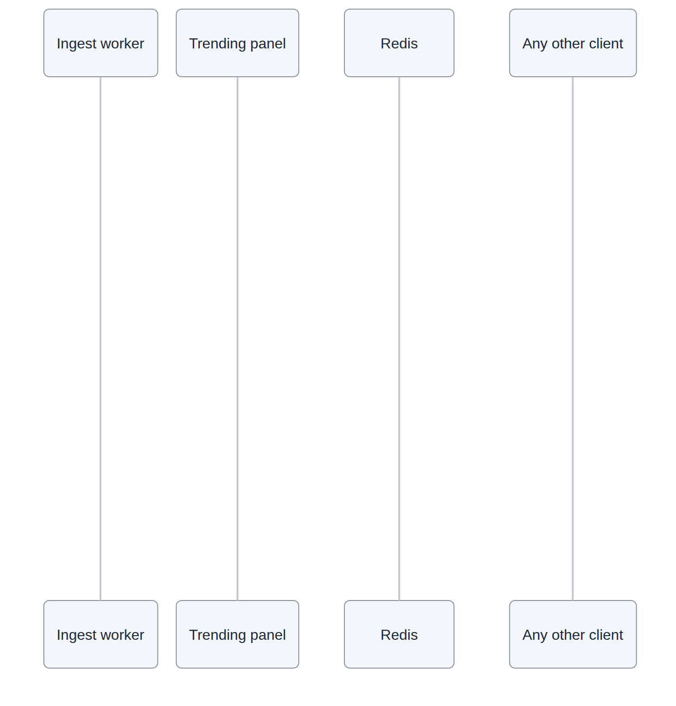
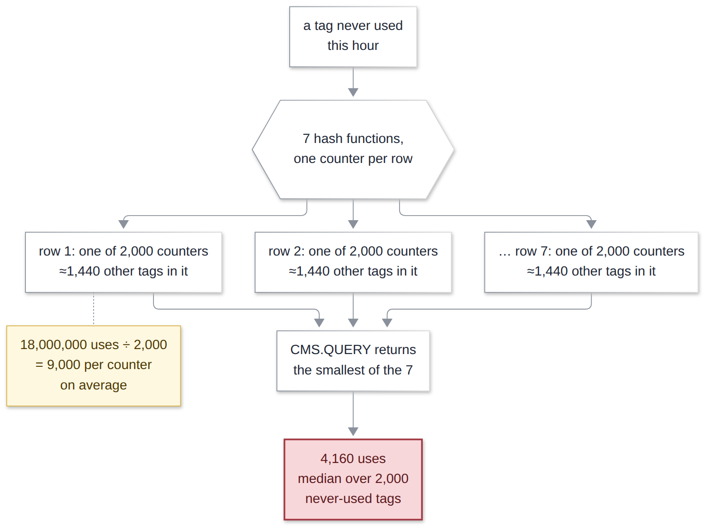
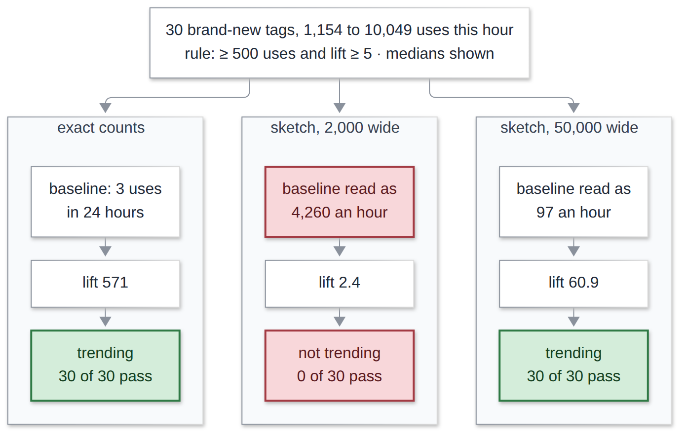
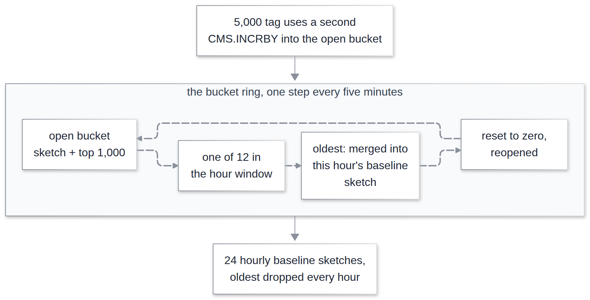

# System Design Interview: What Is Trending Right Now, and How Sure Are You?

#### Counting every tag froze Redis for nine seconds. The faster, approximate fix showed an empty trending panel while 30 new tags took off

**By Tihomir Manushev**

*Nov 7, 2026 · 9 min read*

---

A discovery team at a recipe-sharing app, hiring a senior backend engineer. The interviewer is Thiago.

The question sounds easy: what's trending? The usual answer is to count every tag over the last hour and sort. That works until you notice most tags are used once, and you pay to count every one of them. The usual fix is a count-min sketch, a small structure that counts approximately. Its mistakes are about the same size for every tag, though, and trending depends on exactly the small counts it gets wrong.

Everything below ran on Redis 8.4 in Docker, with Python 3.12.3, redis-py 5.2 and NumPy 1.26, on a Ryzen 5 3600 with 32 GB and an NVMe drive. The traffic is synthetic: 10 million tags with Zipf popularity, 5,000 tag uses a second, and 30 brand-new tags that take off during the hour.

---

### The question

**Thiago:** Every recipe has hashtags, and the home screen shows what's trending: ten tags, refreshed every few seconds. We get about 5,000 tag uses a second. How would you build it?

**Tihomir:** I'd start simple: count every tag over the last hour and show the top ten. In Redis that's one sorted set per minute, and each use adds one to that tag's score. When the panel refreshes, it adds up the last 60 minutes.

```python
import redis

r = redis.Redis(decode_responses=True)


def record(tag: str, now: float) -> None:
    """One ZINCRBY per use, into the bucket for the current minute."""
    key = f"trend:min:{int(now // 60)}"
    r.zincrby(key, 1, tag)
    r.expire(key, 3_900)


def trending_now(now: float) -> list[tuple[str, float]]:
    """Union the last 60 minutes and read the top 10."""
    minute = int(now // 60)
    keys = [f"trend:min:{m}" for m in range(minute - 59, minute + 1)]
    r.zunionstore("trend:hour", keys)

    return r.zrevrange("trend:hour", 0, 9, withscores=True)
```

**Thiago:** 5,000 writes a second. Is that a problem?

**Tihomir:** Not really. One client sending them in batches managed about 128,000 a second.

---

### The first trap

**Thiago:** And reading it back? You're adding up 60 sets every few seconds.

**Tihomir:** That's the part I was worried about, so I measured it. I loaded a full hour, 18 million uses spread over 2.9 million different tags, and ran the union three times. Meanwhile a second client pinged Redis every millisecond, to see whether anyone else could get through.

```
60 minute buckets: 7,191,508 members, 119,858 per minute, bucket 0 = 10.9 MB, used_memory +680 MB
run 1: ZUNIONSTORE 60 keys -> 2,883,233 members in 8969 ms; PING worst 8968 ms, 1 pings over 100 ms
run 2: ZUNIONSTORE 60 keys -> 2,883,233 members in 8880 ms; PING worst 8880 ms, 1 pings over 100 ms
run 3: ZUNIONSTORE 60 keys -> 2,883,233 members in 8830 ms; PING worst 8829 ms, 1 pings over 100 ms
hour set: 270 MB; total used_memory 963 MB
tags used once this hour: 1,872,836 of 2,883,233 (65%)
```

**Thiago:** Nine seconds?

**Tihomir:** Nine seconds, and that's not even the worst part. Redis runs one command at a time, so for those nine seconds nobody else got an answer. Not the ping, not the workers trying to record new tags, nobody.



**Thiago:** What's in those 2.9 million tags?

**Tihomir:** Mostly noise, honestly. 65% were used once in the whole hour. They'll never get near the top ten, but each one takes memory, and the union walks through every one of them.

**Thiago:** Then keep a running total for the hour instead of rebuilding it every time.

**Tihomir:** That would fix the read, though I didn't measure it. It doesn't fix the memory: the minute sets alone are 680 MB, and the hour total adds another 270. If product wants a panel per country, multiply that.

---

### Count less exactly

**Thiago:** So what would you do instead?

**Tihomir:** Stop counting exactly. A count-min sketch is a small grid of counters, here 7 rows of 2,000. Every tag lands on one counter in each row, and lots of tags share each counter.

**Thiago:** Then the counts are wrong.

**Tihomir:** They can be too high, but never too low. To read a tag, you take the smallest of its seven counters, the one that's shared with the least traffic. Redis has this built in, and it hands back the new estimate every time you add to it, so I can keep a short list of each minute's 200 biggest tags almost for free.

```python
ERROR, PROB, KEEP = 0.001, 0.01, 200


def record_batch(minute: int, counts: dict[str, int]) -> None:
    """Add a batch of uses to the minute's sketch; keep its 200 biggest."""
    key, cand = f"trend:cms:{minute}", f"trend:cand:{minute}"

    try:
        r.execute_command("CMS.INITBYPROB", key, ERROR, PROB)
    except redis.ResponseError:
        pass  # this minute's sketch already exists

    flat = [x for pair in counts.items() for x in pair]
    estimates = r.execute_command("CMS.INCRBY", key, *flat)
    r.zadd(cand, dict(zip(counts, estimates)), gt=True)
    r.zremrangebyrank(cand, 0, -(KEEP + 1))


def top_tags(minute: int) -> list[tuple[str, int]]:
    """Merge the hour's sketches, score the candidates, keep 10."""
    minutes = range(minute - 59, minute + 1)
    keys = [f"trend:cms:{m}" for m in minutes]
    r.delete("trend:cms:hour")
    r.execute_command("CMS.INITBYPROB", "trend:cms:hour", ERROR, PROB)
    r.execute_command("CMS.MERGE", "trend:cms:hour", len(keys), *keys)
    r.zunionstore("trend:cand:hour", [f"trend:cand:{m}" for m in minutes])
    names = r.zrange("trend:cand:hour", 0, -1)
    counts = r.execute_command("CMS.QUERY", "trend:cms:hour", *names)

    return sorted(zip(names, counts), key=lambda x: -x[1])[:10]
```

**Thiago:** How big did you make it?

**Tihomir:** I asked Redis for 0.1% error, 99% of the time, and that's what gave 2,000 by 7. Then I ran the same hour through it.

```
per minute: CMS width 2000 depth 7 = 112 KB, candidates 200 = 35 KB (MEMORY USAGE); 60 minutes: used_memory +5.5 MB
run 1: merge 60 sketches + score 1054 candidates in 10.2 ms; PING worst 4.3 ms
run 2: merge 60 sketches + score 1054 candidates in 11.0 ms; PING worst 5.1 ms
run 3: merge 60 sketches + score 1054 candidates in 10.4 ms; PING worst 4.2 ms
same 10 tags: True; same order: True
```

**Tihomir:** 5.5 MB instead of 950, and about 10 milliseconds instead of nine seconds. Same ten tags, in the same order. One surprise: `MEMORY USAGE` claims 8 bytes per counter when Redis really uses 4, so I measured from Redis's own total.

---

### How sure are you?

**Thiago:** You said the counts run high. How high?

**Tihomir:** The guarantee says at most 18,000, which is 0.1% of 18 million. In practice it was about 4,000. The odd part is that it was about 4,000 for every tag, whether it ranked first or ten-thousandth.

```
exact rank band   true count (median)   overestimate (median / max)   relative (median)
      1-10                  201,893          4,053 /    5,022              2.3%
     91-100                  11,049          4,432 /    5,575             38.6%
    991-1,000                 1,097          4,117 /    5,195            376.0%
  9,991-10,000                  107          4,086 /    4,352           3818.7%

2,000 tags never used this hour: estimate median 4,160, max 8,750
```

**Thiago:** 4,000 on a million doesn't matter.

**Tihomir:** Right, at the top it's 2.3%, and tenth and eleventh place were 13,000 apart, so nothing swapped. Further down, the same 4,000 is everything. A tag used 107 times reads as about 4,200, and a tag nobody used at all reads as 4,160.

**Thiago:** Nobody used it, and it has 4,160 uses?

**Tihomir:** It borrows them. Each of its counters is shared with about 1,440 other tags, and even the smallest of its seven still holds a few thousand of their uses.



---

### The second trap

**Thiago:** Your top tag is tag0000000. It was top yesterday too.

**Tihomir:** And the day before, probably. Okay, fair: I built "most popular", not "trending".

**Thiago:** What's the difference?

**Tihomir:** Trending means a tag is used far more than it usually is. Of the 30 brand-new tags that took off this hour, not one made the popular top ten. So I'd compare each tag's hour with its average hour over the past day, and call it trending at 500 uses and five times its usual rate.

```python
MIN_USES, MIN_LIFT, SMOOTH = 500, 5.0, 10


def is_trending(this_hour: int, last_24h: int) -> tuple[bool, float]:
    """At least 500 uses, and five times the usual hourly rate."""
    lift = (this_hour + SMOOTH) / (last_24h / 24 + SMOOTH)

    return this_hour >= MIN_USES and lift >= MIN_LIFT, lift
```

**Thiago:** And yesterday's numbers come from the same kind of sketch?

**Tihomir:** That was the plan, so I tried it. I scored every tag seen in the hour, which is the best case, and checked the result against exact counts. Exact counting finds all 30 new tags and nothing else.

```
exact rule (>= 500 uses, lift >= 5.0): 30 tags pass, 30 of them new

  width KB/sketch   noise floor            new pass         others pass       new-tag lift shown
  2,000        58   4,138 / 4,175 / 4,130  0 / 0 / 0        0 / 0 / 0         2.4 / 2.2 / 2.2

        tags reading >= 500 uses: 2,883,233 (truly: 2,179)
```

**Thiago:** Zero.

**Tihomir:** Zero. The panel was empty, and I didn't believe it at first. A typical new tag had been used three times in the past day, but the sketch said 4,260 an hour, roughly 102,000 for the day. So instead of growing 571 times, it looked like it had grown 2.4 times, nowhere near five.

**Thiago:** And the 500-use minimum?

**Tihomir:** Useless. Every one of the 2.9 million tags read above 500, because the borrowed uses alone are over 4,000.



**Thiago:** Did it at least rank them right?

**Tihomir:** Surprisingly, yes. Sorted by growth, the top ten were still new tags, because the same borrowed uses show up in both sketches and mostly cancel out. It's the thresholds that break, and a trending rule is mostly thresholds.

---

### Size it for the smallest number

**Thiago:** So make it bigger.

**Tihomir:** Sure, but bigger by how much? I'd sized it against the total, 0.1% of everything, when what matters is the smallest number the rule reads. A new tag with 500 uses and no history only passes if the borrowed uses stay under about 115, so I tried a few widths.

```
rule: >= 500 uses, lift >= 5; 30 new tags; seeds 1 / 2 / 3
  width KB/sketch   noise floor            new pass         others pass       new-tag lift shown
  2,000        58   4,138 / 4,175 / 4,130  0 / 0 / 0        0 / 0 / 0         2.4 / 2.2 / 2.2
 10,000       328   658 / 662 / 651        22 / 21 / 25     0 / 0 / 0         10.2 / 8.5 / 8.5
 20,000       655   292 / 293 / 289        29 / 30 / 30     0 / 0 / 0         19.4 / 19.2 / 16.2
 50,000     1,573   96 / 96 / 95           30 / 30 / 30     0 / 0 / 0         60.9 / 46.4 / 44.0
100,000     3,146   40 / 40 / 39           30 / 30 / 30     0 / 0 / 0         114.8 / 92.6 / 100.6
```

**Tihomir:** At 50,000 wide, the borrowed uses drop to 96. All 30 new tags pass in all three test hours, and nothing passes that shouldn't. It still shows them growing 44 to 61 times instead of about 500, so the panel can say "new", but I wouldn't print the number.

**Thiago:** Sixty sketches that size add up.

**Tihomir:** About 94 MB, yes. So I use bigger buckets: twelve five-minute sketches for the hour and 24 hourly ones for the past day. The window moves in five-minute steps, which nobody will notice on a panel, and each bucket keeps its 1,000 biggest tags as candidates.

```python
WIDTH, DEPTH = 50_000, 7


def merged(dest: str, keys: list[str]) -> None:
    """Rebuild dest as the sum of keys; all share width and depth."""
    r.delete(dest)
    r.execute_command("CMS.INITBYDIM", dest, WIDTH, DEPTH)
    r.execute_command("CMS.MERGE", dest, len(keys), *keys)


def trending_panel(bucket: int, hour: int) -> list[tuple[str, float]]:
    """12 five-minute buckets against 24 hourly baseline sketches."""
    buckets = range(bucket - 11, bucket + 1)
    merged("trend:hour", [f"trend:cms:{b}" for b in buckets])
    merged("trend:day", [f"trend:base:{h}" for h in range(hour - 24, hour)])
    names = list({n for b in buckets
                  for n in r.zrange(f"trend:cand:{b}", 0, -1)})
    now = r.execute_command("CMS.QUERY", "trend:hour", *names)
    day = r.execute_command("CMS.QUERY", "trend:day", *names)
    rows = []

    for name, uses, baseline in zip(names, now, day):
        ok, lift = is_trending(uses, baseline)

        if ok:
            rows.append((name, lift))

    return sorted(rows, key=lambda x: -x[1])
```



**Thiago:** Does it actually find them?

```
run 1: merge 12 + 24 sketches, score 1,206 candidates: 78 ms, PING worst 44.6 ms
run 2: merge 12 + 24 sketches, score 1,206 candidates: 78 ms, PING worst 44.7 ms
run 3: merge 12 + 24 sketches, score 1,206 candidates: 79 ms, PING worst 45.2 ms
memory: 36 sketches, MEMORY USAGE says 2.80 MB each, candidate lists 1.09 MB, used_memory 63 MB
panel: 30 tags pass, 30 of them new, 0 not; exact rule passes 30 (30 new)
missed by the panel: 0 []
  tag5808951: sketch 10,144 uses, lift 97.8  |  true 10,049 uses, baseline 2, lift 998
  tag6855625: sketch 7,959 uses, lift 85.0  |  true 7,869 uses, baseline 2, lift 781
```

**Tihomir:** It shows the same 30 tags as exact counting, with nothing missed and nothing extra, and the other two test hours matched too. The candidate lists caught every new tag, so finding them was never the problem. The whole thing fits in 63 MB.

---

### What it costs

**Thiago:** What's the catch?

**Tihomir:** Memory, first. 63 MB is a lot more than the 5.5 MB sketch, but that one showed nothing, and a single exact hour was 950 MB. I didn't build an exact version of the past day, so I can't give you that number.

**Thiago:** And speed?

**Tihomir:** A refresh takes about 80 milliseconds, and for about 45 of them Redis is busy merging sketches and can't answer anyone else. That's fine every few seconds, but not on every page view, so the result gets cached.

**Thiago:** What happens when traffic doubles?

**Tihomir:** The borrowed uses roughly double too, because they come from everyone else sharing your counters, so the sketch has to grow with traffic. I tested that by changing the width, not the traffic, so treat it as an estimate. I also haven't tested bots pushing a tag, more than one Redis server, or real hashtags, which may have a heavier tail than my synthetic ones and more borrowed uses.

---

### Conclusion

**Thiago:** If you had to sum it up?

**Tihomir:** Four things.

**Counting everything exactly means paying for the long tail.** 65% of the tags were used once, the hour took 950 MB, and adding it up froze Redis for nine seconds.

**A count-min sketch adds about the same amount to every count.** About 4,000 here: nothing for the top ten, 38 times the real count at rank 10,000, and 4,160 for a tag nobody used.

**Trending divides by small numbers, which is exactly where that error lives.** At 0.1%, the sketch thought new tags were used 4,260 times an hour, and the panel stayed empty while 30 of them took off.

**Size the sketch for the smallest count your rule reads.** At 50,000 wide, all 30 showed up, nothing else did, and it cost 63 MB and 79 ms a refresh.

The usual answer treats a sketch's error as a small percentage, and for big counts it is. But it's a percentage of the total, not of each tag. Before you trust a sketch, find the smallest number you'll divide by, and check that the error is smaller.
