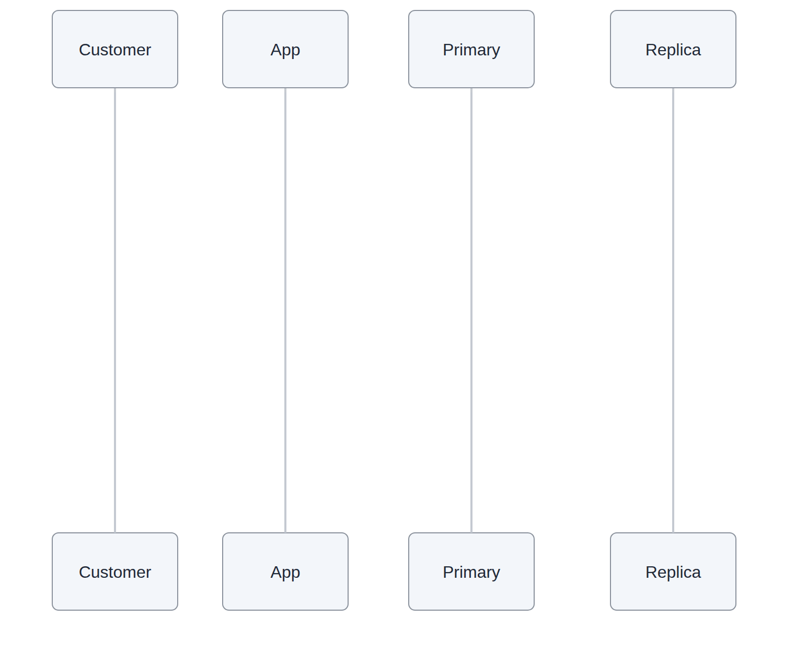
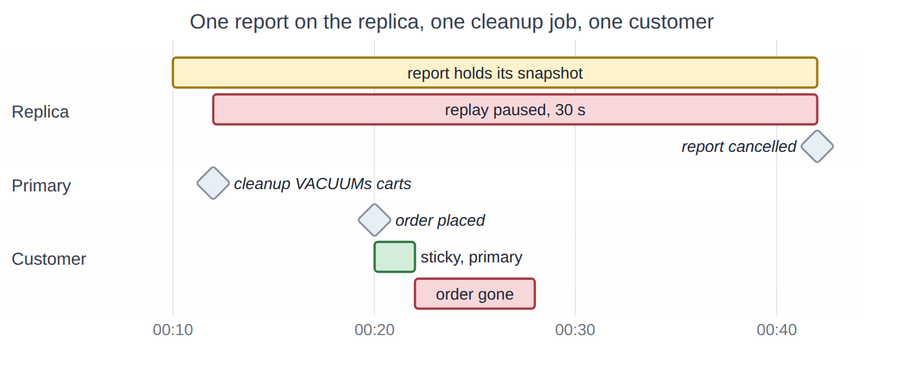
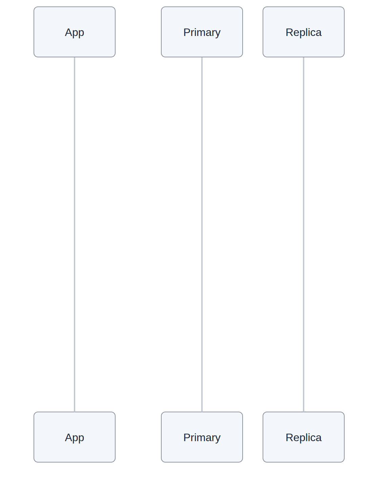
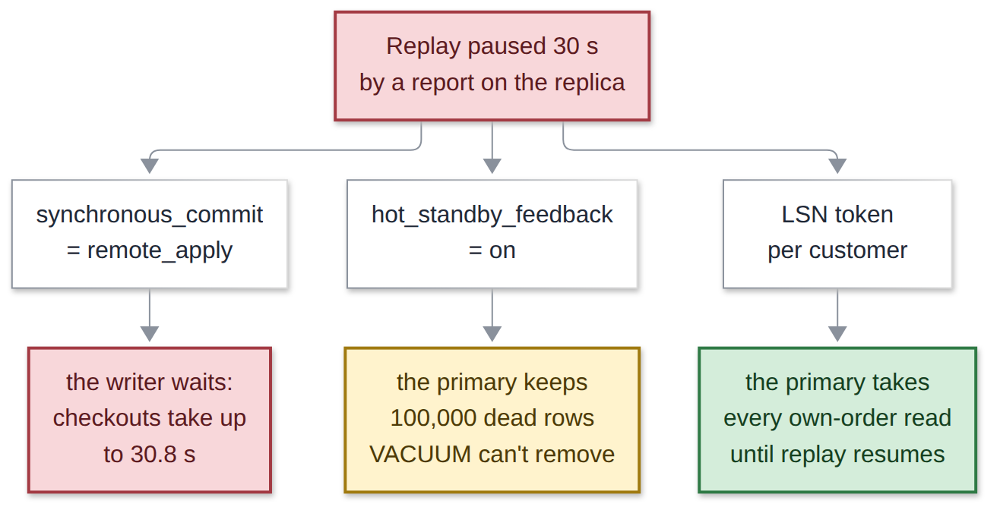

# System Design Interview: The User Saved Their Order and the Page Says It Doesn't Exist. Why?

#### A read replica missed most orders read back right after checkout. The two-second fix held until one report paused the replica for 30 seconds

**By Tihomir Manushev**

*Nov 14, 2026 · 10 min read*

---

An orders team at a grocery-delivery app, hiring a senior backend engineer. The interviewer is Soo-jin.

The question is how to take reads off a busy database. The standard answer is read replicas, copies that serve reads while the primary takes writes. It quietly breaks the simplest promise a page makes: that you can see what you just did. The usual fix is a timer, and a timer is a guess about how far behind the replica is.

Everything below ran on PostgreSQL 17.6 in Docker, a primary and one streaming replica on the same machine, with Python 3.12.3 and psycopg 3.2, on a Ryzen 5 3600 with 32 GB and an NVMe drive.

---

### The question

**Soo-jin:** Order history and order tracking are about 90% of our database traffic, and the primary sits at 70% CPU. How would you take load off it?

**Tihomir:** Read replicas. Postgres streams its write-ahead log, the WAL, to a second server that replays it, so the replica holds the same data a moment later. Writes keep going to the primary, and the order pages read from the replica.

```python
import psycopg

primary = psycopg.connect("host=db-primary dbname=shop", autocommit=True)
replica = psycopg.connect("host=db-replica dbname=shop", autocommit=True)


def place_order(customer_id: int, total_cents: int) -> int:
    """Writes go to the primary."""
    row = primary.execute(
        "INSERT INTO orders (customer_id, total_cents) VALUES (%s, %s)"
        " RETURNING id", (customer_id, total_cents)).fetchone()

    return row[0]


def find_order(conn: psycopg.Connection, order_id: int) -> tuple | None:
    """The order page: one row by primary key."""
    return conn.execute(
        "SELECT status, total_cents FROM orders WHERE id = %s",
        (order_id,)).fetchone()
```

**Soo-jin:** A customer taps "Place order", and the app sends them straight to the order page. Which server renders that page?

**Tihomir:** The replica. And it reads an order that was committed on the other server less than a millisecond earlier. Okay, I see where this is going.

---

### The first trap

**Soo-jin:** How often does it find it?

**Tihomir:** I measured it: 16 customers place orders and read each one straight back from the replica, first on a quiet primary, then during a bulk import. When the order was missing, I kept checking until it showed up.

```
idle: 16 customers, 20 s, 39,951 orders placed and read back
  stale reads (order not found on replica): 35,517 (88.9%)
  time until it appeared: p50 1.46 ms, p99 3.63 ms, max 14.71 ms
bulk import: 91 batches of 50,000 rows
busy: 16 customers, 20 s, 7,820 orders placed and read back
  stale reads (order not found on replica): 7,566 (96.8%)
  time until it appeared: p50 6.85 ms, p99 1077.04 ms, max 2041.84 ms
```

**Soo-jin:** 89%? The replica is that far behind?

**Tihomir:** It isn't far behind at all. The order showed up about 1.5 milliseconds later. But replication is asynchronous: the primary confirms the commit without waiting for the replica, and my read simply gets there first.



**Soo-jin:** And during the import?

**Tihomir:** Then it's not milliseconds any more. Half the misses cleared within 7 ms, but the slowest 1% took over a second, and the worst took two. One process on the replica replays the log in order, and the import fills that log.

---

### Stick to the primary

**Soo-jin:** So what do you do?

**Tihomir:** The usual fix: after a customer writes, their reads go to the primary for a couple of seconds, and everyone else stays on the replica. The timestamp lives in the session; here it's a dictionary.

```python
import time

STICKY_SECONDS = 2.0
last_write: dict[int, float] = {}


def checkout(customer_id: int, total_cents: int) -> int:
    """Place the order and remember when this customer last wrote."""
    order_id = place_order(customer_id, total_cents)
    last_write[customer_id] = time.monotonic()

    return order_id


def connection_for(customer_id: int) -> psycopg.Connection:
    """Primary for two seconds after your own write, replica otherwise."""
    wrote_at = last_write.get(customer_id)

    if wrote_at is not None and time.monotonic() - wrote_at < STICKY_SECONDS:
        return primary

    return replica
```

**Soo-jin:** Why two?

**Tihomir:** On a quiet primary, every order showed up in under 100 ms, so two seconds felt generous.

**Soo-jin:** Your import's worst was two seconds.

**Tihomir:** 2.04, yes, so it's already on the edge. I ran the import four times: the worst was 0.2 seconds in the first run and 1.8 to 2.0 in the other three, because this disk slows down after a few gigabytes of log. Fine, I'd make it five.

---

### The second trap

**Soo-jin:** Finance runs the monthly report on the replica. It takes a minute or two. Does that change anything?

**Tihomir:** It shouldn't, reads don't block replay. Honestly, I wasn't sure, so I ran it: a report holds one snapshot open on the replica, and two seconds later a cron job on the primary deletes abandoned carts.

```sql
-- On the replica: the finance report
BEGIN ISOLATION LEVEL REPEATABLE READ;
SELECT date_trunc('month', created_at) AS month, sum(total_cents)
FROM orders
GROUP BY 1;
-- ...more queries against the same snapshot for another 90 s

-- On the primary, two seconds later: the cart cleanup job
DELETE FROM carts WHERE updated_at < now() - interval '1 hour';
VACUUM carts;
```

**Tihomir:** I faked the slow part with `pg_sleep`. Meanwhile 24 customers place orders and check each one every 250 ms for eight seconds, under the two-second rule.

```
mode sticky: 24 customers placing orders, 24 browsing, 60 s
  t= 10.5 s  report: 13 months summed, transaction held open
  t= 12.2 s  cleanup: deleted 100,000 abandoned carts, VACUUM done
  t= 42.4 s  report cancelled: canceling statement due to conflict with recovery
  replica behind: worst 30.27 s
  own-order reads: 5,285, sent to primary 1,402 (26.5%), stale 1,832 (34.7%)
  orders viewed for the full 8 s: 153; shown then gone: 87; never shown: 0

   t (s)  replica behind   writer reads  primary  stale  commit max ms  browser reads
   8-12        0.12 s          382      103      0            1.0            384
  12-16        3.85 s          384       89     13            1.1            384
  16-20        7.80 s          384      103    203            1.1            384
  ...
  36-40       27.84 s          383       88    295            1.1            384
  40-44       30.27 s          384      104    171            1.0            384
  44-48        0.10 s          383       87      0            1.5            384
```

**Soo-jin:** Thirty seconds behind?

**Tihomir:** Replay stopped. The VACUUM removed rows that the report's snapshot can still see, and the replica can't apply that while the report needs them. So it waits, up to `max_standby_streaming_delay`, which is 30 seconds by default, and then cancels the report.

**Soo-jin:** Only for the carts table, though.

**Tihomir:** No, for everything. One process replays the WAL in order, so every new order queued up behind that one cleanup record. Across nine runs of this scene, it fell 30.3 to 31.1 seconds behind every time.

**Soo-jin:** What did the customers see?

**Tihomir:** 87 of 153 orders appeared and then disappeared. The first two seconds go to the primary, so the order is there, and then the page goes back to a replica that's 20 seconds behind. That's worse than "not found". They saw it, and then it was gone.



**Soo-jin:** You said you'd make it five.

**Tihomir:** I ran that too.

```
mode sticky 5 s: 24 customers placing orders, 24 browsing, 60 s
  replica behind: worst 30.77 s
  own-order reads: 5,396, sent to primary 3,457 (64.1%), stale 894 (16.6%)
  orders viewed for the full 8 s: 156; shown then gone: 78; never shown: 0
```

**Tihomir:** 78 orders still disappeared, and 64% of the customers' own reads went to the primary instead of 26%. A longer window moves more reads to the primary and still guesses wrong.

**Soo-jin:** Thirty, then.

**Tihomir:** And the next pause is 31. Those 30 seconds are just a setting, and replay can also wait on a lock or a slow disk. A timer is a guess about the lag, and nothing caps the lag.

---

### Positions, not timers

**Soo-jin:** So what doesn't guess?

**Tihomir:** Positions. Every commit has a place in the WAL, an LSN, a number that only grows. After the commit I ask the primary where its log is and keep that in the customer's session, as a token. Before a read, I ask the replica how far it has replayed: past my token, read there; not yet, read from the primary.

```python
def lsn(text: str) -> int:
    """'0/9A3F2C8' -> an integer that only grows."""
    high, low = text.split("/")

    return (int(high, 16) << 32) + int(low, 16)


def checkout_with_token(customer_id: int, total_cents: int) -> tuple[int, str]:
    """Place the order, then ask the primary where its log is now."""
    order_id = place_order(customer_id, total_cents)
    token = primary.execute("SELECT pg_current_wal_lsn()::text").fetchone()[0]

    return order_id, token


def read_own_order(order_id: int, token: str) -> tuple | None:
    """Replica only if it has replayed past the token: check, then read."""
    replayed = replica.execute(
        "SELECT pg_last_wal_replay_lsn()::text").fetchone()[0]
    conn = replica if lsn(replayed) >= lsn(token) else primary

    return find_order(conn, order_id)
```

**Soo-jin:** Two queries on the replica. Why not check and read in one?

**Tihomir:** Order. In one statement the snapshot comes first and the check runs after it, so replay could move in between and the check would vouch for rows the snapshot can't see. I never caught that in the lab, but checking first only costs a round trip.



**Soo-jin:** Same report, same cleanup?

```
mode token: 24 customers placing orders, 24 browsing, 60 s
  t= 42.7 s  report cancelled: canceling statement due to conflict with recovery
  replica behind: worst 30.45 s
  own-order reads: 5,360, sent to primary 2,614 (48.8%), stale 0 (0.0%)
  orders viewed for the full 8 s: 156; shown then gone: 0; never shown: 0
  own-order read latency: p50 0.38 ms, p99 0.73 ms

   t (s)  replica behind   writer reads  primary  stale  commit max ms  browser reads
   8-12        0.10 s          384       11      0            1.7            384
  12-16        3.75 s          382       69      0            1.1            384
  20-24       11.74 s          384      384      0            1.1            384
  ...
  40-44       30.45 s          384      267      0            1.5            384
  44-48        0.10 s          384       10      0            1.3            384
```

**Tihomir:** No stale reads, in all three runs. While the replica keeps up, about 3% of a customer's reads go to the primary; during the pause, all of them do, which is right. People browsing old orders never left the replica.

**Soo-jin:** Half your reads hit the primary.

**Tihomir:** Nearly all of them during the pause. The extra round trip took the median read from 0.23 to about 0.37 ms.

**Soo-jin:** Could you take the token from the INSERT itself and save a query?

**Tihomir:** I tried that, with the WAL position returned inside the INSERT. It points to just before the commit record, and the commit record is what makes the row visible.

```
token early, busy: 36,748 reads the replica said were safe, 6 could not find the order (0.02%)
token after, busy: 7,631 reads the replica said were safe, 0 could not find the order (0.00%)
```

**Tihomir:** Six out of almost 37,000 reads the replica had vouched for, during the import, and none with the token taken after the commit. Three later runs on the slower disk didn't catch it at all, and that's exactly the kind of bug that ships. So the token comes after COMMIT, and it costs a query.

---

### What it costs

**Soo-jin:** Postgres can make the commit wait until the replica has applied it. Why not just do that?

**Tihomir:** That's `synchronous_commit = remote_apply`, and I ran the same scene with it. Every read can stay on the replica, and nothing is stale.

```
mode remote_apply: 24 customers placing orders, 24 browsing, 60 s
  t= 43.1 s  report cancelled: canceling statement due to conflict with recovery
  replica behind: worst 30.89 s
  own-order reads: 2,848, sent to primary 0 (0.0%), stale 0 (0.0%)
  orders placed: 110, commit p50 2.83 ms, p99 30159.65 ms, max 30794.3 ms
```

**Tihomir:** But the commit now waits for replay, so when replay stopped, every checkout stopped too. No order went through for over 24 seconds, and the slowest took 30.8.

**Soo-jin:** Then stop the pause. There's a setting for that too.

**Tihomir:** `hot_standby_feedback`. The replica tells the primary which rows its queries still need, so VACUUM leaves them alone. With it on, the replica stayed 0.13 seconds behind and the report ran to the end.

```
mode sticky-feedback: 24 customers placing orders, 24 browsing, 60 s
  t= 12.2 s  vacuum tuples: 0 removed, 200000 remain, 100000 are dead but not yet removable
  t=100.4 s  report finished
  replica behind: worst 0.13 s
```

**Tihomir:** The cost moved to the primary: VACUUM removed none of the 100,000 deleted carts. Fine for a two-minute report. A report left open over a weekend means dead rows piling up on the primary the whole time.



**Soo-jin:** And your token?

**Tihomir:** It sends the lag to the primary. Every customer who wrote recently reads from the primary for as long as the replica is behind, and if the replicas exist because the primary can't take those reads, a lag spike is now a load spike. So I'd alert on replay lag and keep long reports on a replica the app doesn't read from.

**Soo-jin:** What haven't you tested?

**Tihomir:** A second device. The token lives in one session, so an order placed on the phone can still be missing on the laptop, and I haven't built a per-customer token. I also ran one replica on the same machine: no network delay here, and no fleet of replicas.

---

### Conclusion

**Soo-jin:** If you had to sum it up?

**Tihomir:** Four things.

**A replica misses the write you read back right away.** 89% of the time on a quiet primary and 97% during an import, where the worst wait was two seconds.

**A timer guesses the lag, and one report broke the guess.** The replica stopped for 30 seconds, and 87 of 153 orders were shown and then disappeared.

**An LSN token compares positions instead of guessing.** Zero stale reads, about 3% of reads on the primary normally and all of them during the pause. Take the token after the commit, not inside the INSERT.

**Every fix sends the lag somewhere.** `remote_apply` sends it to the checkout (30.8 s), `hot_standby_feedback` to the primary's cleanup (100,000 dead rows), and the token to the primary's reads.

The standard answer treats the replica as the same database a moment later, and for most reads that's fine. A customer reading back their own write is the exception, and a timer doesn't solve it, because nothing caps the lag. Compare positions, and decide up front who pays when the replica falls behind.
