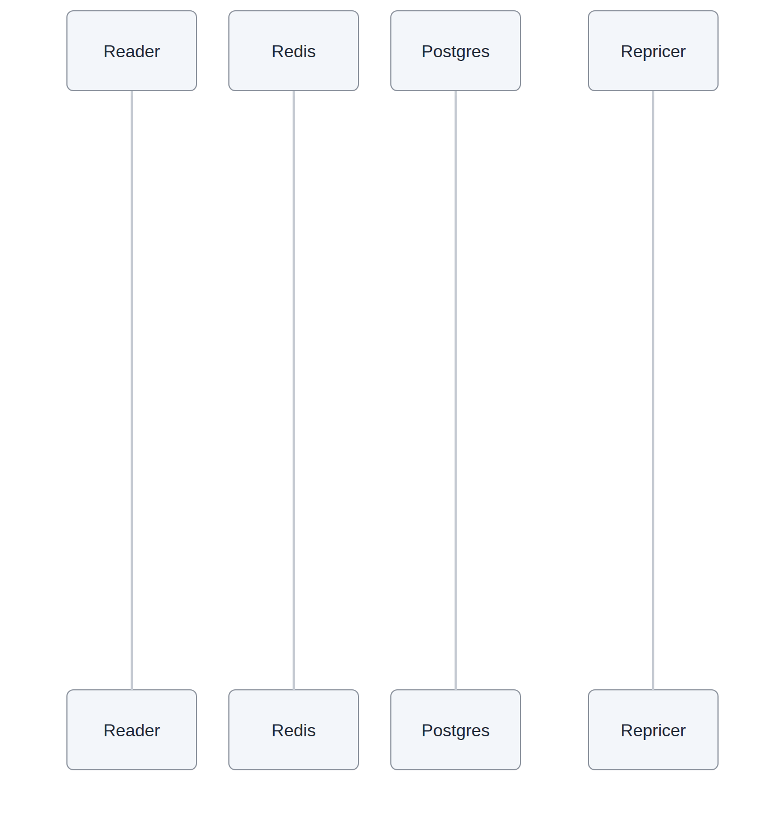
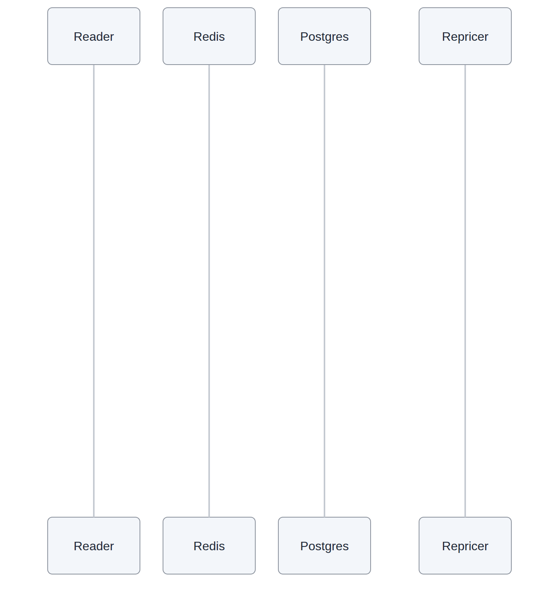
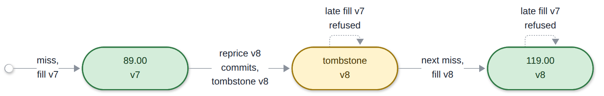

# System Design Interview: You Delete the Cache Key on Every Write. Why Is the Cache Still Stale?

#### A cache read that stalled for 300 ms put an old fare back for an hour. Deleting twice cut how often that happened, but never got it to zero. Version numbers did

**By Tihomir Manushev**

*Nov 22, 2026 · 10 min read*

---

A fares team at a ferry-booking platform, hiring a senior backend engineer. The interviewer is Siobhan.

The question is how to keep a cache from showing a fare that has changed. The standard answer is cache-aside: read through the cache, and delete the key whenever the row changes. It's a good answer, and it has a gap. The delete doesn't stop a reader that read the old row a moment earlier from putting it back.

Everything below ran on Redis 8.4 and PostgreSQL 17.6 in Docker, with Python 3.12.3, redis-py 5.2 and psycopg 3.2, on a Ryzen 5 3600 with 32 GB and an NVMe drive.

---

### The question

**Siobhan:** Fare pages read the price from Redis, and Postgres is the source of truth. During a sale our repricer changes the fare on the busy sailings every couple of seconds. How do you keep the cache from showing an old fare?

**Tihomir:** Cache-aside. A page asks Redis first, and on a miss it reads Postgres and fills the cache with a one-hour TTL, so the entry expires on its own. When the repricer writes, it commits and then deletes the key, and the next reader fills it with the new fare. I also store a version number with the fare, so later I can tell which write a cached fare came from.

```python
import psycopg
import redis

r = redis.Redis(host="cache", port=6379)
db = psycopg.connect("host=db dbname=fares", autocommit=True)
TTL = 3600


def read_fare(sailing_id: int) -> int:
    """Cache-aside: Redis first, Postgres on a miss, then fill."""
    cached = r.get(f"fare:{sailing_id}")

    if cached is not None:
        return int(cached.split(b"|")[1])

    fare, version = db.execute(
        "SELECT fare_cents, version FROM fares WHERE sailing_id = %s",
        (sailing_id,)).fetchone()
    r.set(f"fare:{sailing_id}", f"{version}|{fare}", ex=TTL)

    return fare


def reprice(sailing_id: int, fare_cents: int) -> None:
    """Write the fare, then drop the cached copy."""
    db.execute(
        "UPDATE fares SET fare_cents = %s, version = version + 1"
        " WHERE sailing_id = %s", (fare_cents, sailing_id))
    r.delete(f"fare:{sailing_id}")
```

**Siobhan:** Why delete it instead of writing the new fare into the cache?

**Tihomir:** A delete is the same no matter which write sends it, so two repricers can't leave the wrong one behind. The TTL is a safety net, so nothing can stay wrong for more than an hour.

---

### The first trap

**Siobhan:** A reader misses, reads 89 euros from Postgres, and then does nothing for 300 milliseconds. Meanwhile the repricer sets the fare to 119. What's in the cache?

**Tihomir:** The repricer's delete runs while the reader is stalled, and there's nothing to delete yet. Then the reader wakes up and writes 89. I ran exactly that, one reader and one writer on one sailing:

```
scene plain
      8.5 ms  reader  GET fare:42 -> None (miss)
      9.4 ms  reader  SELECT -> 89.00 EUR, version 7
      9.4 ms  reader  stalls for 300 ms
     61.4 ms  writer  UPDATE -> 119.00 EUR, version 8, COMMIT
     61.7 ms  writer  DEL fare:42
    309.8 ms  reader  SET fare:42 = v7|8900
   1310.9 ms  check   database v8|11900, cache 7|8900, TTL 3599 s
```

**Tihomir:** Postgres says 119, the cache says 89, and it will keep saying 89 for the next 3,599 seconds. The delete worked fine. It just ran before the old value arrived.



**Siobhan:** Where does a 300 ms stall come from?

**Tihomir:** A garbage-collection pause, a container hitting its CPU limit, a slow network hop. In the lab I injected them: 2% of cache fills pause, about 200 ms at the median and up to 4 seconds. Then 1,000 sailings, 32 readers, and the repricer at 400 writes a second for a minute.

```
mode plain: 1,000 sailings, 32 readers, 400 reprices/s for 60 s
  stalls injected: 530 fills (2% of misses), p50 179 ms, max 4000 ms
  reads 749,272, hit ratio 96.5%, misses 26,108 (383/s to Postgres)
  reprices: 24,003
  stale reads (older than a reprice > 1 s old): 2,112 (0.292% of hits)
  reprices undone by a late fill: 59 (0.25%)
    fixed by a later reprice: 56, stale p50 3.96 s, max 9.86 s
  still stale 6 s after the last reprice: 3 sailings, TTL left 3589-3593 s, wrong by 39.83 EUR median
```

**Siobhan:** A quarter of a percent.

**Tihomir:** 44, 59 and 49 undone writes in three runs. During the sale the next reprice deletes the key again, so most of them were wrong for a few seconds. The ones that hit a sailing's last reprice don't get that rescue: two or three sailings per run kept the old fare for the full hour.

**Siobhan:** What does a quarter of a percent mean at our volume?

**Tihomir:** If you reprice two million times a day, that's 4,000 to 5,000 wrong fares a day. That's arithmetic, not a measurement, and the real rate depends on how often your readers stall. But even with no injected stalls at all I got 14 undone writes. My guess is the 32 Python threads sharing one interpreter lock: waiting for it is a small stall too.

**Siobhan:** Then delete first, before the write.

**Tihomir:** That's worse, and it doesn't even need a stall. A reader that comes in between the delete and the commit refills the old fare.

```
mode delete-first: 1,000 sailings, 32 readers, 400 reprices/s for 60 s
  reprices undone by a late fill: 262 (1.09%)
  still stale 6 s after the last reprice: 15 sailings, TTL left 3587-3594 s, wrong by 43.59 EUR median
```

**Tihomir:** 262 instead of about 50, and 15 sailings wrong for the hour.

---

### Delete it twice

**Siobhan:** So what do you do?

**Tihomir:** The usual fix is a delayed double delete. Delete after the commit, then delete again a little later, so any fill that was in flight when the first delete ran gets cleaned up by the second.

```python
import threading

SECOND_DELETE = 0.5


def reprice_twice(sailing_id: int, fare_cents: int) -> None:
    """Delete now, and once more after any in-flight fill has landed."""
    reprice(sailing_id, fare_cents)
    threading.Timer(SECOND_DELETE, r.delete,
                    args=[f"fare:{sailing_id}"]).start()
```

**Siobhan:** Why half a second?

**Tihomir:** It's longer than most of my stalls. I ran four delays, and I count a fare as stale only if it outlives the second delete by a second.

```
mode double 100 ms: 1,000 sailings, 32 readers, 400 reprices/s for 60 s
  reprices undone by a late fill: 41 (0.17%)
mode double 500 ms: 1,000 sailings, 32 readers, 400 reprices/s for 60 s
  reprices undone by a late fill: 17 (0.07%)
mode double 1000 ms: 1,000 sailings, 32 readers, 400 reprices/s for 60 s
  reprices undone by a late fill: 6 (0.03%)
  still stale 7 s after the last reprice: 2 sailings, TTL left 3592-3593 s, wrong by 15.38 EUR median
mode double 2000 ms: 1,000 sailings, 32 readers, 400 reprices/s for 60 s
  reads 781,895, hit ratio 93.7%, misses 49,261 (702/s to Postgres)
  reprices undone by a late fill: 1 (0.00%)
```

**Tihomir:** A hundred milliseconds does nothing, because most stalls are longer than that. Half a second gave 17, 21 and 21 in three runs. Two seconds left one.

---

### The second trap

**Siobhan:** So two seconds works.

**Tihomir:** Against my stalls, which I capped at four seconds. Here's half a second against a 700 ms stall:

```
scene double (500 ms delay, 700 ms stall)
     10.0 ms  reader  SELECT -> 89.00 EUR, version 7
     10.0 ms  reader  stalls for 700 ms
     61.0 ms  writer  UPDATE -> 119.00 EUR, version 8, COMMIT
     61.1 ms  writer  DEL fare:42
    561.5 ms  writer  DEL fare:42 again, 500 ms later
    710.4 ms  reader  SET fare:42 = v7|8900
   1711.5 ms  check   database v8|11900, cache 7|8900, TTL 3599 s
```

**Tihomir:** Same hour of wrong fares. The delay is a bet that no stall lasts longer than the delay, and nothing guarantees that. A paused VM or a long GC can stall a process for ten seconds.



**Siobhan:** You also had two sailings stuck at one second.

**Tihomir:** Yes, the one-second run still left two sailings with the old fare for the full hour. And it costs on every write. Each reprice now causes two misses, so the reads going to Postgres went from about 390 a second to over 700, and the hit ratio fell from 96.8% to 93.6%. The longer the delay, the longer a late fill stays wrong before the second delete catches it.

---

### Versions, not deletes

**Siobhan:** So what doesn't depend on timing?

**Tihomir:** The version number. The cache should refuse a fare that's older than one it already knows about. That's a compare-and-set, and it has to be atomic, so it's a small Lua script running inside Redis. It returns 1 for written, 0 for refused, and 2 when the same version is already there.

```python
SET_IF_NEWER = """
local cur = redis.call('GET', KEYS[1])
if cur then
  local sep = string.find(cur, '|', 1, true)
  local cached = tonumber(string.sub(cur, 1, sep - 1))
  local incoming = tonumber(ARGV[1])
  if cached > incoming then return 0 end
  if cached == incoming then
    if string.sub(cur, sep + 1) ~= '-' or ARGV[2] == '-' then return 2 end
  end
end
redis.call('SET', KEYS[1], ARGV[1] .. '|' .. ARGV[2], 'EX', ARGV[3])
return 1
"""
set_if_newer = r.register_script(SET_IF_NEWER)


def fill(sailing_id: int, version: int, fare_cents: int) -> bool:
    """Reader side: store the fare unless the cache already knows newer."""
    return set_if_newer(keys=[f"fare:{sailing_id}"],
                        args=[version, fare_cents, TTL]) == 1
```

**Siobhan:** Your repricer still deletes the key. When the late fill arrives, what is it newer than?

**Tihomir:** Nothing. The delete threw away the version 8 it needed to compare against, so version 7 goes into an empty key. Okay, fair. I ran it anyway:

```
scene versioned
    311.4 ms  reader  set-if-newer v7 -> written
   1312.4 ms  check   database v8|11900, cache 7|8900, TTL 3599 s
mode versioned: 1,000 sailings, 32 readers, 400 reprices/s for 60 s
  reprices undone by a late fill: 19 (0.08%)
  still stale 6 s after the last reprice: 2 sailings, TTL left 3594-3594 s, wrong by 29.64 EUR median
```

**Tihomir:** It helps a bit, 16 to 19 undone writes instead of about 50, because it stops one late fill from overwriting a newer one. But the race I started with isn't touched.

**Siobhan:** Then don't throw the version away.

**Tihomir:** Right, the repricer stops deleting. It writes a **tombstone**, a marker that holds only the new version and no fare. Readers treat it as a miss, and the script refuses anything older.

```python
def reprice_versioned(sailing_id: int, fare_cents: int) -> None:
    """Writer side: leave the new version behind instead of deleting."""
    version = db.execute(
        "UPDATE fares SET fare_cents = %s, version = version + 1"
        " WHERE sailing_id = %s RETURNING version",
        (fare_cents, sailing_id)).fetchone()[0]
    set_if_newer(keys=[f"fare:{sailing_id}"], args=[version, "-", TTL])


def read_fare_versioned(sailing_id: int) -> int:
    """A tombstone counts as a miss; fills go through the script."""
    cached = r.get(f"fare:{sailing_id}")

    if cached is not None and not cached.endswith(b"|-"):
        return int(cached.split(b"|")[1])

    fare, version = db.execute(
        "SELECT fare_cents, version FROM fares WHERE sailing_id = %s",
        (sailing_id,)).fetchone()
    fill(sailing_id, version, fare)

    return fare
```



**Siobhan:** The same 300 ms stall?

```
scene tombstone
     59.2 ms  writer  UPDATE -> 119.00 EUR, version 8, COMMIT
     59.4 ms  writer  tombstone v8|-
    308.7 ms  reader  set-if-newer v7 -> refused
   1309.7 ms  check   database v8|11900, cache 8|-, TTL 3599 s
mode tombstone: 1,000 sailings, 32 readers, 400 reprices/s for 60 s
  stalls injected: 544 fills (2% of misses), p50 193 ms, max 4000 ms
  reads 829,796, hit ratio 96.8%, misses 26,472 (388/s to Postgres)
  reprices: 24,001, fills refused as older 90, already there 2,203
  stale reads (older than a reprice > 1 s old): 0 (0.000% of hits)
  reprices undone by a late fill: 0 (0.00%)
  still stale 6 s after the last reprice: 0 sailings
```

**Tihomir:** Refused. Over the whole minute, 90 late fills were refused and nothing was undone. All three runs came out at zero, with 69 to 90 refusals each. And the hit ratio stayed at 96.8%, the same as plain deletes, because a tombstone costs one miss per write, just like a delete.

---

### What it costs

**Siobhan:** What does the script cost?

**Tihomir:** I timed each call from one client, 20,000 times.

```
one client, 20,000 calls each, keys fare:0..19999
  SET fare EX 3600 (plain fill)        p50   90.6 us   p99  129.4 us
  DEL fare (plain invalidate)          p50   85.2 us   p99  129.4 us
  set-if-newer, key absent (fill)      p50  101.1 us   p99  141.9 us
  set-if-newer, newer version (fill)   p50  106.1 us   p99  166.4 us
  set-if-newer, older version (refused) p50  101.4 us   p99  152.4 us
  tombstone (invalidate)               p50  104.4 us   p99  162.1 us

100,000 tombstones: 9.2 MB (92 bytes each), MEMORY USAGE of one: 48 bytes
```

**Tihomir:** About 10 to 15 microseconds more per fill and 19 more per write, most of it the round trip. A tombstone takes 92 bytes until a reader replaces it or the TTL expires.

**Siobhan:** That's cheap. Where's the real cost?

**Tihomir:** Discipline. Every write has to bump the version, including a support engineer's manual UPDATE, or the cache refuses the fix as "older." I'd put the bump in a trigger so nobody can forget it. And every writer and reader has to go through the script. One code path with a plain SET or DEL brings the race back.

**Siobhan:** Some teams delete from the change stream instead of from the app. Does that fix it?

**Tihomir:** It fixes a different hole: the app dying between the commit and the delete, which leaves the old fare there for the whole TTL. A change stream that only deletes loses this race exactly like the app does. If it writes versioned tombstones, it's the same fix. I didn't run either.

**Siobhan:** What else haven't you tested?

**Tihomir:** A Redis failover. Replication to the replica is asynchronous, so a promoted replica can be missing the newest tombstones, and that reopens the window for a few writes. I also ran a single Redis and one host, and the stalls were injected, not real.

---

### Conclusion

**Siobhan:** Give me the short version.

**Tihomir:** Four things.

**A delete can't remove a value that hasn't been written yet.** A stalled reader put the old fare back after the delete in 0.18–0.25% of reprices, and two or three sailings per run kept it for the full hour.

**Deleting before the write is worse.** 262 undone writes instead of about 50, with no stall needed.

**A second delete is a bet on how long a stall can last.** At 500 ms it left 17 to 21 a minute, at one second two sailings were stuck for the hour, and every reprice now caused two misses, about 700 reads a second to Postgres instead of 390.

**Versions with tombstones don't depend on timing.** Zero undone writes in three runs, the same hit ratio as plain deletes, and 10 to 19 microseconds more per call. Setting the version without the tombstone doesn't fix this race: the delete throws away the version the check needs.

The standard answer assumes the delete is the last thing that happens to a key, and under concurrency it often isn't. Timing-based fixes only shrink the window. Keep the version in the cache, let Redis refuse anything older, and make sure every writer bumps it.
